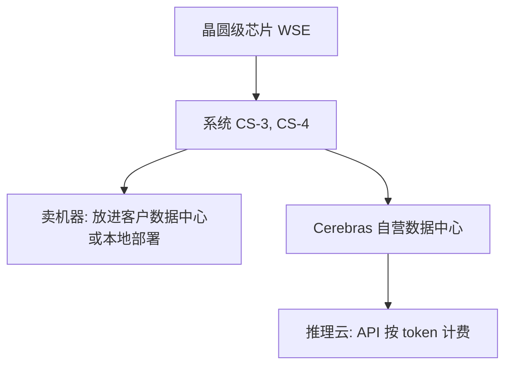

## Q
Cerebras 靠卖哪两样东西赚钱？2026 年收入重心在往哪边移？

## A
- **卖机器**：用自家晶圆级芯片做成的系统（CS-3、CS-4），卖给客户放进自己的数据中心，或者本地部署。
- **卖推理云**：Cerebras 自己运营数据中心，开发者通过 API 调用大语言模型，按 token 计费。**推理（inference）**就是用训练好、参数固定的模型回答请求；**token** 是模型处理文字的最小单位，大约一个英文单词或一两个汉字。

- **重心在移向云**：
  - 2026 Q1：云服务 $82.8M / 总收入 $193.4M ≈ 43%。
  - 2026 Q3：云服务 $141.9M / 总收入 $210.8M ≈ 67%，云服务同比 +265%。
- **为什么移**：OpenAI 等大客户买的是"建好、插上电的推理容量"，按 MW（兆瓦，数据中心耗电规模）签合同，由 Cerebras 自己建和运营。
- **对你的意义**：卖云意味着软件发布直接面对线上客户和 SLA（服务水平承诺），发布质量连着收入。
