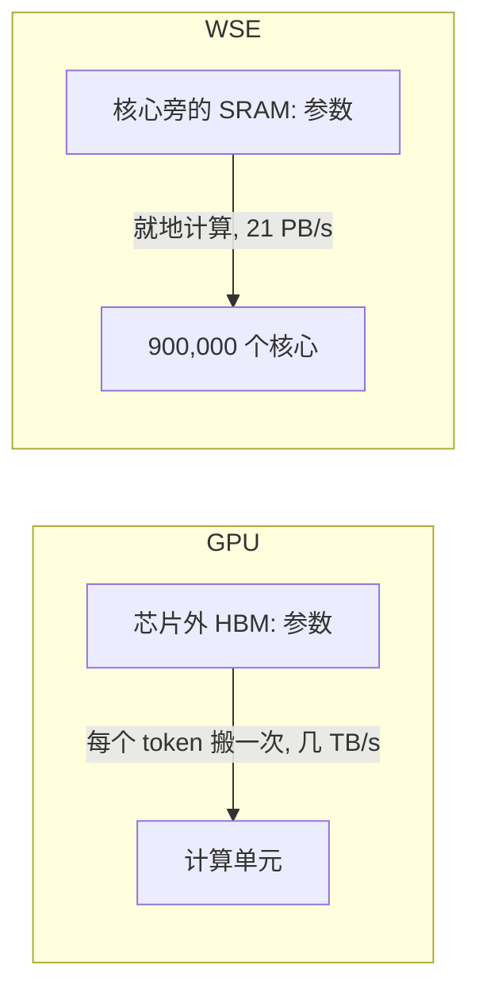

## Q
晶圆级芯片为什么能让单个用户的生成速度特别快？面试里用 4 句话怎么说？

## A
- **原理**：参数分散存在 90 万个核心旁边的 SRAM 里，每个核心只算自己那一份，没有"从 HBM 搬进芯片"这一步。
- **对比**：

| | GPU | WSE |
|---|---|---|
| 参数放在 | 芯片外的 HBM | 芯片上的 SRAM |
| 每个 token | 参数从 HBM 搬进来一次 | 就地计算 |
| 带宽 | 每秒几 TB | 21 PB/s |

- **4 句话（英文）**：
  1. "Every output token needs a pass over all the weights, so decode is memory-bandwidth-bound."
  2. "A GPU streams the weights from HBM at a few terabytes a second."
  3. "The wafer keeps the weights in on-chip SRAM next to 900,000 cores, at 21 petabytes a second."
  4. "So single-user speed is far higher — the trade-off is capacity, 44 GB per wafer."
- **注意**：7,000 倍是 SRAM 对 HBM 的比较，不是整机对整机。
