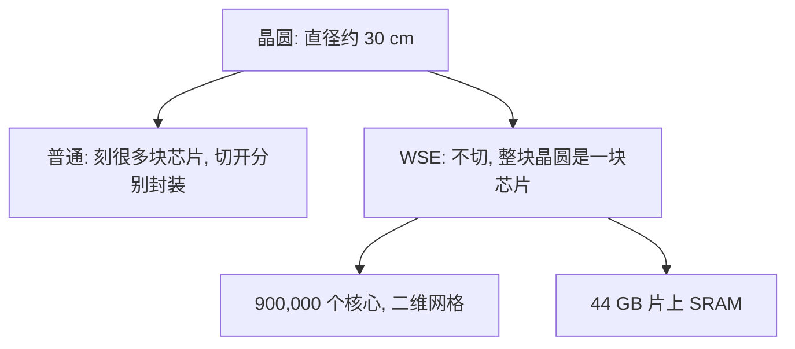

## Q
Cerebras 的 WSE-3 芯片是什么？和普通芯片有什么不同？关键数字是多少？

## A
- **晶圆（wafer）**：直径约 30 cm 的圆形硅片。普通做法是在上面刻很多块芯片，再切开分别封装。
- **WSE（Wafer-Scale Engine，晶圆级引擎）**：Cerebras 不切，整块晶圆就是一块芯片。职位描述说"比 GPU 大 56 倍"。

- **WSE-3 的数字**：

| 项目 | 数字 | 白话 |
|---|---|---|
| 晶体管 | 4 万亿 | 规模 |
| AI 核心 | 900,000 | 小计算单元排成二维网格，每个只和上下左右通信 |
| 片上 SRAM | 44 GB | 模型参数放在这里，不用去外面搬 |
| 内存带宽 | 21 PB/s | 每秒能把多少字节送到计算单元；公司说是 H100 GPU 的 7,000 倍 |
| 峰值算力 | 125 PFLOPS | 稀疏口径；FLOPS = 每秒浮点运算次数 |

- **SRAM**：芯片内部的高速小存储，离计算单元最近、最快，但贵、容量小。
- **一句话**："The whole wafer is one chip: 900,000 cores and 44 GB of on-chip SRAM."
