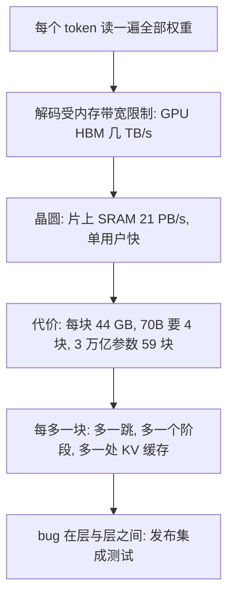

## Q
面试里用自己的话讲清「晶圆级推理为什么快、难在哪、和测试什么关系」，怎么说？

## A
1. "Generating text is **one token at a time**, and every token needs a pass over **all the weights**."
2. "So decode is limited by **memory bandwidth**, not compute — a GPU streams weights from **HBM** at a few terabytes a second."
3. "The wafer keeps weights in **on-chip SRAM** next to **900,000 cores**, at **21 petabytes** a second, so one user's speed is much higher."
4. "The cost is **capacity** — **44 GB** per wafer — so a 70B model needs **four** wafers and a 3-trillion-parameter model was deployed on **59**, pipelined **layer by layer**."
5. "Every extra wafer is another **hop**, another **pipeline stage** and another place the **KV cache** has to fit, so the bugs live **between layers** — that's what release integration testing is for."

> 中文提示：KV 缓存 = 生成时保存前面每个 token 的中间结果，避免重算；对话越长越大。这五句是经理面里 AI 部分的"上限"，说完就停。
