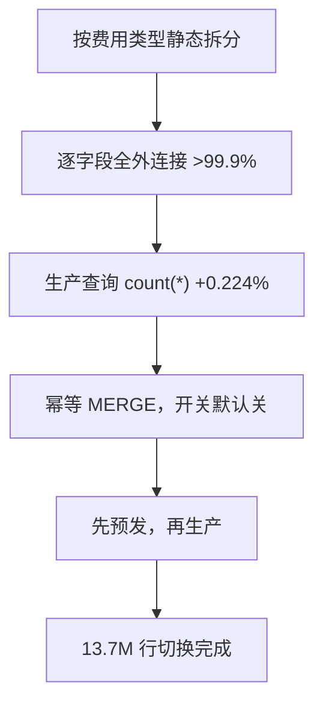

## Q
项目深挖：用生产查询本身验证的数据源切换（13.7M 行），怎么讲？

## A
**对应 JD**：evidence-based recommendations for release qualification、risk-based testing。

1. **Hook**: "I validated with the **production query itself**, so there was no gap between what I tested and what I shipped."
2. **Decision**: a **static split by fee type** over a smarter fallback — the fallback had **sticky state**.
3. **Evidence 1**: **field-by-field** full outer join: **>99.9%**; every difference explained.
4. **Evidence 2**: the production query as a `count(*)` on a full day: **+0.224%**.
5. **Ship safely**: **idempotent MERGE**, toggle **off by default**, pre-prod then production; **13.7M rows** cut over.

6. **Known risk, written down**: a **one-month dedup window**; reprocessing after a month bypasses dedup — documented next to the clause.

> 中文提示：0.07% 和 0.224% 是两个不同的数。追问为什么不双写：同一个开关反向控制两个任务才互斥，否则重复扣费。
