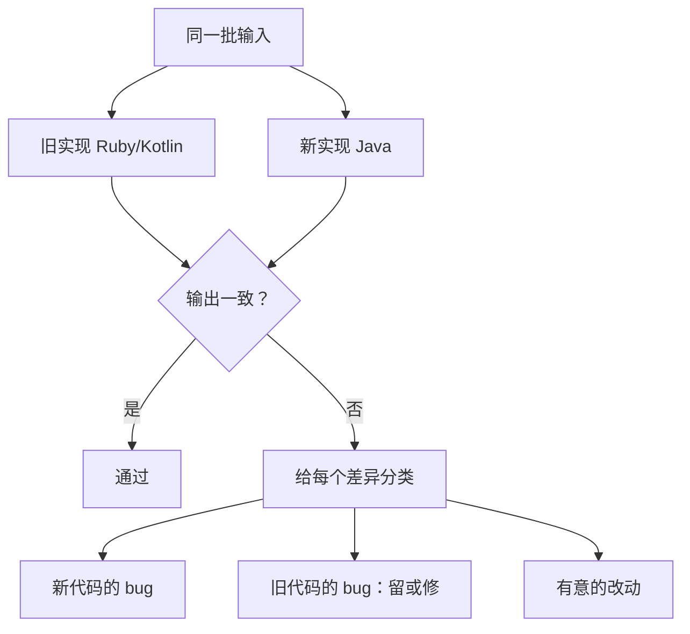

## Q
项目深挖：Ruby/Kotlin → Java 迁移的行为一致性测试，怎么讲？对应 JD 哪一条？

## A
**对应 JD**：regression validation、production-quality code、end-to-end validation。

1. **Hook**: "When we moved business logic from Ruby and Kotlin to Java, the bar was: the new code does **exactly** what the old did."
2. **Method**: same inputs through **both implementations**, outputs **compared**.
3. **Classify every diff**: a bug in the new code, a bug in the old code we chose to keep or fix, or an **intended change**.

4. **AI-assisted, human-gated**: Claude Code for test generation and refactoring; "in money code I **read every diff**."
5. **Bridge to Cerebras**: "A new compiler or runtime build against a **reference output** is the same idea, with a **tolerance** for floating point."

> 中文提示：【待补：规模、最难的一个行为差异、数值怎么比】补上前只讲方法。追问"比较时 NULL 怎么办"：`EQUAL_NULL`，因为 SQL 里 `NULL = NULL` 不为真。
