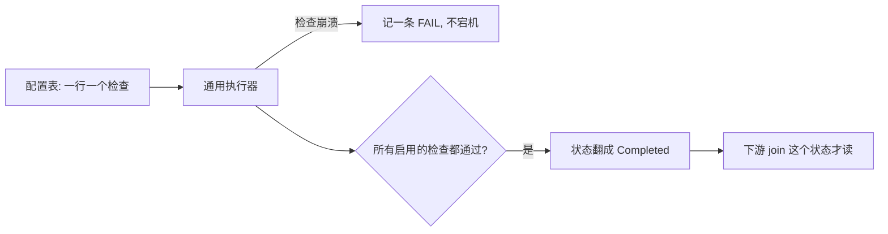

## Q
项目深挖：配置驱动的质量门框架，怎么讲成「发布门」？

## A
**对应 JD**：release qualification pipelines、entry/exit criteria、quality metrics。

1. **Hook**: "I turned 'is this data safe to read' from a **Slack convention** into a **join condition**."
2. **Before**: every reconciliation table had its own **hand-written** check.
3. **Built**: a **config table + generic executor**; adding a check = **insert a row**; a crashing check becomes a **FAIL record**, not an outage.
4. **Gate**: when every enabled check passes, a status flips to **Completed**; downstream **joins on it**. **Eight** subject areas.

5. **Own flaw**: readiness was per table, so about **fifty bad merchants out of thirty-five thousand** could block everyone; I wrote an **ADR** for merchant-level readiness — "**strictest wins**" — **proposed, not shipped**.
6. **Bridge**: "Checks are **entry criteria**, the status is the **exit**, and nobody reads until it flips — that's a readiness gate."

> 中文提示：别说商户级"上线了"。追问动态 SQL 风险：失去静态检查；配置由工程师经迁移管理，注入不是威胁。
