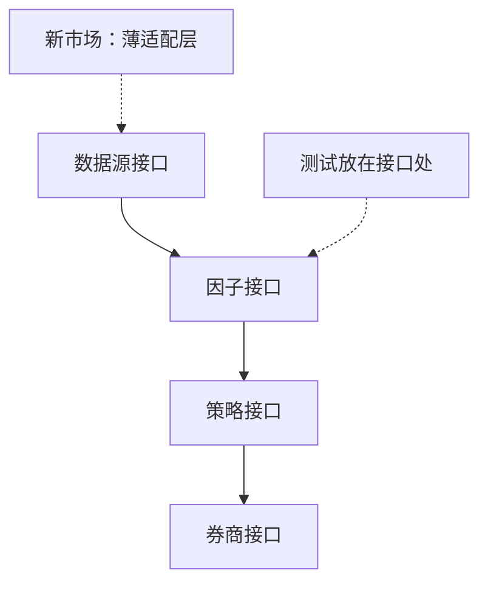

## Q
项目深挖：Quant-Stroller 个人研究平台的测试体系，怎么讲？

## A
**对应 JD**：scalable test frameworks、CI/CD、Python production-quality code。

1. **Say first**: "It's a **personal project**."
2. **Hook**: "I built it to see how much of a good-looking backtest survives realistic costs — and it only works because tests stop a change from **silently moving a result**."
3. **Scale**: Python, **66K+ lines**, **470+ test files**, **self-hosted CI**.
4. **Design for testing**: **four narrow interfaces** — data source, factor, strategy, broker; a new market is a **thin adapter**, so tests sit **at the seams**.

5. **Gates**: two gates before a strategy is trusted; **340+ experiments** in an **append-only ledger**.
6. **GPU**: PyTorch training on an **8-GPU** server.

> 中文提示：【待补：CI 每次跑什么、多久；一个测试救过你的例子】。别说任何速度、收益数字。
