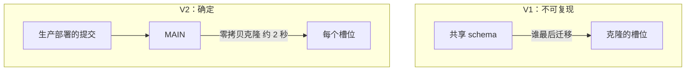

## Q
项目深挖：schema pool（确定性的测试环境），怎么讲成测试基础设施？

## A
**对应 JD**：test infrastructure、tooling for test automation、engineering efficiency。

1. **Hook**: "Two engineers, or two **AI agents**, collided on shared-schema DDL, so I built a pool of **two-second zero-copy clones**."
2. **Problem**: integration tests ran migrations against **one shared schema**.
3. **V1 failed**: slots cloned the shared schema, whose state depended on **who migrated last** — not reproducible.
4. **V2**: a `MAIN` synced to the **production-deployed commit**; each slot a **zero-copy clone**, about **2 seconds**.

5. **Result**: several agent sessions run migrations and tests **concurrently**; three **ADRs**.
6. **Lesson**: "Test state must be **deterministic** — derived from what's deployed, never from who ran last. That kills a whole class of **flaky** tests."

> 中文提示：先说是个人仓库，不是团队工具链。为什么 2 秒：克隆只复制元数据，数据文件不可变。
