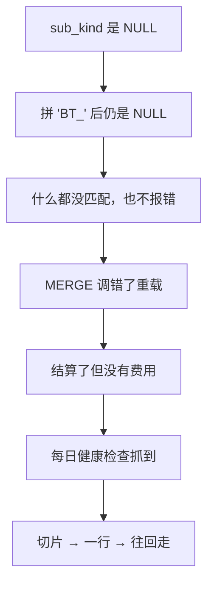

## Q
项目深挖：没有报错的 bug（每日健康检查抓到的静默 NULL），怎么讲？

## A
**对应 JD**：debug cross-stack failures、root cause analysis、tests that prevent regressions。

1. **Hook**: "My hardest bug **threw no error**: rows that should exist were simply missing."
2. **Found by**: a **daily health check I built**: settled transactions with **no fee**, about **200 merchants**.
3. **Method**: **slice → one row → walk back**. `sub_kind` was NULL; `'BT_' || NULL` is NULL; nothing matched; the final `MERGE` called the **wrong overload**.

4. **Rule out**: "just late" — **control group** and **age buckets**, 0% at every age. Refused to add the type to the check's **exclusion list**.
5. **Fix**: postmortem with **four reasons tests missed it**; one function; old signature **dropped** in a versioned migration; an **end-to-end test** across promote → fee.
6. **Bridge**: "Every stage's unit tests passed; the bug lived **between stages** — that's the integration layer."

> 中文提示：止血 PR 是同事的，根因、复盘、加固是你的。四个漏洞：只断言路由不断言费用、fixture 是卡支付、pending 行没断言该字段、没有跨阶段测试。
