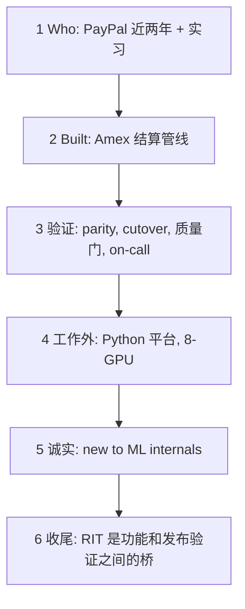

## Q
Cerebras 经理面：2 分钟自我介绍，按说出口的顺序有哪几段？

## A
1. **Who**: almost **two years** full time at PayPal, after an **internship** on the same team.
2. **Built**: the **Amex settlement pipeline** end to end; "bad data is **recorded, never dropped**"; idempotent at every stage; a mismatch **halts and pages** on-call, which is me.
3. **Verification work**:
   - **Parity**: Ruby/Kotlin → Java, same inputs through old and new, **outputs compared**.
   - **Cutover**: **13.7M rows**, **>99.9%** field-level parity, then the **production query itself**; toggle **off by default**.
   - **Quality gates**: data is readable downstream only when **every check passes**; **eight** subject areas.
   - **On-call**: a daily check caught **silently missing fees**; **four reasons** tests missed it; an **end-to-end test across stages**.
4. **Outside work**: Python platform, **66K lines**, **470+ test files**, **self-hosted CI**; PyTorch on an **8-GPU** server.
5. **Honest line**: "I'm **new to ML internals** and learning the inference stack in order."
6. **Close**: "RIT is the **bridge** between feature and release qualification — the work I've been doing in payments."

> 中文提示：约 270 词。每段结尾都可以被打断；被问 which part was yours：管线从拓扑开始是我的，NULL 事故的止血 PR 是同事的。
