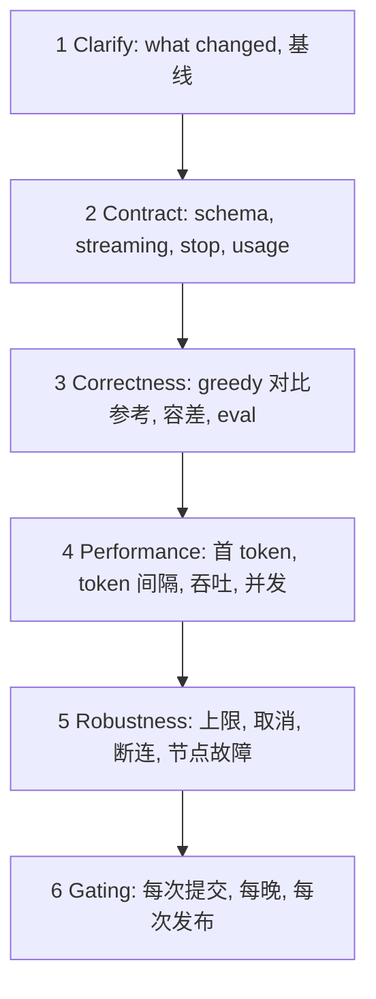

## Q
面试题：你会怎么测一个推理端点（比如新模型上线到 chat completions 接口）？按层次答。

## A
- **白话**：**温度（temperature）**设为 0 时每步都选概率最高的 token（贪心解码），最可复现；**logits** 是模型给每个候选 token 打的原始分；**参考实现**是同一模型在公认正确环境（如 GPU 上的 PyTorch）里的输出。

1. **Clarify**: what changed — new model, runtime or compiler build, hardware config? What's the baseline?
2. **Contract**: schema; **streaming** chunks in order and ending cleanly; `stop`, `max_tokens`, **usage** counts; error codes; valid tool calls and **JSON-schema** output.
3. **Correctness**: **greedy** run vs a **reference** — first N tokens match or logits within **tolerance**; an **eval** score within a threshold. Not byte-for-byte, because floating-point **addition order** changes results.
4. **Performance**: **time to first token**, time **between tokens**, tokens/s per user, throughput at several **concurrency** levels, vs last release with a **noise threshold**.
5. **Robustness**: context near the **limit**, empty and Unicode input, **cancel mid-stream**, client disconnect, a node **failing** mid-request.
6. **Gating**: per commit, nightly, per release; go/no-go numbers; **staged rollout**.

> 中文提示：先问"what changed"。结尾一句：It's the parity testing I did for the Java migration, with a tolerance instead of exact equality.
