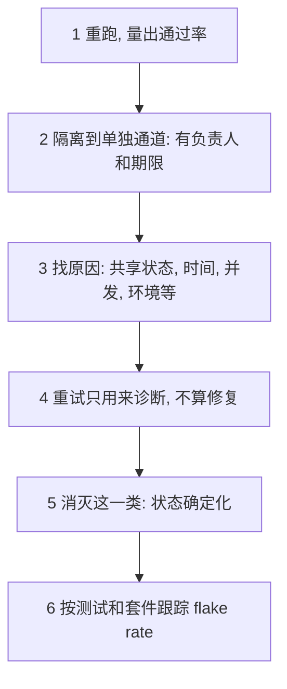

## Q
面试题：How do you deal with flaky tests? 按说出口的顺序怎么答？

## A
1. **Measure first**: rerun to get a **pass rate**; a test that passes 95% of runs on the same commit is flaky, not "unlucky".
2. **Quarantine, don't delete**: move it to a **separate lane** so it stops blocking master, with an **owner** and a **deadline**.
3. **Find the cause**: shared state, **time** and ordering, **concurrency**, test environment, external services, resource limits.
4. **Retries are diagnosis, not a fix**: auto-retry hides real intermittent bugs — like a race in a runtime.
5. **Kill the class**: make state **deterministic**. "My schema pool did that: test state came from the **deployed commit**, never from **who ran last**."
6. **Track it**: flake rate per test and per suite, so master's signal stays **trustworthy**.

> 中文提示：这正是 RIT 职位里的"distinguish real regressions from flakiness"。在推理里还要加一条：浮点结果随运算顺序变化，比较要用容差，否则会制造假 flaky。
