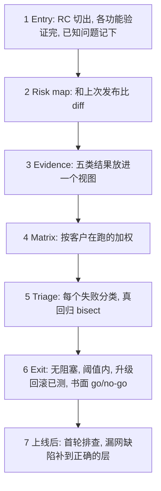

## Q
面试题：你会怎么验证一次推理软件栈的发布（发布候选）？按顺序答。

## A
1. **Entry**: release candidate cut; each feature's **own qualification** done; **known issues** written down.
2. **Risk map**: diff vs last release — compiler, runtime, kernels, firmware, models. **New interactions** get new scenarios; the rest get standing regression.
3. **Evidence**: unit, simulation, benchmark, feature and integration results **in one view**; gaps **named**.
4. **Matrix by risk**: models × sizes × context lengths × batch sizes, weighted by **what customers run**.
5. **Triage**: every failure **classified** — real regression, flaky, environment, infrastructure, known; real ones **bisected** to a commit with an owner.
6. **Exit**: no open blockers; performance and accuracy within thresholds; **upgrade and rollback** tested; a written **go/no-go with explicit gaps**.
7. **After rollout**: first-pass triage; every **escaped defect** gets a test **at the right layer**; track escape rate, time to triage, master green rate.

> 中文提示：**批大小（batch size）**= 一次一起算的请求数。结尾连到你的质量门："checks are entry criteria, a status is the exit."
