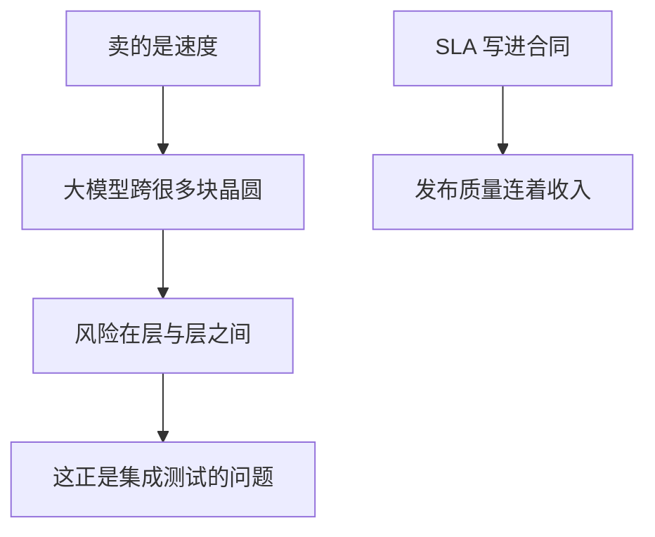

## Q
面试 Cerebras 被问「Why Cerebras?」，按说出口的顺序怎么答？

## A
1. **The product creates my problem**: "The product is speed, and the cost is integration: a large model spans many wafers, so the risk sits **between layers**. That's the testing problem I like."

2. **Zero to one**: "RIT is being **built from scratch**. I've built a quality gate and a test-environment tool **nobody assigned**; I'd rather **define the gates** than just run them."
3. **Quality is revenue**: "Reliability is **in the contract** — SLAs — so release quality connects straight to revenue, the same way a missing fee is money in payments."
4. **I use it**: "I work with **AI coding agents** every day, and faster tokens change how agents work."

> 中文提示：45 秒。第 4 条只在你确实每天用时说。别说"因为你们上市了""因为股价"。
