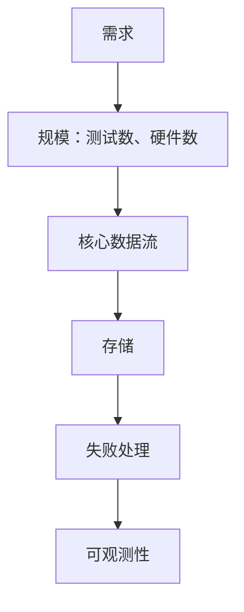

## Q
Cerebras 的系统设计和背景问题轮常问什么？测试岗的系统设计最可能是什么题？

## A
- **系统设计**：实用、题目常常很模糊，要自己问清需求。见过的题：设计一个类似 Bugsnag 的错误追踪系统。
- **测试岗最可能的版本**：
  - 测试执行平台：排队、分片、硬件资源分配、结果存储；
  - flaky 测试检测器；
  - 发布验证流水线。
- **答题顺序**：需求 → 规模（每天多少测试、多少硬件）→ 核心数据流 → 存储 → 失败处理 → 可观测性。

- **背景问题**见过的：
  - 和上级的一次严重分歧；
  - 在资料很少的情况下学会一个领域；
  - 你怎么学新东西；
  - 团队合作和沟通。
- **准备**：每题配一个故事，60 秒讲完，停，等追问。
