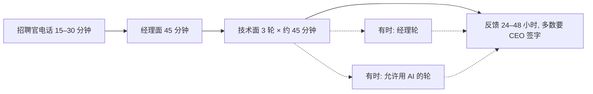

## Q
Cerebras 这个组织的软件岗面试流程是怎样的？

## A
| 步骤 | 形式 | 考什么 |
|---|---|---|
| 招聘官电话 | 15–30 分钟 | 背景、兴趣、时间线 |
| **经理面** | **45 分钟**，视频，招聘经理或技术负责人 | 过往项目和技术决策、兴趣是否对得上团队、沟通 |
| 技术面 | 3 轮 × 约 45 分钟，HackerRank 写代码 | 编码（语言自选）+ 岗位相关的技术深挖，**偏 Python** |
| 经理轮（有时） | 45 分钟，Microsoft Teams | 沟通、团队合作、解决问题的风格 |
| 允许用 AI 的轮次（有时） | 提前通知 | 真实代码库或数据集上的任务 |
| 反馈 | 24–48 小时 | 多数 offer 要 CEO 签字；全程 2 周到 2 个月 |

- **按团队定**：有的团队面得多得多，有的只有 4 轮（2 编码 + 2 背景问题）。
- **技术深挖的原则**：问"日常要用的东西，不是抽象的"。
