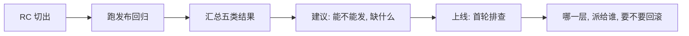

## Q
Cerebras RIT 的 SDET 一周大概做什么？

## A
按职责推出来的合理图景，面试里说成"my understanding, please correct me"。

| 时间 | 做什么 |
|---|---|
| 每天早上 | 看 master 和发布分支的夜间回归；给每个失败分类；真回归用二分查找（`git bisect`）找到引入的提交，开 bug、指派负责人 |
| 功能合入前后 | 读功能设计，列出它和运行时、内存、调度、模型执行的交互风险；补集成场景 |
| 发布周期 | 发布候选（RC, release candidate）切出 → 跑发布回归 → 汇总五类结果 → 写"能不能发、缺什么"的建议 |
| 上线时 | 首轮排查：失败归到哪一层、派给谁、要不要回滚 |

| 间隙 | 改测试框架、加诊断工具和看板、修 flaky、代码评审、带新人 |

- **节奏**：同组岗位明说"不是追求规律、可预测工作时间的岗位"，集成期会很紧张；混合办公每周至少 3 天。
- **风气**：鼓励在测试里用 AI 工具。
