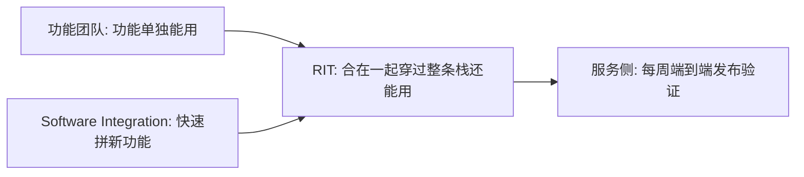

## Q
Cerebras 的 RIT（发布集成测试）和功能团队怎么分工？

## A
| 归功能团队 | 归 RIT |
|---|---|
| 功能设计 | 推理核心的**集成策略** |
| 功能级验证（feature qualification） | **推理路径的就绪审批** |
| 功能回归 | 跨层的**集成验证** |
| — | **首轮上线排查** |

- **一句话**：RIT 是"功能验证和发布验证之间的桥"：功能团队证明自己的功能单独能用；RIT 证明所有功能合在一起、穿过整条软件栈时还能用。
- **上游**：Software Integration（自称"创新引擎"）把新功能快速拼起来，节奏快、优先级常变。
- **RIT 自称"生产引擎"**：把拼好的东西变成可靠的生产版本。
- **下游**：服务侧每周的端到端发布验证。RIT 要在那之前把跨层缺陷挡住。

- **英文**："Feature teams prove a feature works alone; RIT proves the features work together across the stack."
