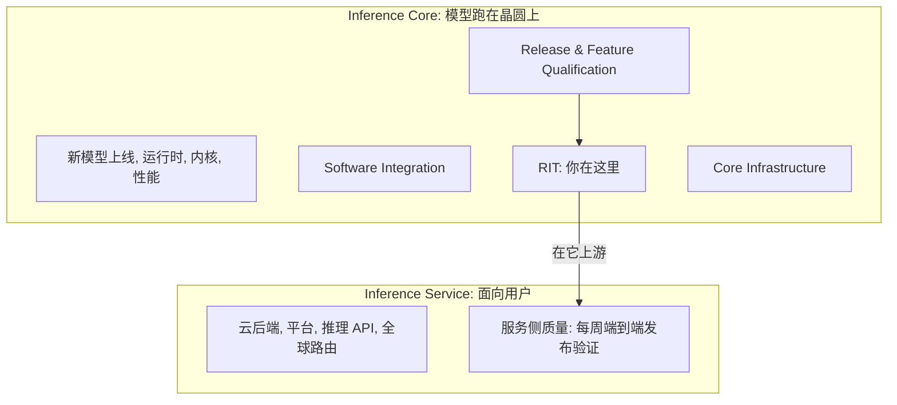

## Q
Cerebras 的 SDET（发布集成测试）岗位在组织里的位置是什么？两个推理组织各管什么？

## A
- **位置**：AI Inference Core → Release & Feature Qualification → **Release Integration Testing（RIT）**。Sunnyvale 或 Toronto，每周至少 3 天到办公室。
- **SDET（Software Development Engineer in Test）**：写代码的测试工程师，造测试框架和工具，不只是执行用例。
- **Inference Core（你在这里）**：把模型跑在晶圆上的那一半。
  - 新模型上线：模型翻译、编译优化、运行时集成。
  - 运行时、内核、ML 系统性能、推理算法研究。
  - Software Integration（把新功能快速拼起来）、RIT、Core Infrastructure（Python 编排、测试基础设施、CI/CD、Kubernetes）。
- **Inference Service**：面向用户的那一半。
  - 推理云后端（计费、配额、控制台）、平台、推理 API、全球路由、GPU 推理。
  - 服务侧质量团队：每周一次端到端发布验证。

- **一句话**："RIT sits in Inference Core, upstream of the service side's weekly release qualification."
