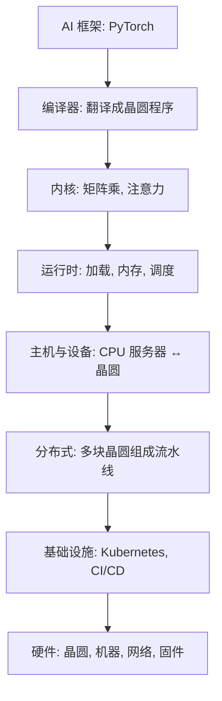

## Q
一个推理请求从云端走到晶圆要经过哪几层软件？每层用一句白话说清。

## A
| 层 | 白话 |
|---|---|
| **AI 框架**（framework） | 写模型用的库，主要是 PyTorch |
| **编译器**（compiler） | 把 PyTorch 模型翻译成晶圆能跑的程序，决定每一层放在哪些核心上、数据怎么在核心间走 |
| **内核**（kernel） | 在芯片上执行一个基本运算（矩阵乘、注意力）的底层小程序；Cerebras 用汇编和自家 C 风格语言 CSL 写 |
| **运行时**（runtime） | 程序跑起来时管资源：把模型加载到设备、分配内存、调度请求、在主机和设备之间搬数据 |
| **主机与设备**（host / device） | 主机是普通 CPU 服务器，设备是晶圆；设备编程 = 把程序和数据写进晶圆 |
| **分布式系统** | 多块晶圆、多台主机按层组成流水线 |
| **基础设施** | Kubernetes、CI/CD、集群管理与监控 |
| **硬件** | 晶圆、机器、网络、固件 |

- **模拟器**（simulator）：没有真机器时在普通电脑上模拟晶圆执行，用来早测。
- **职位里的高风险交互**："runtime, host, device programming, memory, scheduling, and model execution"。
