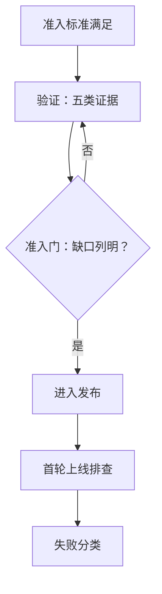

## Q
RIT 岗位里的准入门、分支健康、失败分类、覆盖放在正确的层、首轮上线排查各是什么意思？

## A
- **准入门（readiness gate）**：一个版本进入发布前必须拿出的证据：单元、模拟、基准、功能、集成五类结果，覆盖不到的地方明确列出。
- **准入 / 准出标准（entry / exit criteria）**：什么条件下开始验证、什么条件下算验证完。

- **master 与发布分支健康**：主干和发布分支上的测试有多稳定、多少是绿的、红了多久没人管。
- **失败分类**：每个失败判成真回归、不稳定测试（flaky）、环境问题、基础设施问题或已知问题。
  - flaky：代码没变、结果时好时坏；真回归：新改动把原来能用的弄坏了。
- **覆盖放在正确的层**：单元测试能抓到的不放到端到端；只有跨层才出现的问题才放进集成测试。
- **把耐用的功能测试晋升进发布回归**：功能团队的测试里稳定、有价值的部分，搬进发布回归套件。
- **首轮上线排查（first-pass rollout triage）**：新版本上线时第一个看失败的人，判断是哪一层的问题、派给谁、要不要回滚。
- **风险驱动测试**：测试资源按"出错概率 × 出错代价"分配。
