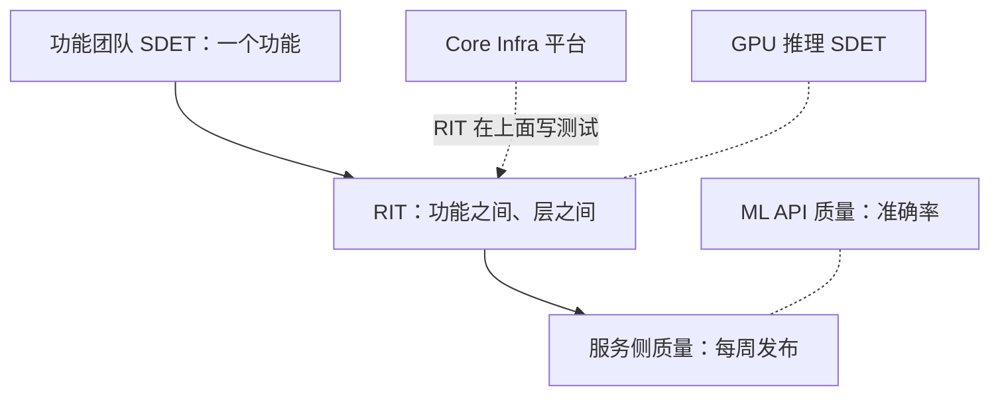

## Q
Cerebras RIT 的 SDET 和功能团队 SDET、服务侧质量团队、Core Infrastructure 有什么不同？

## A
| 岗位 | 关注 | 和 RIT 的区别 |
|---|---|---|
| 功能团队的 SDET | 一个功能自己对不对 | RIT 看功能**之间**和层**之间** |
| 服务侧质量团队 | API、平台、云控制台的每周发布 | RIT 在它上游，看晶圆这一侧 |
| ML API 质量 | 模型准确率、公平性、基准评测 | RIT 看"同一个模型换了软件版本还对不对" |
| GPU 推理 SDET | AMD GPU 预填充那条线 | RIT 看晶圆这条线 |
| AI 集群 SDET | 几千个节点的集群可靠性 | RIT 看推理软件栈的集成 |
| Core Infrastructure | 编排、执行引擎、测试基础设施平台 | RIT 是它最大的用户，在上面写测试和工具 |

- **一句话**："Feature SDETs ask 'does my feature work'; RIT asks 'does everything work together on the path from the API to the wafer'."
