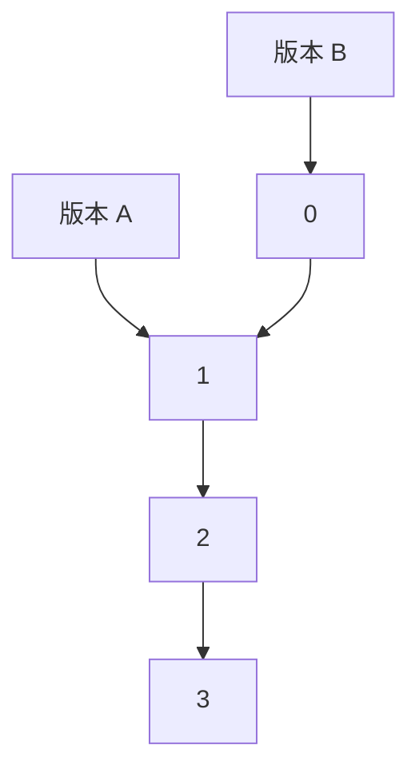

# hc04 讲义 · 队列均值与快照：从「每次重新加一遍」到「无锁读」

> 读者：会写基本 Java（类、方法、循环、`ArrayList`/`HashMap`），没学过数据结构、浮点数、并发；每个概念从零讲。

---

## 1. 问题是什么

实现一个能随时报告「当前所有元素平均数」的队列：元素进出时不重新遍历，平均数要精确，数值很大也不能溢出。在这个基础上再加「快照」（保存某一刻的状态以便回看）和并发读取，考的是你能否在每一步主动发现精度、溢出和线程安全的问题。

**第一问**：实现一个**队列**（queue）和 `push`、`pop`、`get_mean`。队列像排队买票：新来的站队尾（`push`），队头先走（`pop`），「先进先出」（FIFO）。`get_mean()` 返回队里所有数的**平均数**（mean）。

| 操作 | 返回 | 队列 | `get_mean` |
|---|---|---|---|
| push 1 | | `[1]` | |
| push 2 | | `[1, 2]` | |
| push 3 | | `[1, 2, 3]` | (1+2+3)/3 = 2 |
| push 4 | | `[1, 2, 3, 4]` | 10/4 = 2.5 |
| pop | 1 | `[2, 3, 4]` | 9/3 = 3 |

面试官要看**你接下来五十分钟会不会主动发现问题**，至少五个：

1. 每次 `get_mean` 都重新加一遍，太慢。
2. 用 `double` 保存「当前总和」，加了又减会悄悄变错。
3. 数很大时 `long` 加法溢出（变负数）。
4. 「快照」是什么？保存历史版本要复制多少数据？
5. 一个线程改队列，另一个读平均数，会不会读到「一半新一半旧」？

**第二问**：带 snapshot 的版本：Part 2「修正快照」事件流，Part 3 可回看任何历史版本的持久化队列，Part 4 并发读。

---

## 2. 前置知识

> 复杂度速记：`O(n)` 线性；`O(log n)` n 翻倍只多一步；`O(n²)` 每对都处理；`O(1)` 与 n 无关。

### 2.1 队列与「环形缓冲」（ring buffer）

队列只能从一端放、另一端取。**环形缓冲**用固定大小数组实现队列，首尾连成圈。

`pop` 时把后面元素前挪要 `O(n)`；只后移「队头下标」则 `pop` 是 `O(1)`，但前面空格永远用不上。解决：队尾走到末尾后绕回开头用那些空格。

**怎么工作**（容量 8，`head` 队头下标，`size` 元素个数）：

```
下标:    0   1   2   3   4   5   6   7
内容:   [ ] [ ] [C] [D] [E] [ ] [ ] [ ]      head=2, size=3   队列是 C D E
push F, G, H, I, J：
下标:    0   1   2   3   4   5   6   7
内容:   [I] [J] [C] [D] [E] [F] [G] [H]      head=2, size=8（满）
                                              I 和 J 绕回了开头
```

第 k 个元素（从队头数，k 从 0 起）在 `(head + k) % 容量`；队尾下一个空位是 `(head + size) % 容量`。容量是 **2 的幂**时，`% 容量` 可换成 `& (容量 - 1)`（`x % 8 == x & 7`），位运算更快，口头提一句加分。

**满了怎么办**：开两倍大的新数组，**按逻辑顺序**（从 head 起，绕回去）抄过去，`head` 归零。分两段抄：先 `head..末尾`，再 `0..head-1`。这是常见 bug（第 8 节）。

```java
long[] buf = new long[16];
int head = 0, size = 0;
void push(long x) {
    if (size == buf.length) grow();
    buf[(head + size) & (buf.length - 1)] = x;
    size++;
}
long pop() {
    long x = buf[head];
    head = (head + 1) & (buf.length - 1);
    size--;
    return x;
}
```

**为什么不用 `ArrayDeque<Long>`**：每个数是堆上单独的小对象（**装箱**，boxing），CPU 要先读引用再跳到别处（「指针追逐」）。`long[]` 连续，相邻数据预取进缓存（cache），快得多。没有性能要求时 `ArrayDeque` 够用，说清取舍即可。

### 2.2 复杂度与「均摊」（amortized）

**均摊 O(1)**：环形缓冲偶尔扩容抄 n 个数（`O(n)`），但容量翻倍后要再 push n 次才下一次扩容。昂贵操作的成本平摊到之前 n 次便宜操作上，平均每次 `O(1)`。第 3 节朴素解每次 `get_mean` 是 `O(n)`，100 万次操作 × 2 万元素 = 200 亿步。

### 2.3 浮点数（`double`）为什么会错

`double` 64 位：1 位符号、11 位指数、**52 位尾数**，有效数字约 15–16 位十进制（53 个二进制位）。它不是「更大的 long」：能表示很大的数，但**相邻两个可表示数之间有空隙**，数越大空隙越大。`10^16` 附近相邻 `double` 间隔是 2，所以 `1e16 + 1` 的精确结果 `10000000000000001` 表示不出来，舍入（到偶数）得 `1e16`，**加的 1 消失了**。

| 步骤 | `s` 的值 | 说明 |
|---|---|---|
| `s = 0.0` | 0.0 | |
| `s += 1e16` | 1e16 | |
| `s += 1` | 1e16 | 1 被吃掉 |
| `s += 1` | 1e16 | 又被吃掉 |
| `s -= 1e16` | 0.0 | 正确答案应该是 2 |

队列里：先 push 巨大的数，再 push 两个 1，然后 pop 掉巨大的数——和应是 2，`double` 维护的总和得 0。这叫**灾难性抵消**（catastrophic cancellation）。解决不是「更好的 double」，而是**别用浮点数存总和**，用整数。

### 2.4 整数溢出、补码与 128 位累加器

`long` 范围 `-2^63 .. 2^63-1`。超出时 Java **不报错**而「绕回」：`Long.MAX_VALUE + 1 == Long.MIN_VALUE`（溢出 overflow）。两个 `Long.MAX_VALUE` 的和 `2^64 - 2` 存成 `-2`，平均数变负，**悄悄错了**。原因是**补码**（two's complement）：负数最高位是符号位，`-1` 是全 1，加法与无符号加法是同一电路，所以「绕回」。

**怎么办**：用两个 `long` 拼 128 位整数：`hi`（高 64 位，有符号）和 `lo`（低 64 位，**当无符号数看**）。加一个 `long x`：

```
lo' = lo + x                           （64 位加法，可能绕回）
carry = lo' 比 lo 还小（按无符号比）? 1 : 0   （绕回了就说明向高位进了 1）
hi' = hi + (x 的符号扩展) + carry
```

`x >> 63`（算术右移）：`x` 非负得 0，负得 -1（全 1）——64 位 `x` 扩展成 128 位时高 64 位的值。演示 `MAX + MAX + MAX`（`MAX = 2^63 - 1`）：

| 步骤 | lo | hi | 说明 |
|---|---|---|---|
| 初始 | 0 | 0 | |
| +MAX | 2^63-1 | 0 | |
| +MAX | 2^64-2 | 0 | 无符号看 lo 是 2^64-2，没有绕回 |
| +MAX | 绕回成 2^63-3 | 1 | (2^64-2)+(2^63-1) = 2^64+2^63-3，绕回；lo' < lo（无符号），carry=1，hi=1 |

结果 = 1·2^64 + (2^63-3) = 3·(2^63-1) ✓

（验算：`3 * (2**63 - 1) == 27670116110564327421`，与 `hi*2^64 + lo` 一致。）

**够用吗**：n 个 `long` 之和绝对值 ≤ n·2^63，队列最多 2^31 个元素，和 < 2^94，128 位（约 ±2^127）永远放得下。Java：`Long.compareUnsigned(a, b)` 无符号比大小；`Math.addExact` 溢出抛异常（只想「报错」不要「算对」时用）。

### 2.5 分数与最大公约数（gcd）

平均数 = 总和 / 个数，是分数。`6/4` 和 `3/2` 同一个数，约分成最简，分母恒为正。比较均值是否相等或给「精确」均值，不能先除成 `double`；约分后的分数（`BigInteger` 分子 + `long` 分母）可精确比较，`record` 的 `equals` 自带。`g = gcd(分子, 分母)` 都除以 g（分子为 0 时 `gcd(0, d) = d`，得 `0/1`）。`BigInteger` 不溢出但每次运算分配新对象，所以只在**取答案**时用，不在每次 push/pop 里用。

**转成 `double`**：`a` 和 `b` 都能被 `double` 精确表示（绝对值 ≤ 2^53）时，IEEE 754 规定除法是「精确商舍入到最近」，`(double)a / b` 就是正确舍入。否则先用 `BigDecimal` 高精度除再 `doubleValue()`（有极小概率「二次舍入」偏差，这里数据范围内不出现，面试提一句）。

### 2.6 持久化数据结构（persistent data structure）与「版本」

普通数据结构一改就丢旧状态；**持久化**每次修改生成**新版本**，旧版本仍可读。Part 3 要「保留每个历史版本，随时查任意版本均值，并从旧版本分叉」。每版本复制一份要 `O(n²)` 时间和空间（2 万个版本 168 ms，按平方增长）。**办法**：新旧版本**共享**没变的部分，只新建变了的一点点。最简单的例子是链表：



版本 A：`1 → 2 → 3`。版本 B 是在 A 前面加 0：`0 → (A 的 1 → 2 → 3)`。只新建了一个节点 `0`，后面全部共享。

队列两头变化，不能直接用链表；第 4 节推导用**树**。**树与父指针**：每节点只存一个「父节点」（根没有），沿父指针往上走到根的路径唯一；多个节点可有同一个父——这就是「分叉」。

### 2.7 祖先查询（level ancestor）与跳跃指针（jump pointer）

给定节点 `v` 和深度 `d`，求 `v` 在深度 `d` 的祖先（深度 = 到根的步数，根为 0）。Part 3 的 `pop` 要找的「队头元素」正是这样的祖先。

**朴素**：沿父指针爬，`O(深度)`。**加速**：每节点多存一个「跳跃指针」`jump` 指向更高的祖先；找深度 `d` 的祖先时，能跳（跳完深度仍 ≥ d）就跳，否则走一步父指针。`jump` 的选法决定总步数是否 `O(log n)`，漂亮的规则（Eugene Myers 1983，skew-binary 跳跃指针）：

```
新节点 n，父 p。令 j = jump[p]。
如果 depth[p] - depth[j] == depth[j] - depth[jump[j]]   （p 的跳跃长度等于 j 的跳跃长度）
    jump[n] = jump[j]        （把两段跳合并成一段更长的）
否则
    jump[n] = p
```

直觉：跳跃长度按 1、1、3、1、1、3、7…这种「近似 2 的幂减 1」模式增长，长跳数量是 `log n` 级。深度 1..16 的 `jump`（所指祖先的深度）：

```
深度:  1  2  3  4  5  6  7  8  9 10 11 12 13 14 15 16
jump:  0  1  0  3  4  3  0  7  8  7 10 11 10  7  0 15
```

从深度 8 的节点找深度 5 的祖先：

| 当前 v | `jump[v]` | 深度 | 动作 |
|---|---|---|---|
| 8 | 7 | 7 ≥ 5 | 跳到 7 |
| 7 | 0 | 0 < 5 | 不能跳，走父指针到 6 |
| 6 | 3 | 3 < 5 | 不能跳，走父指针到 5 |
| 5 | | 5 == 5 | 找到 |

共 3 步（朴素要 3 步，差别在深度大时才显现：深度 16 → 深度 1 只要 7 步，朴素要 15 步）。

每节点只多存一个 `int`，不需「倍增表」的 `n log n` 内存。面试说「binary lifting（倍增）也行但 `O(n log n)` 内存，jump pointer 更省」即可。

### 2.8 线程、可见性与「撕裂读」

Part 4：写者改队列，读者读均值。每线程有自己的 CPU 缓存和寄存器，编译器和 CPU 还会**重排**指令，所以一个线程写的值，另一个**不一定**马上看到，甚至先看到后面的写。

**撕裂读**（torn read）：写者先更新 `sum` 再更新 `size`，读者在两次写之间读到「新 sum + 旧 size」，算出根本不存在过的均值。例：队列全是 7，size=3，sum=21，均值 7。写者 push 7：先 `sum=28`，再 `size=4`；读者恰好读到 `sum=28, size=3` → 9.33，从未存在过。

**happens-before**：JMM 规定了「A 一定在 B 之前、且 A 的写入对 B 可见」的规则：
* 同一线程里，前面的语句 happens-before 后面的。
* `volatile` 变量的写 happens-before 之后对它的读。
* 线程 `start()` happens-before 该线程里所有动作；线程里所有动作 happens-before 别人 `join()` 它返回。

**解决**：把 `(sum, size)` 打包进**不可变对象**（字段全 `final`），写者每次 `new` 新对象并**一次性发布**一个引用，读者读到的永远是某个完整对象——「不可变对象 + 安全发布」。

**发布的写法**（越往下越精细）：

| 写法 | 效果 | 代价 |
|---|---|---|
| `synchronized` 读写都加锁 | 最简单，正确 | 读者排队；JDK 21 虚拟线程在 `synchronized` 里阻塞会「钉住」（pin）载体线程 |
| `volatile Stat published` | 写后读可见 | 每次写有全序屏障，通常够用 |
| `VarHandle.setRelease` / `getAcquire` | release 写之前的所有写入，对 acquire 读到该值的线程可见 | 比 `volatile` 更弱更便宜，也更难推理 |
| `StampedLock.tryOptimisticRead` | 读者不加锁，读完检查 stamp，期间有写就重读 | 读者要写重试循环 |

`VarHandle`（Java 9）是对字段做精确内存操作的句柄。`setRelease` 与 `getAcquire` 配对建立 happens-before：写者 `setRelease` 之前做的一切（含 `Stat` 的字段初始化），读者 `getAcquire` 读到该引用后都看得到。

### 2.9 虚拟线程

虚拟线程（JDK 21 正式）由 JVM 调度，可开几十万个，跑在少量「载体线程」（= CPU 核数）上。阻塞时让出载体线程，但**纯自旋（`while (!flag) {}`）永不让出**：自旋的虚拟线程数 ≥ 载体线程数时，其他虚拟线程（如写者）饿死，程序挂住。解决：自旋里 `Thread.yield()`，或读者用平台线程。

---

## 3. 从最笨的解法开始

```java
// 最笨：用 ArrayDeque<Long>，get_mean 每次遍历求和
class NaiveQueueMean {
    private final ArrayDeque<Long> q = new ArrayDeque<>();
    void push(long x) { q.addLast(x); }
    long pop() { return q.removeFirst(); }
    double getMean() {
        double s = 0;
        for (long x : q) s += x;
        return s / q.size();
    }
}
```

对（小数据）。`push/pop` 是 `O(1)`，`getMean` 是 `O(n)`（n = 队列长度）。

**慢在哪**：队列长 2 万，共 20 万次 push、约 10 万次 `getMean` × 2 万次加法 = 20 亿次加法，实际 **2604 ms**（改进后的 `QueueMean` 同序列只要 **3 ms**）。

**错在哪**：`push(10^16), push(1), push(1)` 后 `pop()`，剩两个 1，均值应为 1。遍历版从头加是对的；但为加速改成维护总和，减掉 `10^16` 就得 0（第 4 节）。两个 `Long.MAX_VALUE`：若用 `long` 累加就变负数。

---

## 4. 一步一步改进

### 步骤 1：维护「总和」，均值变 O(1)

`getMean` 每次重新加一遍。均值只依赖总和和个数，可增量更新：`push` 时 `sum += x; size++`，`pop` 时 `sum -= x; size--`，`getMean` 是 `sum / size`，三个操作都 `O(1)`。**新问题**：`sum` 若是 `double`，2.3 的漂移出现。

### 步骤 2：总和用整数

改用 `long`：整数加减**精确**，不存在「吃掉小数」。**新问题**：`long` 溢出（2.4），`push(MAX), push(MAX)` 后 `sum = -2`。

### 步骤 3：128 位总和

`hi/lo` 两个 `long` 的 128 位累加器（2.4），n ≤ 2^31 个 `long` 之和 < 2^94，永不溢出。

```java
long l = lo + x;
hi += (x >> 63) + (Long.compareUnsigned(l, lo) < 0 ? 1 : 0);
lo = l;
```

**为什么不用 `BigInteger`**：每次 push/pop 都分配新对象；两个 `long` 字段零分配。折中：平时 `long`，`Math.addExact` 溢出时才转 `BigInteger`，但要写「转回来」的逻辑，否则一转就永远慢。

### 步骤 4：`ArrayDeque<Long>` 换成 `long[]` 环形缓冲

`ArrayDeque<Long>` 装箱，内存多、指针追逐、GC 压力。换 `long[]` 环形缓冲（2.1），仍均摊 `O(1)`，常数小、内存连续。

### 步骤 5：返回「精确」均值

`double` 本身已舍入。「能给精确值吗？」→ 返回约分分数 `record Mean(BigInteger numerator, long denominator)`（紧凑构造器里 gcd 约分），再提供 `toDouble()` 得最接近的 `double`。**快路径**：总和多在 ±2^53 内，`(double) lo / size` 已正确舍入，不分配 `BigInteger`。

到这里 Part 1 结束。

### 步骤 6（Part 2）：把「操作序列」做成数据

一堆 `if (cmd.equals("push"))` 易漏易错。每种事件建成一个类型，`sealed interface Event` 限定这四种，用模式匹配 `switch`，编译器检查是否漏。

**修正快照**：语义是「丢掉此前整段历史，队列内容就是快照给的列表」，实现：`q = new QueueMean()` 逐个 push。事件 `O(1)`，快照 `O(快照长度)`，总共 `O(输入总大小)`，是下界。

**健壮性**：文本解析的每种错误（缺参数、不是数字、超出 `long`、未知命令）都带**行号**。`NumberFormatException` 是 `IllegalArgumentException` 的子类，一个 `catch` 同时处理两类，统一加 `"line k: "` 前缀。

### 步骤 7（Part 3）：版本化 —— 从复制到共享

**最笨**：每版本复制整份，`n` 个版本 `O(n²)`（2 万版本 168 ms，按平方外推 30 万版本约 37 秒，必超时）。

**改进 A**：队列内容 = push 序列去掉最前面已 pop 的若干个，即**一段后缀**；两版本的 push 序列有公共前缀，前缀可共享。**改进 B**：所有 push 过的元素放进一棵树，`push(version, x)` 新建节点：值 `x`，父亲是该版本的「队尾节点」。根到某节点的路径就是一条 push 序列；同一版本 push 两个不同值就是同一节点的两个孩子——**分叉**。

一个版本用三个数描述：
* `tail`：队尾节点；
* `headDepth`：已弹出多少个（队头在路径上的深度 = `headDepth + 1`）；
* `sum`：当前内容之和（128 位）。

`push 1, push 2, push 3, pop, push 9` 的过程（树 + 版本）。树（父指针）：根(0) ← 1 ← 2 ← 3 ← 9。节点 9 是 `push(v4, 9)` 新建的，父亲是 3。

| 操作 | 新版本 | tail | headDepth | sum | 队列 |
|---|---|---|---|---|---|
| push 1, 2, 3 | v3 | 节点 3 | 0 | 6 | `[1,2,3]` |
| `pop(v3)` | v4 | 3 | 1 | 6-1=5 | `[2,3]` |
| `push(v4, 9)` | v5 | 9（新节点，父亲是 3） | 1 | 5+9=14 | `[2,3,9]` |

* **push**：新建节点，`sum += x`，`O(1)`。
* **mean / size**：`size = depth[tail] - headDepth`，均值 = `sum / size`，`O(1)`。
* **pop**：要知道被弹出的值才能 `sum -= 值`；它是路径上深度 `headDepth + 1` 的节点——正是 **level ancestor**（2.7）。朴素走父指针 `O(队列长度)`，跳跃指针 `O(log n)`。

每版本只存三个数，每节点 4 个原始值（值、父、跳跃、深度），没有复制。

> 为什么不是「银行家队列」（两个栈实现队列）？它的 pop 是**均摊** `O(1)`，但持久化时同一旧版本被反复 pop，昂贵的「翻转」被反复触发，均摊失效，最坏 `O(n)`。好追问点（Okasaki 专门讲）。

**代价**：节点只增不减；回收需引用计数或「只保留最近 K 个版本」。

### 步骤 8（Part 4）：并发读 —— 从撕裂到一致

写者线程不停 push/pop，监控线程随时读均值。

* **尝试 1：直接读 `QueueMean.getMean()`**。`QueueMean` 非线程安全：读者可能读到写了一半的 `hi/lo/size`，甚至 `hi` 和 `lo` 之间撕裂。数据竞争，结果未定义。
* **尝试 2：整个类 `synchronized`**。正确，但读写互相阻塞；JDK 21 虚拟线程在 `synchronized` 内阻塞会钉住载体线程。读多写少时浪费。
* **尝试 3：`volatile long sum; volatile int size;`**。每个字段单独可见，但**分别**读写，读者在两次读之间可能插进写者的更新：撕裂读（2.8）。
* **尝试 4（我们的做法）：不可变快照 + 一次发布**：

```java
record Stat(long seq, int size, I128 sum) {}   // 全部 final，建好不变
Stat published;                                // 只通过 VarHandle 访问

// 写者
queue.push(x);
PUBLISHED.setRelease(this, new Stat(++seq, queue.size(), queue.sum()));

// 读者
Stat st = (Stat) PUBLISHED.getAcquire(this);   // 拿到一个完整的 Stat
```

**为什么正确**：`Stat` 不可变；`setRelease` 保证「构造 Stat 的所有写入」先于「引用被别人看到」，`getAcquire` 读到引用就看得到。读者要么看到旧要么新 Stat，永不半新半旧；`seq` 每次 +1，同一读者读到的 `seq` 不倒退。

**代价**：写者每次分配一个 `Stat`；每秒百万次写时可「每 N 次或每 1ms 发布一次」。**单写者强制**：`push/pop` 用 `compareAndSet` 抢占 `owner`（原子地「当前是 null 就设成我」），别的线程写抛 `IllegalStateException`。

---

## 5. 逐段讲解法

### 5.1 `QueueMean.I128`

```java
public record I128(long hi, long lo) {
    public I128 plus(long x) {
        long l = lo + x;
        long carry = Long.compareUnsigned(l, lo) < 0 ? 1 : 0;
        return new I128(hi + (x >> 63) + carry, l);
    }
    public I128 minus(long x) {
        long l = lo - x;
        long borrow = Long.compareUnsigned(lo, x) < 0 ? 1 : 0;
        return new I128(hi - (x >> 63) - borrow, l);
    }
    ...
}
```

* `plus` 见 2.4。`minus` 类似：低位不够减则借位（`lo` 比 `x` 小，按无符号比），高位少 1。`x >> 63` 对负数是 -1，`hi - (-1)` 即 `hi + 1`，符号扩展自动处理负数。
* 不写 `plus(-x)` 实现 `minus`：`x == Long.MIN_VALUE` 时 `-x` 还是它自己（溢出），错。
* `toBigInteger()`：`hi` 有符号、`lo` 当无符号；`BigInteger.valueOf(lo)` 当有符号，`lo < 0` 时要加 `2^64` 补回来。

### 5.2 `QueueMean.Mean`

```java
public record Mean(BigInteger numerator, long denominator) {
    public Mean {
        if (denominator <= 0) throw new IllegalArgumentException(...);
        BigInteger g = numerator.gcd(BigInteger.valueOf(denominator));
        if (g.signum() != 0 && !g.equals(BigInteger.ONE)) {
            numerator = numerator.divide(g);
            denominator /= g.longValueExact();
        }
    }
```

**紧凑构造器**：无参数列表，直接用参数名，结尾由编译器把（可能被你重新赋值的）参数赋给字段。这里**重新赋值参数**就是约分，所以 `new Mean(6, 4)` 得到 `3/2`，`equals` 才有意义。

### 5.3 `QueueMean` 本体

```java
private long[] buf = new long[16];  // 容量恒为 2 的幂
private int head, size;
private long hi, lo;

public void push(long x) {
    if (size == buf.length) grow();
    buf[(head + size) & (buf.length - 1)] = x;
    size++;
    long l = lo + x;
    hi += (x >> 63) + (Long.compareUnsigned(l, lo) < 0 ? 1 : 0);
    lo = l;
}
```

push：值放进环形缓冲，更新 128 位总和；`pop` 对称（读 `buf[head]`，`head` 前进，总和减去它）。`getMean()` 的快路径：

```java
if (hi == (lo >> 63) && lo >= -(1L << 53) && lo <= (1L << 53)) return (double) lo / size;
return mean().toDouble();
```

`hi == (lo >> 63)` 表示 128 位值能装进一个 `long`（高 64 位只是符号扩展）。再加绝对值 ≤ 2^53，分子和 `size` 都能精确表示成 `double`，一次除法 = 正确舍入；否则走慢路径。`grow()`：

```java
long[] bigger = new long[Math.multiplyExact(buf.length, 2)];
int firstPart = buf.length - head;
System.arraycopy(buf, head, bigger, 0, firstPart);   // head..末尾
System.arraycopy(buf, 0, bigger, firstPart, head);   // 绕回来的 0..head-1
buf = bigger; head = 0;
```

扩容必须按**逻辑顺序**抄，并把 `head` 复位到 0。`Math.multiplyExact` 让容量翻倍溢出时抛异常而不是变负数。

### 5.4 `QueueEvents`

```java
public sealed interface Event permits Push, Pop, Query, Correct {}
public record Correct(List<Long> contents) implements Event {
    public Correct { contents = List.copyOf(contents); }
}
...
switch (e) {
    case Push(var v) -> q.push(v);
    case Pop _ -> q.pop();
    case Query _ -> out.add(q.isEmpty() ? new Empty() : new Value(q.mean()));
    case Correct(var contents) -> { q = new QueueMean(); for (long v : contents) q.push(v); }
}
```

* `sealed ... permits`：只有这四个类能实现 `Event`，`switch` 可**穷尽**不需 `default`；加第五种事件时立刻编译报错。
* `List.copyOf` 做**防御性拷贝**且拒绝 `null`；没有它，调用者之后改原列表，历史就被悄悄改写。

渲染用嵌套 record 模式：

```java
case Value(QueueMean.Mean(var n, var d)) when d == 1 -> n.toString();
case Value(QueueMean.Mean(var n, var d))              -> n + "/" + d;
case Empty _                                           -> "empty";
```

一行里拆开 `Value` 再拆里面的 `Mean`；`when d == 1` 是守卫条件，不匹配就落到第二个分支。

### 5.5 `VersionedQueue`

数据全放原始类型数组（SoA）：节点 `val/parent/jump/depth`，版本 `vTail/vHeadDepth/vHi/vLo`。无每节点一个对象，内存紧凑，GC 压力小。

```java
public int push(int version, long x) {
    check(version);
    int node = newNode(vTail[version], x);
    var sum = new QueueMean.I128(vHi[version], vLo[version]).plus(x);
    return newVersion(node, vHeadDepth[version], sum);
}
public int pop(int version) {
    check(version);
    if (size(version) == 0) throw new NoSuchElementException(...);
    int h = vHeadDepth[version] + 1;
    long front = val[levelAncestor(vTail[version], h)];
    var sum = new QueueMean.I128(vHi[version], vLo[version]).minus(front);
    return newVersion(vTail[version], h, sum);
}
```

* `newNode` 里算跳跃指针（2.7）。节点 0 是**哨兵根**（`parent[0]=jump[0]=0`，深度 0），空队列版本 `EMPTY = 0` 的 `tail` 就是它。
* `levelAncestor(v, d)`：`while (depth[v] > d) v = depth[jump[v]] >= d ? jump[v] : parent[v];`。
* `correct(contents)`：从根连续 `newNode` 产生独立的链，`headDepth = 0`，**不**依赖旧版本，不影响旧历史。
* 数组满了 `Arrays.copyOf` 翻倍（均摊 `O(1)`）。
* `check(version)`：未知版本号抛 `IllegalArgumentException` 而非数组越界，区分「调用者错误」和「程序 bug」。

### 5.6 `SharedMean`

```java
private static final VarHandle PUBLISHED;  // 指向字段 published
...
public Stat read() { return (Stat) PUBLISHED.getAcquire(this); }
private void publish() { PUBLISHED.setRelease(this, new Stat(++seq, queue.size(), queue.sum())); }
private void claimWriter() {
    Thread me = Thread.currentThread();
    Thread cur = (Thread) OWNER.getAcquire(this);
    if (cur == me) return;
    if (cur != null || !OWNER.compareAndSet(this, null, me)) throw new IllegalStateException(...);
}
```

* `queue`、`seq` 只有写者线程碰，不需同步。
* `published` 是**普通字段**，只通过 `VarHandle` 访问，只付 release/acquire 的代价；`Stat` 的字段 `final`，JMM 还额外保证 final 字段的安全发布。
* `compareAndSet(this, null, me)`：原子地「`owner` 是 `null` 就设成 `me`」；两线程同时第一次写，只一个成功，另一个抛异常。

---

## 6. Java 21 特性小课

### `record`（Java 16）

旧写法（Java 8）：两个字段的值类要写字段、构造器、getter、`equals`、`hashCode`、`toString` ≈ 40 行，`equals` 易漏字段。新写法 `record Mean(BigInteger numerator, long denominator) {}` 一行全有；不可变、不能继承别的类；**紧凑构造器**可校验/规范化参数。**不该用**：需要可变状态或继承时。

### `sealed` 接口（Java 17）

旧写法 `interface Event {}` 谁都能实现，`switch` 永远要 `default`。`sealed interface Event permits Push, Pop, Query, Correct {}` 让编译器知道「所有可能」，可检查穷尽性。

### `switch` 模式匹配（Java 21）与 record 模式

旧写法 `if (e instanceof Push) { Push p = (Push) e; ... } else if ...`。新写法 `case Push(var v) -> ...`，类型测试 + 强转 + 拆字段一步完成，`when` 写附加条件。**不该用**：只有两三种情况且不会增加时，普通 `if` 更直白。

### `switch` 表达式与 `yield`（Java 14）

`events.add(switch (t[0]) { case "push" -> { ...; yield new Push(...); } case "pop" -> ...; default -> throw ...; })`：`switch` 是有值的表达式；分支是代码块时用 `yield`；无 fallthrough（旧 `case` 忘 `break` 会「掉进」下一个）。

### 未命名模式 `_`（Java 21 预览，需 `--enable-preview`）

`case Pop _ ->`、`catch (InterruptedException _)`：明说「这个变量我不用」。预览特性，只在学习/练习中用。

### `VarHandle`（Java 9）与虚拟线程

旧写法只有 `volatile`（全序，最强也最贵）或 `AtomicReference`（多一层对象）。`VarHandle` 可对任意字段选内存序：`getAcquire/setRelease`、`compareAndSet`、`getVolatile` 等。**不该用**：说不清为何需要比 `volatile` 更弱的序时就用 `volatile`——错了很难 debug。虚拟线程：`Executors.newVirtualThreadPerTaskExecutor()` 每任务一个，注意 2.9 的饥饿陷阱。

---

## 7. 追问预演

**Q1：为什么不用 `ArrayDeque<Long>`？**
* 它也是环形数组 `O(1)`，差异在常数：装箱（每元素一个 `Long`，16–24 字节 + 8 字节引用）、指针追逐、GC 压力。
* 说法："复杂度一样。我用 `long[]` 避免装箱、提升缓存局部性；没有性能要求我会直接用 `ArrayDeque`。"

**Q2：`get_mean` 返回 `double`，精度不够怎么办？**
* 两类误差：累积误差、最后除法的舍入。总和用整数（精确），只有最后一步可能舍入；需要时返回约分分数。
* 说法："累积误差靠整数总和消除；分子分母都能精确表示时 IEEE 除法本身正确舍入，保证最近 double。"

**Q3：128 位够吗？**
* 算上界：n 个 `long` 之和绝对值 ≤ n·2^63；n ≤ 2^31（Java 数组长度上限）→ < 2^94 < 2^127。要任意多元素就用 `BigInteger`。

**Q4：快照怎么存？一定要复制吗？**
* 先说最笨的 O(n)/版本，再问「版本间有没有共享」。队列内容 = push 序列的一段，序列组成树，版本 = (尾节点, 弹出数, 和)，push `O(1)`，pop 需 level ancestor `O(log n)`。可补「银行家队列在持久化下均摊失效」。

**Q5：多个线程读怎么保证一致？**
* 先问读者要什么一致——`(sum, size)` 一起；再想能否变成一个值：不可变快照 + 一次发布（release/acquire 或 `volatile`）；对比 `synchronized`、`ReadWriteLock`、`StampedLock` 乐观读。
* 说法："状态打成不可变对象，写者原子换引用，读者永远看到完整的某个时刻。"

**Q6：写者也有多个呢？**
* 串行化（写入投递到单线程执行器）；或 `AtomicReference<Stat>` + CAS 循环：读当前 Stat，算新 Stat，`compareAndSet`，失败重试。但队列的 FIFO 语义要求 push/pop 有顺序，先问清楚语义。

**Q7：C++ 怎么写？**
* `std::vector<int64_t>` 或 `std::deque`；总和用 `__int128`（GCC/Clang 扩展）；均值 `long double` 或自己做分数；并发发布用 `std::atomic<std::shared_ptr<const Stat>>`（C++20）。

---

## 8. 常见误区

1. **用 `double` 存总和。** 加减大小悬殊的数丢精度（2.3），且错误**静默**。总和用整数。
2. **用 `long` 存总和，以为「数不会那么大」。** `Long.MAX_VALUE` 是合法输入；溢出后均值变负，无异常。用 128 位，或 `Math.addExact` 至少报错（但「报错」不等于「算对」，要和面试官确认期望）。
3. **环形缓冲扩容 `Arrays.copyOf(buf, 2 * n)`。** `head` 不在 0 时逻辑顺序被打乱。分两段 `arraycopy`，`head` 归零。
4. **`Mean` 没约分，或分母可为负。** `6/4 != 3/2`，`3/-2 != -3/2`，record 的 `equals` 判不相等。
5. **`Correct(List)` 直接存传入的列表引用。** 调用者之后 `add`，事件内容变了。用 `List.copyOf`。
6. **版本化时每版本 `new long[]` 复制。** O(n²)，30 万深度链 + 20 万随机分叉就超时。
7. **并发读用两个 `volatile` 字段。** 每个字段单独可见，组合不原子，撕裂读（2.8）。
8. **纯自旋的读者跑在虚拟线程上，写者被饿死。** 自旋里 `Thread.yield()`，或读者用平台线程。

---

## 9. 自测题

**1.（概念）** 为什么环形缓冲容量选 2 的幂？
<details><summary>答案</summary>
可用 `& (容量-1)` 代替 `% 容量`，位与比取模快；扩容 ×2 自然保持 2 的幂。
</details>

**2.（概念）** `push(10^16), push(1), push(1), pop()` 后，`double` 维护的总和是多少？应是多少？
<details><summary>答案</summary>
`double` 里 `1e16 + 1 = 1e16`（1 被舍掉），再 `+1` 同样，最后减 `1e16` 得 0。正确是 2。
</details>

**3.（计算）** `hi/lo` 方案，`lo = 0xFFFF_FFFF_FFFF_FFFF`（无符号最大），`hi = 0`，加 `x = 1`，结果？
<details><summary>答案</summary>
`l = lo + 1 = 0`（绕回）；`compareUnsigned(0, 0xFFFF…F) < 0`，carry = 1；`x >> 63 = 0`；`hi = 0 + 0 + 1 = 1`。结果 `hi=1, lo=0`，即 2^64。
</details>

**4.（设计）** 版本 v 的 `tail` 节点深度 9，`headDepth` 是 4。队列有几个元素？队头在路径上的深度？
<details><summary>答案</summary>
9 − 4 = 5 个元素；队头是深度 5 的祖先（`headDepth + 1`）。`pop` 后 `headDepth` 变 5。
</details>

**5.（并发）** `Stat` 改成非 `final` 的普通类（有 setter），写者「修改同一个对象再重新发布」，会出什么问题？
<details><summary>答案</summary>
读者可能拿到「正在被修改」的同一个对象，读到半新半旧的字段（撕裂读），不可变性保证没了。必须每次 `new` 新对象。
</details>

**6.（小编程）** 不用 `BigInteger`，写判断两个 `long` 相加是否溢出的表达式。
<details><summary>答案</summary>
`long r = a + b; boolean overflow = ((a ^ r) & (b ^ r)) < 0;`（两加数符号相同、结果符号与它们不同就是溢出）。或 `Math.addExact(a, b)` 捕获 `ArithmeticException`。
</details>

---

## 延伸阅读

* Okasaki《Purely Functional Data Structures》（持久化数据结构）。
