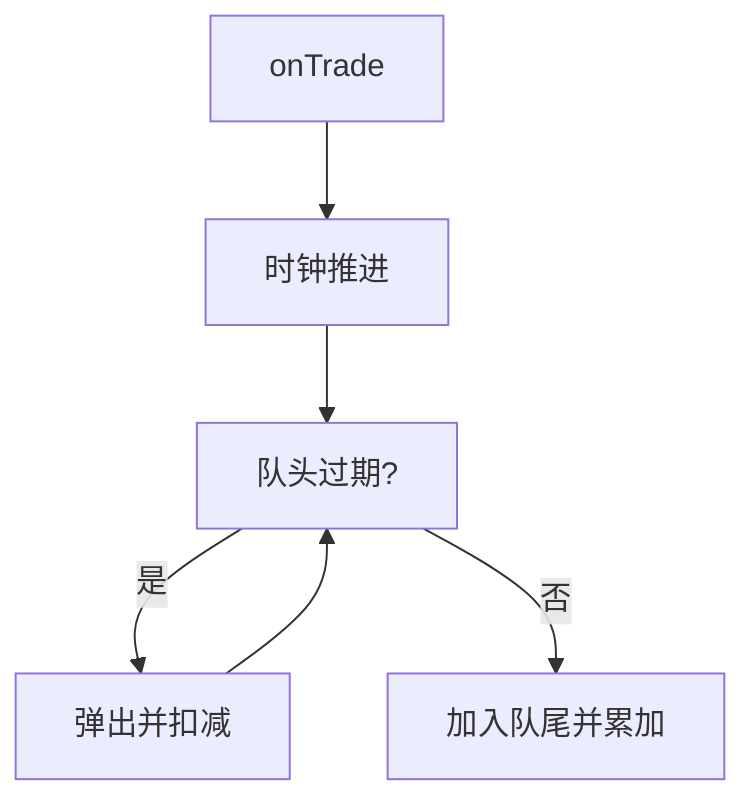

# hc14 · Trade Log → VWAP（成交日志、滑动窗口 VWAP、top-k、字节级解析）—— 讲义

> 读者：会基本 Java（类、方法、循环、`List` / `HashMap`）。覆盖：定点数解析、坏行规则、VWAP 舍入、滑动窗口的摊还 O(1)、窗口内 top-k、百万行的零分配解析。

---

## 1. 问题是什么

### 1.1 日志长什么样

交易系统把每笔成交写成一行：

```
ts_ms,symbol,price,qty
1000,AAPL,187.25,100
```

时间戳（毫秒）、代码、价格（十进制字符串）、数量。你要做四件事：

1. **读日志**：按代码汇总笔数、成交量、名义金额、VWAP、最低价、最高价；坏行跳过并计数。
2. **流式化**：成交一笔一笔到达，只看最近 W 毫秒，随时回答某个代码的 VWAP。
3. **窗口内排名**：名义金额最大的前 k 个代码。
4. **提速**：一百万行日志，不建 `String`、不用正则、不装箱。

### 1.2 VWAP 是什么

VWAP（volume-weighted average price，成交量加权平均价）= Σ(价格 × 数量) / Σ数量。例：先成交 100 股 @ 10 元，再成交 300 股 @ 12 元，简单平均是 11，VWAP = (1000 + 3600) / 400 = 11.5。大单的价格权重大，所以 VWAP 才代表「大家实际成交在哪」。

分子 Σ(价格 × 数量) 叫**名义金额**（notional）。

### 1.3 为什么价格不能用 `double`

`0.1 + 0.2 != 0.3`：二进制浮点数存不准十进制小数。同一个价格 `187.3` 也可能因运算顺序不同得到两个略有差别的 `double`，比较相等就不可靠；累加百万笔更会积累误差。金额用整数。

**定点数**（fixed-point）：把价格乘以 10000 存成 `long`，`187.25` → `1_872_500`，单位是 0.0001。价格 × 数量 仍是整数（单位 0.0001），VWAP 的结果也用同一个单位。输出时再格式化回小数。

---

## 2. 前置知识

### 2.1 摊还复杂度（amortised）

「每次操作 O(1)」有两种含义：每次真的 O(1)，或者**平均**下来 O(1)。滑动窗口里一次 `onTrade` 可能要弹出很多过期成交，看起来是 O(n)；但每笔成交**最多入队一次、出队一次**，n 笔成交总共做 O(n) 次出队，平均每笔 O(1)。这就叫摊还。

### 2.2 队列（FIFO）与 `ArrayDeque`

成交按时间到达，最老的最先过期——先进先出。`ArrayDeque` 的 `addLast` / `getFirst` / `removeFirst` 都是 O(1)。Java 21 起这些方法属于 `SequencedCollection`，「取头、取尾」有统一名字。

### 2.3 堆与「大小为 k 的最小堆」

取最大的 k 个：用**最小堆**，堆里只留目前最好的 k 个，堆顶是其中最差的「守门员」。新元素比守门员差就丢掉，比它好就替换。每个元素最多 O(log k)。为什么用最小堆而不是最大堆：你要随时能找到并踢掉最差的那个。

### 2.4 整数溢出

`long` 只有 64 位。`price × qty` 最大可到 10^13 × 10^12 = 10^25，远超 `Long.MAX_VALUE`（约 9.22 × 10^18）；Java 的 `*` 溢出时**静默回绕**成一个错误的（可能是负的）数。`Math.multiplyExact` / `Math.addExact` 溢出时抛 `ArithmeticException`。这里：一行乘积溢出 → 当作坏行；汇总累加溢出 → 抛异常。

### 2.5 为什么热路径要避免 `String` 和正则

每行 `line.split(",")` 分配 1 个数组 + 4 个 `String`；`Double.parseDouble` 再分配；正则每次匹配要建 `Matcher`。一百万行就是上百 MB 的垃圾，GC 忙起来，延迟毛刺。低延迟代码的做法：直接在字节上扫，状态放在局部变量和预分配的数组里。

---

## 3. 先把规则写下来

面试里最容易丢分的是「没把规则说清楚就开写」。动手前先写下：

| 问题 | 约定 |
|---|---|
| 一行必须有几个字段 | 恰好 4 个，恰好 3 个逗号，不 trim |
| 时间戳 | 1–18 个 `0`–`9` |
| 代码 | 1–10 个字符，`A`–`Z`、`0`–`9`、`.` |
| 价格 | `D{1,9}` 或 `D{1,9}.D{1,4}`，值 > 0 |
| 数量 | 1–12 个 `0`–`9`，值 > 0 |
| 乘积 | 装不进 `long` → 坏行 |
| 空行 | 长度 0：跳过，不计数；只含空白：坏行 |
| VWAP 舍入 | 四舍五入，半数向上 |
| 汇总溢出 | 抛 `ArithmeticException` |

为什么这样定：代码最长 10 个字符、字母表 37 个，每字符 6 位，刚好 60 位，能打包进一个 `long`（Part 4）；价格整数部分 ≤ 9 位、小数 ≤ 4 位，价格定点值 < 10^13；数量 ≤ 12 位。有了上限，才好论证「会不会溢出」。

---

## 4. 一步一步写

### 第 1 步：解析价格

不用正则、不用 `Double`：逐字符扫。

```java
public static OptionalLong parsePrice(String s) {
    int n = s.length(), i = 0, intDigits = 0;
    long whole = 0;
    while (i < n && isDigit(s.charAt(i))) {
        whole = whole * 10 + (s.charAt(i) - '0');
        i++;
        if (++intDigits > 9) return OptionalLong.empty();     // 整数部分最多 9 位
    }
    if (intDigits == 0) return OptionalLong.empty();           // ".5"、"" 都不行
    long frac = 0;
    int fracDigits = 0;
    if (i < n && s.charAt(i) == '.') {
        i++;
        while (i < n && isDigit(s.charAt(i))) {
            frac = frac * 10 + (s.charAt(i) - '0');
            i++;
            if (++fracDigits > 4) return OptionalLong.empty(); // 小数最多 4 位
        }
        if (fracDigits == 0) return OptionalLong.empty();      // "5." 不行
    }
    if (i != n) return OptionalLong.empty();                   // 还有多余字符："1e3"、"1 "
    for (int d = fracDigits; d < 4; d++) frac *= 10;           // "187.3" → 小数部分 3000
    long price = whole * SCALE + frac;
    return price > 0 ? OptionalLong.of(price) : OptionalLong.empty();
}
```

要点：`isDigit` 自己写成 `c >= '0' && c <= '9'`。`Character.isDigit('٣')`（阿拉伯-印度数字）是 `true`，用它会把非 ASCII 数字放进来。

### 第 2 步：解析一行

找三个逗号，且不能有第四个：

```java
int c1 = line.indexOf(',');
if (c1 < 0) return Optional.empty();
int c2 = line.indexOf(',', c1 + 1);
if (c2 < 0) return Optional.empty();
int c3 = line.indexOf(',', c2 + 1);
if (c3 < 0 || line.indexOf(',', c3 + 1) >= 0) return Optional.empty();
```

时间戳和数量用同一个 `digits(line, from, to, maxDigits)` 小函数（长度 1..max 且全是数字，否则 -1）。代码的校验、乘积的溢出检查放进 `Trade` record 的紧凑构造器：

```java
public record Trade(long tsMs, String symbol, long price, long qty) {
    public Trade {
        Objects.requireNonNull(symbol, "symbol");
        if (tsMs < 0) throw new IllegalArgumentException("negative timestamp: " + tsMs);
        if (!validSymbol(symbol)) throw new IllegalArgumentException("invalid symbol: " + symbol);
        if (price <= 0) throw new IllegalArgumentException("non-positive price: " + price);
        if (qty <= 0) throw new IllegalArgumentException("non-positive quantity: " + qty);
        Math.multiplyExact(price, qty);        // 乘积不溢出：之后 notional() 可以放心用 *
    }
    public long notional() { return price * qty; }
}
```

`parseLine` 里 `try { return Optional.of(new Trade(...)); } catch (IllegalArgumentException | ArithmeticException e) { return Optional.empty(); }`——构造器是「合法性的唯一出口」。好处：手里有 `Trade` 就一定合法，后面的代码不用再检查。

### 第 3 步：VWAP 的舍入

要求四舍五入、半数向上。`n / v` 取整后看余数：`r = n % v`，如果 `r ≥ v − r`（余数至少占一半）就加一。

```java
public static long vwap(long notional, long volume) {
    if (volume <= 0 || notional < 0) throw new IllegalArgumentException("...");
    long q = notional / volume, r = notional % volume;
    return r >= volume - r ? q + 1 : q;
}
```

为什么不写 `2 * r >= volume`：`volume` 接近 `Long.MAX_VALUE` 时 `2 * r` 会溢出。`volume - r` 一定在 `[1, volume]` 里，安全。验证：`5 / 2`：`q = 2, r = 1`，`1 ≥ 2 − 1` → 3 ✓；`1 / 3`：`r = 1`，`1 ≥ 2`？否 → 0 ✓；`MAX / 2`：`q = 2^62 − 1`，`r = 1`，`1 ≥ 1` → `2^62` ✓。

### 第 4 步：汇总

```java
var by = new TreeMap<String, Acc>();            // 天然按代码升序
for (String line : lines) {
    if (line.isEmpty()) continue;                // 空行：不算
    var parsed = parseLine(line);
    if (parsed.isEmpty()) { malformed++; continue; }
    var t = parsed.get();
    var a = by.computeIfAbsent(t.symbol(), _ -> new Acc());
    a.volume = Math.addExact(a.volume, t.qty());
    a.notional = Math.addExact(a.notional, t.notional());
    a.count++;
    a.min = Math.min(a.min, t.price());
    a.max = Math.max(a.max, t.price());
    accepted++;
}
```

`Acc.min` 的初值是 `Long.MAX_VALUE`、`max` 初值 0，第一笔就会被覆盖（价格 > 0）。最后每个代码 `new SymbolStats(sym, count, volume, notional, vwap(notional, volume), min, max)`。

手算样例见 problem.md：AAPL 四笔，notional 1_685_150_400，volume 900，VWAP = 1872389.33… → 187.2389。

### 第 5 步：流式化——滑动窗口 VWAP

「只看最近 W 毫秒」最直接的写法：每次查询把所有成交扫一遍，筛 `now − ts < W` 的再算——每次 O(n)。窗口里常驻 10 万笔、每笔都查一次，就是 10^11 步。

改进：**增量维护**。两个结构：

* `ArrayDeque<Trade> live`：活的成交，队头最老；
* `HashMap<String, Acc> bySymbol`：每个代码的 `count` / `volume` / `notional`。



- 过期成交：从队头弹出，在 `bySymbol` 里减掉它的数量和金额，`count` 归 0 就把代码删掉。
- 新成交：队尾加入，累加。
- 查询 VWAP：直接用 `bySymbol` 里的 `notional / volume`，O(1)。

摊还 O(1)：每笔成交入队一次出队一次。

规则要写清楚（也是测试会打的）：

* 活的 ⇔ `now − ts < W`，窗口是 `(now − W, now]`，`now − ts == W` 刚好过期；
* 时钟只进不退，倒退 → `IllegalArgumentException`；**查询也推进时钟**（否则过期的清理没法 O(1)）；
* `onTrade` 里累加可能溢出：**先算出新值（`addExact` 可能抛），再改状态**，抛了就什么也没改；
* 过期的代码要从表里删掉（`liveSymbols` 才对）。

```java
private void advance(long t) {
    if (t < now) throw new IllegalArgumentException("time went backwards: " + t + " < " + now);
    now = t;
    while (!live.isEmpty() && now - live.getFirst().tsMs() >= window) {
        var old = live.removeFirst();
        var a = bySymbol.get(old.symbol());
        a.count--;
        a.volume -= old.qty();
        a.notional -= old.notional();
        if (a.count == 0) bySymbol.remove(old.symbol());
    }
}
```

过期判断写成 `now − ts >= window` 而不是 `ts <= now − window`：前者不会在 `now − window` 上下溢。

### 第 6 步：窗口内 top-k

想取名义金额最大的 k 个代码。最简单：每次查询遍历 `bySymbol`（m 个代码），用大小为 k 的最小堆：

```java
var heap = new PriorityQueue<SymbolNotional>(k + 1, BEST_FIRST.reversed());  // 堆顶 = 保留集合里最差的
for (var e : bySymbol.entrySet()) {
    var cand = new SymbolNotional(e.getKey(), e.getValue().notional);
    if (heap.size() < k) heap.add(cand);
    else if (BEST_FIRST.compare(cand, heap.peek()) < 0) { heap.poll(); heap.add(cand); }
}
```

比较器必须是**全序**：金额降序，金额相同按代码升序，否则并列的顺序不确定：

```java
Comparator.comparingLong(SymbolNotional::notional).reversed().thenComparing(SymbolNotional::symbol)
```

代价 O(m log k) 每次查询。如果查询比成交还频繁，改成维护一个 `TreeSet<SymbolNotional>`，按 (金额 desc, 代码 asc) 排序：每笔成交和每次过期「删旧键、插新键」O(log m)，查询取前 k 个 O(k)。**为什么不能只用堆**：代码的金额会变小（成交过期），堆不支持「改任意元素的键」。

### 第 7 步：百万行，零分配（`FastLog`）

先量一下：`TradeLog.analyze` 对 100 万行大约 100 ms（预热后），看起来不慢——但它每行分配 `substring`、`Trade`、`Optional`……100 万行总共约 150 MB，GC 一忙就有毛刺。字节版的做法：

1. 整个文件读成一个 `byte[]`，用索引 `pos` 扫，不建 `String`。
2. **代码打包**：每个字符映射到 1..37（`A`–`Z`=1..26，`0`–`9`=27..36，`.`=37），每个占 6 位，一个代码 ≤ 10 个字符 = 60 位，装进一个 `long` 当哈希键。不同长度的代码键不同，因为字符编码从不为 0。
3. **开放寻址哈希表**：`long[] keys`（0 = 空槽）+ 并行数组 `count[] / volume[] / notional[] / min[] / max[]`。槽位 `(int) ((key * GOLDEN) >>> (64 − bits))`，冲突线性探测；装填率超过一半就翻倍重哈希。
4. **乘积溢出**用 `Math.multiplyHigh(price, qty) != 0 || price * qty < 0` 判断——不抛异常（坏行很多时异常很慢）。
5. 所有数字用局部 `long` 累加；字符查表 `CODE[b[p] & 0xFF]`——`byte` 有符号，`0xE9` 当下标是负数，要先 `& 0xFF`。
6. 扫完才把键解码成 `String`、按代码排序、产出和 Part 1 完全相同的 `Report`。

解析的主体就是 Part 1 的规则逐字符改写：

```java
while (p < e && digit(b[p])) {            // ts：1..18 位数字
    p++;
    if (++d > 18) return false;
}
if (d == 0 || p >= e || b[p] != ',') return false;
p++;
// symbol：1..10 个合法字符，边读边打包
long key = 0; int len = 0;
while (p < e && b[p] != ',') {
    int code = CODE[b[p] & 0xFF];
    if (code == 0 || ++len > MAX_SYMBOL_LEN) return false;
    key = (key << 6) | code;
    p++;
}
```

**怎么保证快慢两个版本一致**：用随机「改坏」的日志对拍（对每行随机删、改、插一个字符，然后两个版本的 `Report` 必须完全相等）。任何一条语法规则漏掉或写错，对拍几百行就能暴露。

---

## 5. Java 21 特性小课

### `record`（含紧凑构造器）

`Trade`、`SymbolStats`、`Report` 都是 record：一行声明就有构造器、访问器、`equals`、`hashCode`、`toString`。紧凑构造器 `public Trade { ... }` 里写校验，使「非法 `Trade` 构造不出来」。`equals` 按字段，测试可以直接 `assertEquals(new SymbolStats(...), actual)`。不适合：字段会变的类（`Acc` 要累加，所以是普通类）。

### 未命名变量 `_`（Java 21 预览，需 `--enable-preview`）

`by.computeIfAbsent(sym, _ -> new Acc())`：lambda 参数用不到就写 `_`，读的人一眼知道它被忽略。JDK 22 正式。

### `Math.multiplyExact` / `addExact` / `multiplyHigh`

溢出时抛 `ArithmeticException`，而不是回绕。`multiplyHigh(a, b)` 返回 128 位乘积的高 64 位，用于热路径上「不抛异常地判断溢出」。

### Sequenced Collections

`ArrayDeque` 的 `getFirst()` / `removeFirst()` / `addLast()` 属于 `SequencedCollection`；`List.copyOf` 返回不可变快照（`topK` 的返回值）。旧写法取队头 `peekFirst()` 要判 null。

### `String.formatted`、文本块、`Comparator` 组合子

`"%d.%04d".formatted(units / SCALE, units % SCALE)`；多行日志样例用 `"""` 文本块原样写进测试；`Comparator.comparingLong(...).reversed().thenComparing(...)` 一行写出带 tie-break 的全序。

---

## 6. 追问预演

**Q1. 为什么价格不用 `double`？**
浮点存不准十进制小数，累加有误差，相等比较不可靠。用 `long` 定点数：精确、可比较、可做哈希键。代价：要自己管小数位数、舍入、溢出。
说：「金额和价格我用整数最小单位，所有舍入规则显式写出来，所有乘法和累加做溢出检查。」

**Q2. 舍入怎么保证不溢出？**
`q = n / v`，`r = n % v`，`r ≥ v − r` 则 `q + 1`。避免 `2r` 或 `n + v/2`。

**Q3. 窗口里成交乱序到达怎么办？**
约定时间不降，乱序直接拒绝。真实系统：水位线（watermark）+ 允许迟到的时间，水位线之前的丢弃或走补偿；窗口里用按时间排序的结构代替 FIFO，出队 O(log n)。

**Q4. top-k 被频繁查询怎么办？**
维护有序集合（`TreeSet`，键 = (金额, 代码)），更新 O(log m)，查询 O(k)。不能只用堆，因为金额会变小。

**Q5. 一亿行怎么提速？**
先量；`mmap` 或分块读，避免多次拷贝；按行边界切块并行，每块自己一张表，最后合并（笔数 / 数量 / 金额相加，min / max 取极值，满足结合律）；解析可以用 SIMD 找换行与逗号。

**Q6. 坏行很多怎么办？**
计数之外，记前 N 条样本与行号，超过阈值告警或整批拒收；不要静默吞。

**Q7. 为什么 `Trade` 的构造器要检查乘积？**
把「合法」的定义集中在一个地方：拿到 `Trade` 就不用再考虑溢出，`notional()` 可以直接 `price * qty`。

**Q8. 数量为什么不用 `int`？**
单笔数量最多 12 位十进制，已经超过 `int`；累加更要 `long`。

---

## 7. 常见误区

1. **用 `Double.parseDouble` 解析价格。** 精度丢失，且接受 `1e3`、`NaN`、`Infinity`。
2. **`Character.isDigit`。** 接受 Unicode 数字，应该 `c >= '0' && c <= '9'`。
3. **`trim()` 或 `split(",")`。** `trim` 吞掉本该算坏行的空白；`split` 默认丢弃末尾空串，`"1,A,1,"` 看起来只有 3 个字段。
4. **漏检第四个逗号 / 尾逗号。**
5. **乘积不检查。** 回绕成负数或错误的小数，汇总悄悄变错。
6. **VWAP 用 `double` 除法，或 `2 * r >= v`。**
7. **窗口边界差一。** `now − ts == W` 必须过期。
8. **重扫窗口。** 每次查询都 O(窗口)；改成队列 + 增量累计。
9. **先改状态再检查溢出。** 抛异常后状态已经坏了。
10. **代码过期后留空条目。** `liveSymbols` 不对，内存也漏。
11. **top-k 的比较器不是全序。** 并列的代码顺序不确定，测试偶尔红。
12. **（Part 4）`byte` 当下标。** `CODE[b[p]]` 对 `0xE9` 越界；要 `& 0xFF`。
13. **（Part 4）最后一行没有换行就漏处理；符号表不扩容。**
14. **（Part 4）为了快而改了语法。** 快版必须和慢版逐字段一致，用对拍保证。

---

## 8. 自测题

**Q1（手算）** `parsePrice("187.3")`、`parsePrice("0.0001")`、`parsePrice("007.5")` 各是多少？`parsePrice("5.")`、`".5"`、`"0.0000"` 呢？

<details><summary>答案</summary>1_873_000；1；75_000。后三个都是 empty：小数点后没有数字、整数部分为空、值为 0。</details>

**Q2（手算）** `W = 10`。依次 `onTrade(0, A, 1.0000, 1)`、`onTrade(5, A, 3.0000, 1)`，然后 `vwap(A, 9)`、`vwap(A, 10)`、`vwap(A, 15)` 各是多少？

<details><summary>答案</summary>`vwap(A, 9)`：两笔都活（9−0 = 9 < 10），(10000 + 30000) / 2 = 20000（2.0000）。`vwap(A, 10)`：`t=0` 那笔 10−0 = 10 过期，只剩 30000。`vwap(A, 15)`：`t=5` 也过期（15−5 = 10），empty。</details>

**Q3（复杂度）** 为什么 `onTrade` 里的 `while` 循环不会让它变成 O(n)？

<details><summary>答案</summary>摊还：每笔成交只入队一次、出队一次。n 笔成交总共 O(n) 次出队，平均每笔 O(1)。</details>

**Q4（找 bug）** 下面的 `vwap` 有什么问题？

```java
long vwap(long notional, long volume) { return (2 * notional + volume) / (2 * volume); }
```

<details><summary>答案</summary>`2 * notional` 和 `2 * volume` 在接近 `Long.MAX_VALUE` 时溢出。应当用 `q = n / v; r = n % v; r >= v - r ? q + 1 : q`。</details>

**Q5（设计）** 日志有一亿行，只允许一遍扫描，内存只能放得下所有代码的统计。你会怎么做？

<details><summary>答案</summary>字节级流式解析，边读边累加到「代码 → 累计值」的哈希表（代码打包成 `long` 键，开放寻址）；按块并行，每块一张表，最后合并（加法与 min / max 满足结合律）；坏行只计数与抽样记录。</details>

**Q6（边界）** 同一个代码两笔成交，每笔 `1e12 × 9e6 = 9e18`，会发生什么？单笔 `1e12 × 1e7` 呢？

<details><summary>答案</summary>每笔都装得进 `long`（9e18 < 9.22e18），但两笔相加溢出：`analyze` 抛 `ArithmeticException`，`RollingVwap.onTrade` 抛异常且这笔不计入。单笔 `1e12 × 1e7 = 1e19` 在解析阶段就溢出，所以是坏行。</details>

---

## 延伸阅读

* Java 文档：`Math.multiplyExact`、`Math.multiplyHigh`、`ArrayDeque`、JEP 431（Sequenced Collections）、JEP 443（未命名模式和变量，预览）。
