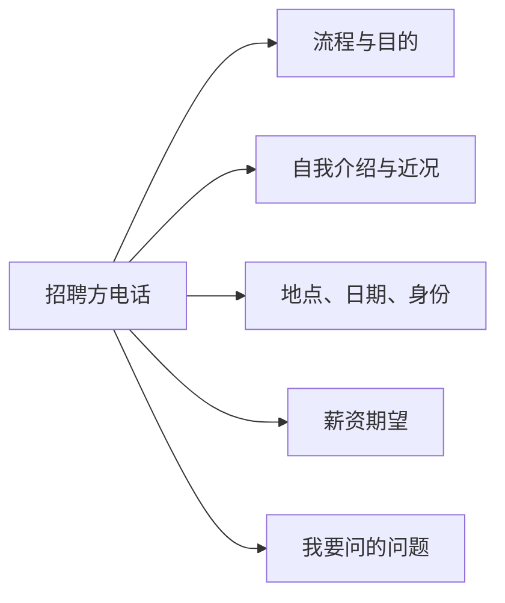

## Q
**这一部分的地图**｜招聘方电话

团队轮之前有一通 30 分钟的招聘方电话（recruiter call）。整通电话要做成什么样？

## A
**一句话。** 周一的电话是第一轮（10 月 5 日，45 分钟编程面）之后、团队轮之前的一次近况确认：对方确认你还想来、能来、条件合得上，你拿到团队轮的形式。

**关键直觉。**
- **这是确认，不是考试：** 技术上第一轮已经过了，这通电话看的是意愿、条件和沟通是否干脆。
- **答案短且英文现成：** 每题 30 秒内，先给结论，再补一句事实。
- **不知道的情况分情形备好：** 在职状态、其他流程、身份这几项，每种情形各有一句英文。
- **结束时必须拿到团队轮信息：** 几轮、每轮多长、考什么、什么时候出结果。
