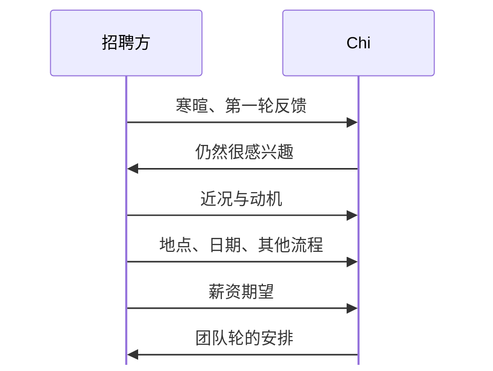

## Q
**电话的目的和节奏**｜招聘方电话

招聘方约你 30 分钟聊一聊（catch-up call），说团队轮由她来安排。这通电话在整个流程里是什么位置，30 分钟怎么用？

## A
位置：第一轮（10 月 5 日的 45 分钟编程面）已经顺利通过，下一步是团队轮（team round，几场连续的面试，形式还没告知）。招聘方负责把你从第一轮送到团队轮，所以这通电话是**流程节点，不是技术面**。

- **前 5 分钟：** 对方开场，你用一句话表态，先把兴趣讲清。
- **中间 15–20 分钟：** 对方逐项确认；你每题先给结论。
- **最后 5–8 分钟：** 轮到你问，拿到团队轮的形式和时间线。

**英文答法。**
- "Thanks for making the time. I really enjoyed the first round, and I'm **still very excited** about the program."
- "I'm happy to go through anything you need, and I have a few questions about the **team round** at the end."
