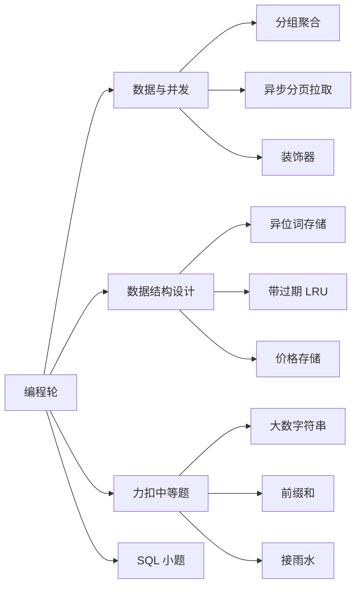

## Q
**编程轮的地图**｜编程轮

Millennium 的编程轮考什么题、有几类？

## A
**一句话。** 45 分钟里的实时编码（前面还有 15 分钟聊背景），题目贴近工作的 Python：数据聚合、异步拉取、装饰器、数据结构设计、价格数据和 SQL，外加几道力扣中等题；允许查语法，要求边写边讲。

**关键直觉。**
- **先简单后推广：** 每题都是先给能跑的基本解，再被追问到规模、并发、变体；先把基本解写对，再谈优化。
- **哈希表加有序结构：** 分组、缓存、前缀和、价格存储，核心都是字典配上排序列表、堆或链表。
- **金额用 Decimal，时间要有序：** 价格题里乱序到达、按时间取"不晚于"的值是常客，浮点数不能用来算钱。
- **边写边讲：** 先确认输入输出和边界，说明为什么选这个结构，写完说复杂度和还能怎么扩展。
