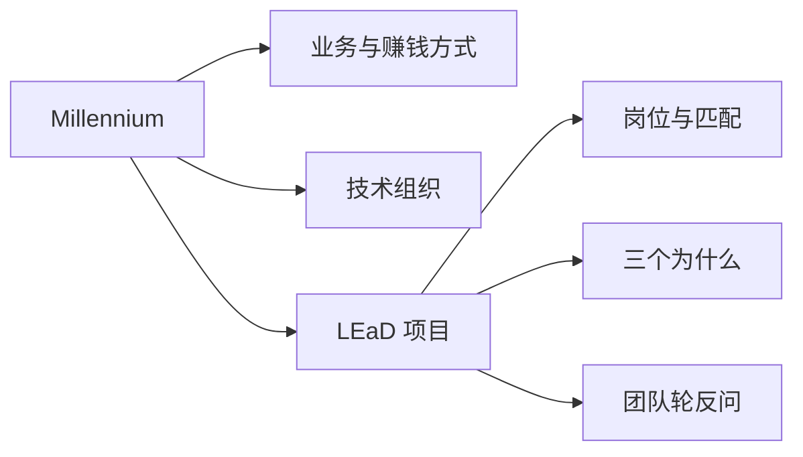

## Q
**这一部分的地图**｜公司与岗位

Millennium 是什么公司，LEaD 项目是什么，你为什么适合、为什么想来？

## A
**一句话。** 先弄懂这家基金怎么运作、技术团队服务谁，再把岗位要求逐条对到你的经历，最后把三个"为什么"说成现成的英文。

**关键直觉。**
- **平台加很多独立团队：** 几百个交易团队（pod）各做各的策略，公司统一提供风险、基础设施和技术；工程师服务的是这些团队。
- **轮岗是为了广度：** 项目让早期工程师接触前台、中台、后台，最后进入一个技术分部。
- **你的证据是同一类问题：** 多方共用、数据要精确的平台，加一个自己做的回测平台。
- **说法要诚实：** 没有金融行业经验就直说，用学得快和严谨来补。
