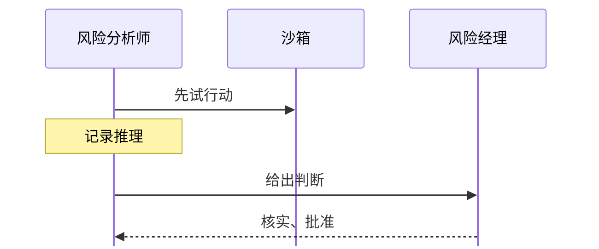

## Q
**AI 实验室与和 Anthropic 共建的数字风险分析师**｜公司与岗位

Millennium 2026 年在 AI 上做了什么？"数字风险分析师"是什么，有哪些控制？

## A
- **AI 实验室（2026 年 6 月）：** 首席信息官 Vlad Torgovnik 宣布成立内部 AI 实验室：基础设施和生产环境分开，提前评估 AI 产品，和 AI 公司共同开发，不局限在一个城市。
- **和 Anthropic 合作（2026 年 8 月）：** 双方在这个实验室里共同开发一个数字风险分析师。Anthropic 的团队和 Millennium 的技术、风控团队一起做。
- **它做什么：** 一个受监督的 AI 同事，帮风险经理分析风险头寸、解释每天的风险变化、对各资产类别的风险暴露形成判断；跨多次对话记住信息。
- **控制：** 记录自己的推理过程；行动先在沙箱里测试；它的决定要由人类风险专家评估和批准；结论由风险经理核实和补充。
- **已经在用的：** Claude 和 Claude Code 在 Millennium 用得很广，从交易台、工程到业务部门，包括 340 多个投资团队中的很多个。

**工程看点。** 这是"受监督的智能体"：权限最小、每一步可审计、高风险动作要人批准、上线前在沙箱里评估。

**英文答法。**
- "I read about the **digital risk analyst** with Anthropic: a supervised agent that **logs its reasoning**, tests actions in a **sandbox**, and needs **human approval**."
- "That's the pattern I'd use for any agent touching money: least privilege, an audit trail, and evaluation before it acts."
