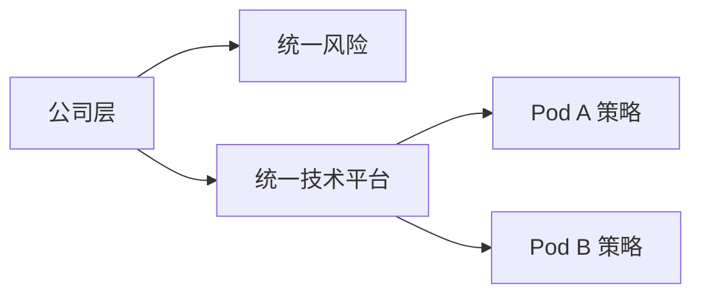

## Q
**pod 结构与工程**｜公司与岗位

"Do you understand our multi-manager / pod structure?"

## A
这是招聘方和面试官都爱问的题，检查你有没有做功课。30 秒讲出：pod 做什么、公司层统一什么、技术在哪个位置。

- **工程的三个要求：** 数据要准、系统要快、要可靠；这是 pod 之间共用的底座。
- **你的类比：** 一条手续费管线服务所有商户，也必须精确。

**英文答法。**
- "Hundreds of **independent pods** each run their own strategy and risk, while the firm provides **centralized risk and technology**."
- "Technology teams serve the **front office** pods and the middle and back office."
- "The LEaD rotation across all three is what I'm after."
