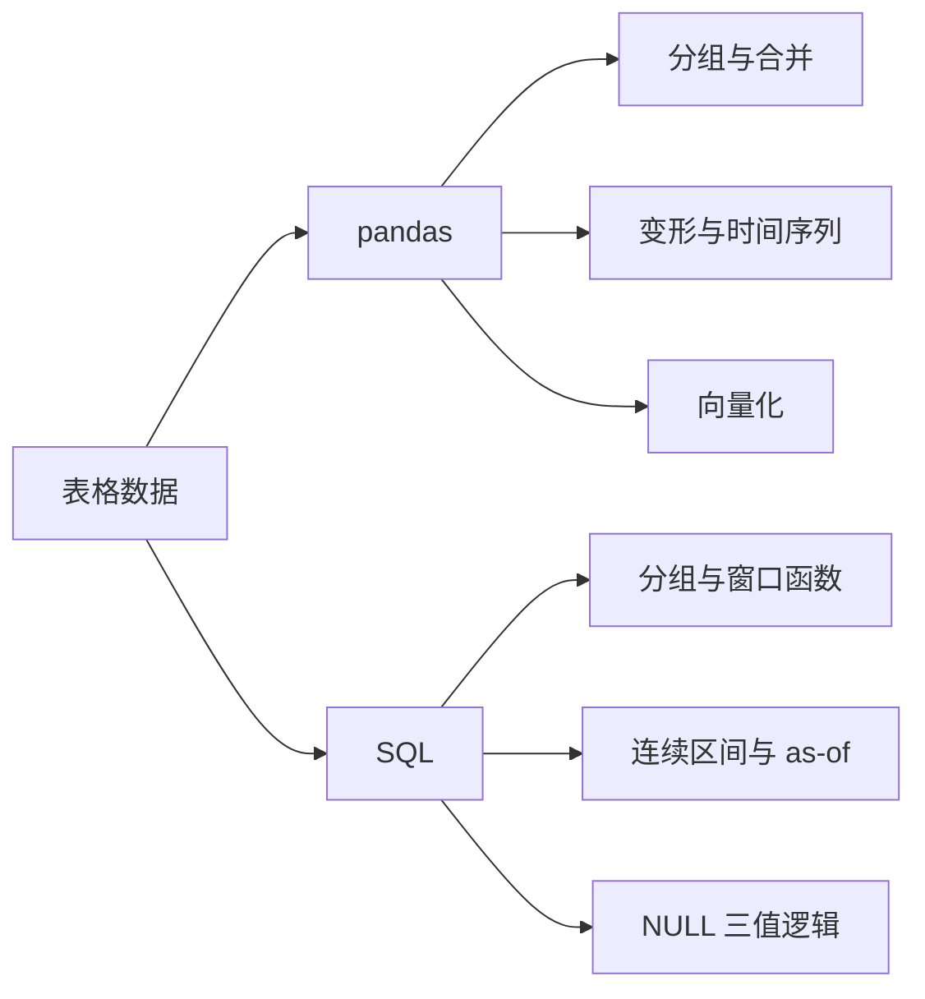

## Q
**这一部分的地图**｜数据处理：pandas 与 SQL

岗位要求会用 pandas 和 NumPy，第一轮报道里有"百万行数据按 id 分组求和"，也有 SQL 小题。这两件事怎么归到一起复习？

## A
**一句话。** 两边做的是同一类事：把一张表按某个键分组、汇总、对齐、按时间排队；pandas 在内存里做，SQL 在数据库里做，每个操作两边几乎一一对应。

**关键直觉。**
- **先想键：** 每道题先问"按什么分组、按什么对齐"，再写代码；多数错误出在键重复或键里有空值。
- **悄悄出错比报错更危险：** 重复键让行数变多、NULL 让结果变空、没排序让 as-of 错位，程序都不崩，只是数字不对。
- **规模靠分块和向量化：** 数据大了，先分块聚合再合并，或整列运算代替逐行循环。
- **边写边讲：** 动手前先说输入输出的样子，再说一个可能踩的坑。
