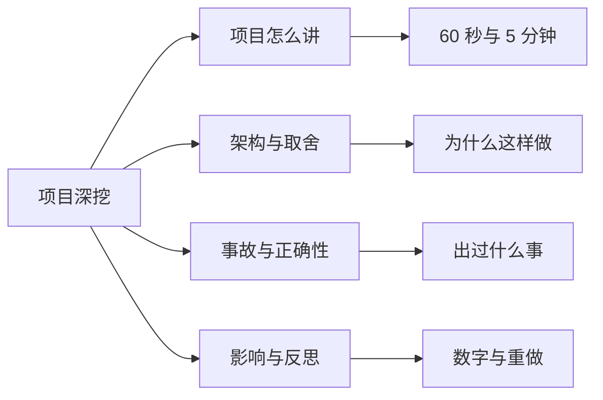

## Q
**这一部分的地图**｜项目深挖

面试官让你“挑一个项目讲讲”，之后会怎么一层层往下问？你手上有哪几个项目？

## A
**一句话。** 项目深挖整轮就围着简历上的一两个项目转：先让你讲，再问架构、取舍、规模、出过什么事、数字、重做会改什么。你备好四个项目，每个都能讲 60 秒版和 5 分钟版，并且每一层追问都有一句话的答案。

**关键直觉。**
- **四个主力项目：** Quant-Stroller 回测平台（自己做的研究平台）、Amex 结算管线（最重的生产系统）、interchange 数据源切换（迁移与验证）、质检框架（平台化）。
- **每答的顺序：** 先一句话结论，再机制，再“我决定了什么”，再量级，最后学到什么，90 秒内。
- **三层追问：** 为什么这样做、有哪些替代、怎么出的错；讲不出取舍就是流水账。
- **边界要主动说：** 哪部分是你的、哪部分是同事的、数字是什么口径，主动讲比被问出来强。
