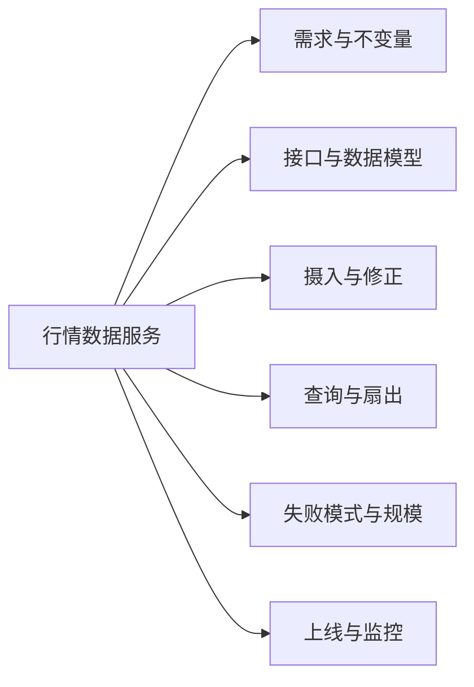

## Q
**设计轮的地图**｜设计轮

设计轮考什么、这道行情数据题是怎么拆开的？

## A
**一句话。** 设计轮给一个开放的系统设计题，45 分钟里要主动推进：先复述题目并说出不变量，再讲接口、数据模型、主路径，最后讲失败情形、规模和上线；这道题是编程轮"价格数据存储"的系统版，要把单机的逻辑拆成能服务几百个交易团队的分布式服务。

**关键直觉。**
- **先说不变量：** 历史查询绝不能看到未来，迟到的修正不能抹掉历史；这两条同时成立，才决定了数据模型是双时间加追加。
- **按失败模式拆层：** 文件重投和流断线是两种失败，所以摄入分两条路径；热路径和历史路径访问模式不同，所以分开。
- **自己推进：** 面试官很少给反馈，要主动提出规模假设，主动往失败模式的方向讲。
- **取舍说得出：** 正确性优先于存储成本，说明你知道代价在哪。
