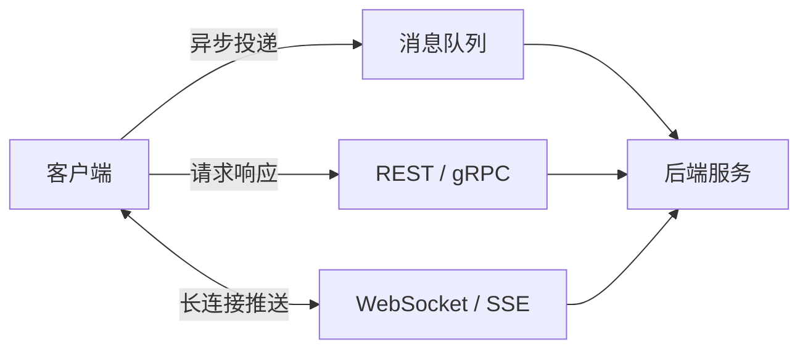

## Q
**客户端与服务之间用什么协议通信：怎么选**｜设计轮

客户端（浏览器、手机，或公司内别的服务）要和后端服务通信。REST、gRPC、WebSocket / SSE 和消息队列，各适合什么场景，你怎么选？

## A

先问一个问题：谁发起、要不要立刻拿到结果、数据是一次还是持续不断。

- **REST（HTTP + JSON）：** 请求响应，一问一答；任何语言、浏览器和 `curl` 都能用，容易缓存和调试。适合对外的 API、增删改查。代价是 JSON 文本体积大，每次请求都带头部，不适合高频内部调用和推送。
- **gRPC：** 基于 HTTP/2，二进制的 protobuf（带类型的接口定义，先写 `.proto` 文件再生成代码），长连接上多路复用，延迟低、体积小，还支持流式调用。适合服务之间的内部调用。代价是浏览器不能直接调用，要经代理，调试也没有 REST 直观。
- **WebSocket：** 一条长连接上双向随时发消息，服务端能主动推。适合行情推送、聊天、协同编辑。代价是连接有状态：负载均衡要做粘性，断线要自己重连、补发错过的数据。
- **SSE（Server-Sent Events，服务端事件）：** 只有服务端到客户端的单向推送，跑在普通 HTTP 上，浏览器内置自动重连。只需要推给客户端时比 WebSocket 简单。
- **消息队列（如 Kafka、RabbitMQ）：** 生产者把消息放进队列就返回，消费者之后再取；生产者和消费者互相不用同时在线，也可以多个消费者各读一份。适合异步任务、削峰、把一份数据分发给很多下游。代价是调用方拿不到即时结果，要处理重复投递和顺序。

**选择规则。** 要立刻拿结果就用请求响应：对外 REST，内部 gRPC；服务端要持续推数据就用 WebSocket 或 SSE；调用方不需要等结果、或者要分发给很多下游，就进消息队列。一个系统通常几种并用。

**英文答法。**
- "First I ask who initiates, and whether the caller needs the **result right away**."
- "**REST** for public APIs, **gRPC** for internal service calls, **WebSocket or SSE** for server push, and a **message queue** when the caller doesn't need to wait."
- "For a market data service, I'd push prices over WebSocket and put corrections and fan-out through a queue."
