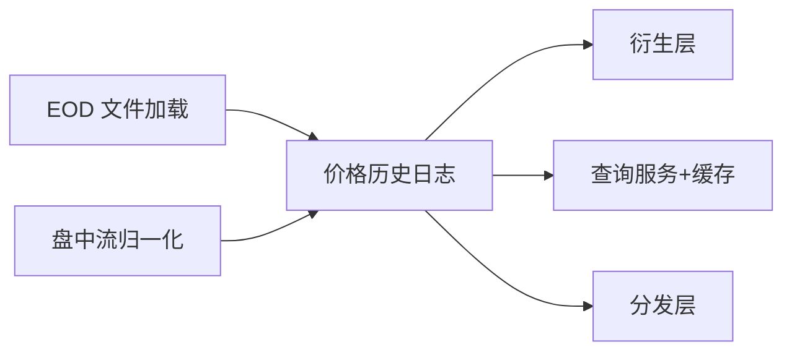

## Q
**高层设计**｜设计轮

行情与价格数据服务（供应商文件和流进来，几百个 pod 和风控系统读和订阅）：高层有哪些组件，每条路径怎么走？

## A

- **摄入层：** 两条各自独立的路径。文件路径会遇到重投，流路径会遇到断线重连，失败模式不同，不共用容错逻辑。每个供应商的解析是配置驱动的，不是每接一家就写一段新代码；两条路径都归一化成同一种内部记录再写入。
- **存储层：** 追加式（append-only）的价格历史日志，记录不可变，是唯一的事实来源（source of truth）；按 symbol 和 `knowledge_time` 有序，只管持久化和读取，不关心数据来自文件还是流。
- **衍生层：** OHLC、VWAP 和币种换算，对存储做无状态的读时计算，不回写；换聚合算法不动存储和摄入。
- **查询服务：** `GET_LATEST` 走最新价缓存，命中即返回，未命中回源到日志；`GET_AS_OF` 跳过缓存，直接在历史层查；不感知供应商细节，新增供应商不用改这一层。
- **分发层：** 尾随写日志，把变更推给订阅的 pod 和风控；和摄入层之间只有"读日志"一个耦合点，慢订阅方不会反压写入。

**关键分离。** 最新价是高频热路径，要快；历史查询是风控偶发的回溯，要准、可复现。两者物理上不共享索引和计算资源，互不拖累。

**英文答法。**
- "Ingestion has **two independent paths**, files and streams, because their failure modes differ."
- "The append-only log is the **single source of truth**; everything else is derived from it."
- "Distribution just **tails the log**, so a slow subscriber can't back up the write path."
