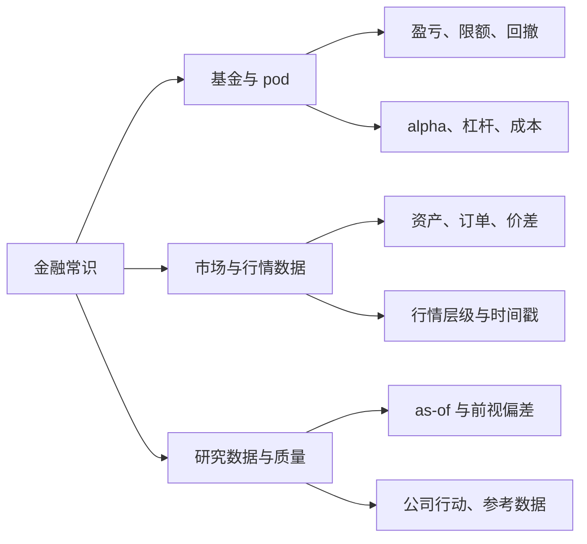

## Q
**金融常识的地图**｜金融常识

面试官会拿哪些金融词来聊业务？一个数据工程师需要懂到什么程度？

## A
**一句话。** 轮岗项目看的是你对金融的兴趣，不考定价公式；要能把行情、订单、盈亏、回测这些词用平实的话讲清楚，并说出它们对数据工程意味着什么。

**关键直觉。**
- **每个词都落到数据：** 盈亏要正确的价格和汇率，风控要新鲜的仓位，研究要时点正确的历史。
- **时间是主线：** 价格什么时候生效、系统什么时候知道，是行情数据里最容易出错的地方。
- **正确与可复现优先：** 基金按风险和回撤管理 pod，数据错了或事后改了，风控和回测都会失真。
