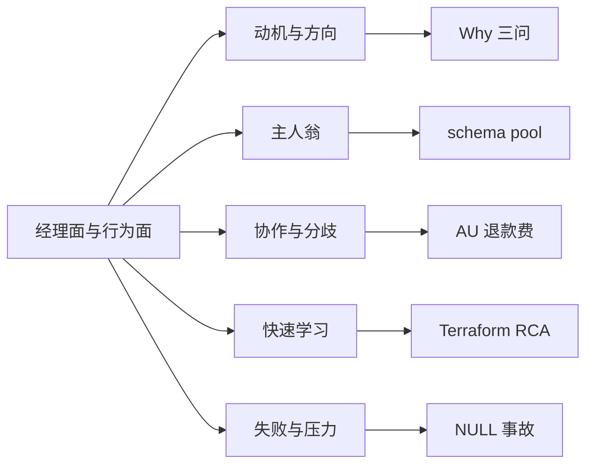

## Q
**这一部分的地图**｜经理面与行为面

经理面和团队轮的行为题，一共分哪几块？每块用你的哪件事来答？

## A
**一句话。** 经理面听的是你这个人：动机是否具体、做事有没有主人翁意识、和人合作怎么处理分歧、能不能快速学新东西、出事时怎么办。每类题你只需要手上有一两件真事，用同一套 STAR（情境、任务、行动、结果）说出来。

**关键直觉。**
- **一件事答多题：** 同一件事换个角度能答好几类题，所以准备的是十件左右的事，不是十几个答案。
- **说“我”不说“我们”：** 面试官在听你本人做了哪一步、做了什么决定；不是你的部分要主动说清楚是同事做的。
- **数字用原口径：** 只说有出处的量级，说不准的就说量级（几千万笔、数十亿美元），不报精确数。
- **先结果后细节：** 开口第一句就是结论，每个回答控制在 60 到 90 秒，细节等追问再给。
