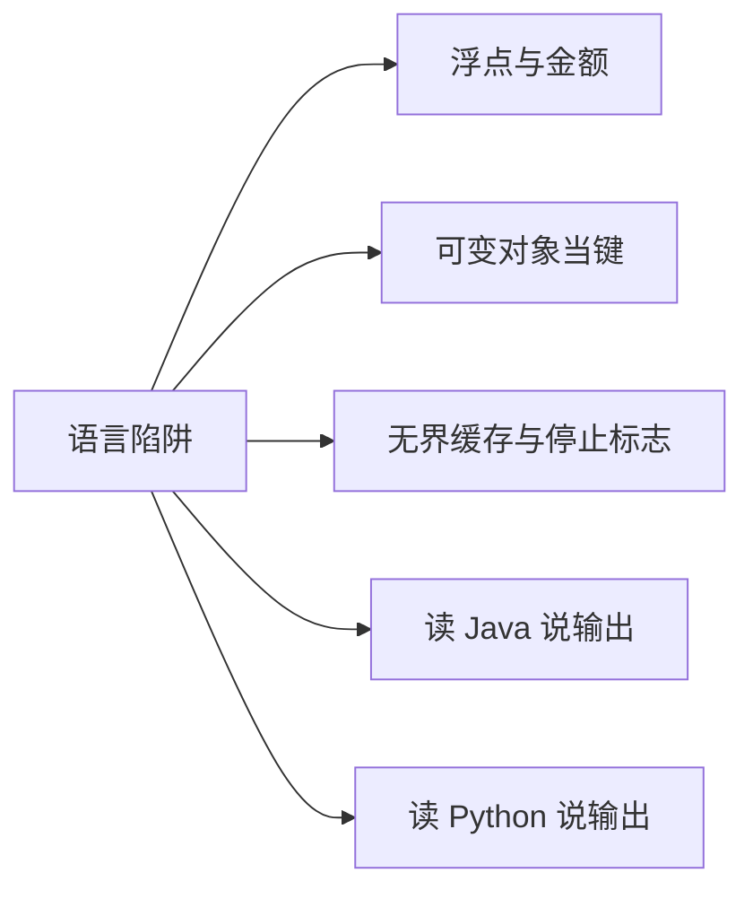

## Q
**这一部分的地图**｜语言陷阱与读代码

面试里面试官贴一段短代码，问"输出什么"或"这里有什么问题"。这类题考什么、有哪几类？

## A
**一句话。** 这类题考你对语言规则的掌握，不考算法：给 10 行以内的代码，你逐行追踪、说出输出，并指出规则和修法；同一类陷阱在 Java 和 Python 里各有一份。

**关键直觉。**
- **先追踪再回答：** 在草稿上按行记下每个变量的值，不凭感觉猜；说出口的是"第几行之后变成什么"。
- **每个陷阱背后只有一条规则：** 二进制表示、哈希桶位置、对象缓存、传值、晚绑定、共享引用；说出规则比说出输出更重要。
- **输出之后补修法：** 面试官的下一句通常是"那怎么改"，每张卡的"记住"一行就是修法。
- **并发题不要硬报输出：** 可见性问题的结果没有保证，说"不保证"并给出 volatile 或 Event。
