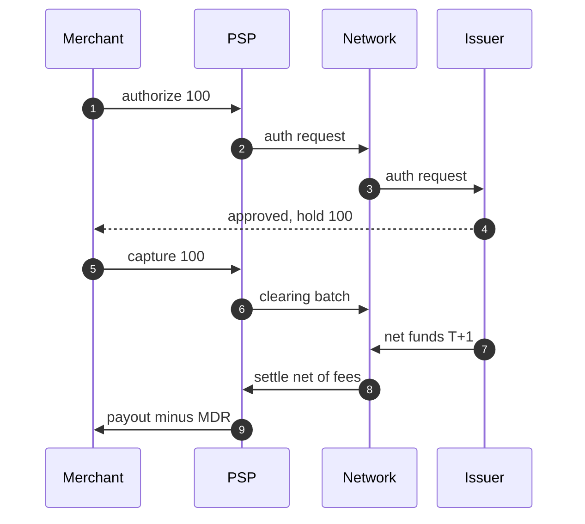

# 支付领域知识：Global Payment 面试官默认你懂的东西

Global Payment 是 ByteDance 在中国以外所有业务共用的支付平台：替 TikTok Shop、LIVE、广告、订阅收钱（收单，pay-in），把钱付给卖家和创作者（出款，pay-out），并负责支付方式管理、换汇、记账、对账和交易监控。Financial Product and Solution 组在这之上做消费金融：先买后付（PayLater）、消费信贷、保险、TikTok Pay 钱包。面试官不会从「什么是支付」讲起，他默认你懂下面七件事，并会在简历拷问和设计题里随手用到。每一节先从零讲清概念，再给面试里要说出口的判断，最后指向更深的页面或卡组。

## 这个组管的钱

| 业务 | 钱从哪到哪 | 最难的地方 |
|---|---|---|
| 收单（acquiring） | 买家 → 渠道 → 平台 | 渠道超时、回调重复、多渠道路由 |
| 出款（disbursement） | 平台 → 卖家 / 创作者的银行或钱包 | 绝不重复付、退票几天后才回来、合规拦截 |
| 换汇（FX） | 一种货币 → 另一种 | 汇率锁定、取整、汇兑损益 |
| 记账与对账 | 不动钱，记录钱 | 内部账、渠道账、银行流水三方一致 |
| 消费金融 | 资金方 → 买家（借），买家 → 资金方（还） | 分期计划、计息、逾期、授信 |

一个贯穿所有业务的区分：**信息流**（information flow，「谁欠谁多少」的记录，实时走）和**资金流**（capital flow，真正的钱在银行账户之间移动，隔一到几天才动）。「支付成功」是信息流的结论，「钱到账」是资金流的结论，二者之间的时间差就是对账和资金头寸要处理的东西。

## 1. 钱怎么流：授权、请款、清算、结算

一笔卡支付牵涉五方：**持卡人**；**商户**；**收单行**（acquirer，替商户收钱的银行，平台通常通过支付服务商 PSP 接入它）；**卡组织**（card network，Visa / Mastercard，负责转发消息和清算）；**发卡行**（issuer，给持卡人发卡、最终出钱的银行）。

一笔交易分四步：

- **授权**（authorization）：发卡行检查卡和额度，同意后在持卡人账户上**冻结**这笔钱（auth hold），钱并没有动。授权几天后会过期。
- **请款**（capture）：商户确认要收这笔钱（电商常在发货时请款），授权变成真正的扣款请求。只授权不请款可以撤销（void），不产生费用。
- **清算**（clearing）：收单行把一批请款明细经卡组织发给发卡行，双方对齐「谁欠谁多少」。
- **结算**（settlement）：钱真正划拨，通常 T+1 或 T+2（交易日之后一到两个工作日），按净额：发卡行付给卡组织，卡组织付给收单行，收单行扣掉费用付给商户。

1. 商户在结账时发起授权，金额 100。
2. PSP（代表收单行）把授权请求发给卡组织。
3. 卡组织转给发卡行。
4. 发卡行批准并冻结 100，结果经卡组织、PSP 回到商户（图上合成一步）。
5. 发货时商户请款。
6. PSP 把当天的请款汇成一批清算明细。
7. 第二个工作日，发卡行按净额把钱付给卡组织。
8. 卡组织扣掉自己的费用后结算给收单行 / PSP。
9. PSP 扣掉商户扣率（MDR，merchant discount rate）后付给商户。

费用藏在第 7–9 步：**交换费**（interchange，收单方付给发卡行，按卡种、商户类别、地区而不同）+ **卡组织费**（scheme fee）+ **收单加价**。把三项分开报给商户叫 IC++，打包成一个费率叫混合定价（blended）。你在 PayPal 做的 interchange 数据源切换，就是在算第一项。

**闭环卡**（closed-loop，例如 Amex）自己既是卡组织又是发卡行，消息和结算都不走 Visa / Mastercard 的标准报表，常常每天一个结算文件；在文件确认之前不能入账，这叫「钱到了才算」（good-funds model）。

出款（pay-out）是反方向：平台把卖家余额换成打款单，经银行转账、本地实时支付或钱包发出。它的难点是**不可撤回**：付出去的钱很难追回，所以打款前要过合规检查（KYC、制裁名单），打款单要有唯一键，超时要当作「结果未知」去查询，而不是重发。

- **面试里要说出口**：「支付成功」只是授权或请款成功；商户拿到钱在 T+1 到 T+N 之后；中间这段时间钱在渠道和卡组织那里，平台账上记的是一笔**应收渠道款**。
- **深入**：[[domains/payments/map/landscape.money-vs-info|信息流与资金流]] · [[domains/payments/map/card-lifecycle.capture-clearing-settlement|请款、清算与结算]] · [[domains/payments/map/card-lifecycle.fees|交换费与商户定价]] · [[domains/payments/map/payouts.payout-flow|打款流程]] · [[sd10-creator-payouts]]

## 2. 账本与复式记账

最朴素的做法是给每个用户一个余额字段，付钱时减、收钱时加。它有三个致命问题：改错了无法追溯；两次更新之间崩溃，钱凭空出现或消失；没有办法证明总账是平的。

**复式记账**（double-entry bookkeeping）的规则：每一次资金变动写成一条**分录**（journal entry），分录至少有两条**腿**（posting），一借（debit）一贷（credit），**借贷金额相等**。账户分五类，各有自己的「正常方向」：资产和费用借方增加；负债、权益和收入贷方增加。用户钱包里的钱是平台**欠用户的**，所以是负债。

一个例子：用户用卡充值 100 美元，PSP 收 2.9% + 0.30 的手续费，第二天净额结算。

| 事件 | 借（Dr） | 贷（Cr） |
|---|---|---|
| 充值成功 | 应收 PSP 款（资产）100.00 | 用户钱包（负债）100.00 |
| PSP 结算 | 银行存款（资产）96.80；支付手续费（费用）3.20 | 应收 PSP 款（资产）100.00 |
| 用户送礼 30 | 用户钱包（负债）30.00 | 主播待结算（负债）30.00 |

几个设计决定和它们的原因：

- **只追加，不修改**（append-only）：写错了就再写一条**冲正分录**（reversal），把原分录的每条腿反向记一次，然后写正确的分录。原因：下游可能已经读过错的状态，只有新分录能让所有人看到「错了、改了、改成什么」。
- **余额是推导出来的**：余额 = 该账户所有分录腿之和。为了读得快可以缓存余额，但缓存必须和分录在同一个事务里更新，并能随时从分录重算核对。
- **可用余额 ≠ 账面余额**：冻结（hold）把一部分余额标为不可用，例如打款处理中、风控审核中。可用余额 = 账面余额 − 冻结。
- **热点账户**：平台手续费收入这类账户每秒被几万笔分录写，单行余额会成为锁热点。做法：只追加分录、余额按时间片或分片汇总，读时取快照加增量。
- **应收 / 清算账户应该归零**：「应收 PSP 款」在 PSP 结算后应该回到 0；不为 0 的部分就是对账要解释的差异。

- **面试里要说出口**：所有分录的借方合计等于贷方合计；任何账户的余额都能从分录重算；纠错只靠新分录。
- **深入**：[[domains/payments/map/ledger.double-entry|复式记账]] · [[domains/payments/map/ledger.accounts-postings|账户与分录的数据模型]] · [[domains/payments/map/ledger.balances-holds|余额与冻结]] · [[domains/payments/map/ledger.immutability|不可变账本与冲正]] · [[sd09-wallet-ledger]] · [[07-class-design]] 的复式账本

## 3. 幂等键

网络会超时，客户端会重试，消息队列至少投递一次（at-least-once），回调会重复。支付系统不能指望「只发一次」，只能让「同一个请求做多少次都只产生一次效果」，这就是**幂等**（idempotency）。

**幂等键**（idempotency key）是调用方为一次业务意图生成的唯一字符串（例如每次点击「支付」生成一个），随请求一起发送。服务端的标准做法：

1. 在幂等键表上用**唯一约束**插入 `(调用方, 键)`，记下请求内容的指纹和状态「处理中」。插入失败说明这个键见过。
2. 见过的键：指纹不同 → 拒绝（同一个键不能用于不同请求）；还在处理中 → 让对方稍后重试；已完成 → **原样返回上次保存的结果**，不再执行。
3. 执行业务、写账本、保存结果，三者在**同一个数据库事务**里；需要调外部的步骤用 outbox（先把「要发的消息」和业务数据写进同一个事务，再由后台投递）。

支付链路上有三层幂等，缺一层就会双扣：

| 层 | 谁重试 | 靠什么去重 |
|---|---|---|
| 商户 / 客户端 → 平台 | 用户双击、客户端超时重发 | 调用方传来的幂等键 |
| 平台 → PSP | 平台自己的重试 | 平台生成、传给 PSP 的幂等键（或订单号） |
| 崩溃窗口 | 进程在两步之间挂掉 | 先记意图再动手，恢复任务用同一个键重放 |

最容易答错的一点：**调 PSP 超时不等于失败**。PSP 可能已经扣了款，只是响应丢了。正确做法是把支付标为「结果未知」（unknown），用同一个键去查询或重试，等到有定论再推进状态；直接当失败重新下单就是双扣。

- **面试里要说出口**：at-least-once 投递 + 幂等处理 = 效果上只有一次（effectively-once）；唯一约束是最后一道防线；超时是 unknown。
- **你的例子**：S1 三层幂等（文件加载历史、`MERGE` 键、错误日志）；S11 消费侧落库前去重 + 唯一约束兜底。
- **深入**：[[domains/payments/map/correctness.idempotency|幂等与幂等键]] · [[domains/payments/map/correctness.unknown-outcomes|超时与未知结果]] · [[domains/payments/map/correctness.distributed-transactions|outbox、SAGA 与 TCC]] · [[tiktok-idempotency-transactions]] · [[sd01-payment-system]]

## 4. 对账

同一笔钱在三处各有一份记录：**内部账本**、**渠道（PSP）的交易和结算报告**、**银行流水**。三份记录由不同系统独立产生，任何一处的 bug、延迟或人工操作都会让它们不一致。对账（reconciliation）就是定期拿独立的记录互相核对，在差异变成资金损失之前发现它。

**三方对账**（three-way reconciliation）分两段：内部账本对渠道报告（每一笔交易对得上吗），渠道结算总额对银行到账（渠道说付了的钱真的到了吗）。

匹配和差异处理：

- **匹配键**：先按交易号精确匹配；渠道报告只有批次号时按批次总额匹配。每一行最多匹配一次。
- **差异分类**：我们有、渠道没有（可能是渠道漏报，或我们记了一笔并没成功的交易）；渠道有、我们没有（钱扣了但订单还是未支付，最危险）；两边都有但金额或状态不同。
- **时间差**：跨午夜的交易、T+N 结算会造成「暂时性差异」，先放进缓冲期，下一轮还对不上才升级。
- **处理**：差异变成一个工单（case），查明原因后写**调整分录**，不改原记录；能安全自动修复的（例如补单）自动修，涉及退款的人工复核。
- **规模**：每天 1,000 万笔订单也不需要逐行比对数据库：把两边按交易号分片、排序，再像归并一样双指针流式比对，内存只放一个分片。

- **面试里要说出口**：对账用的必须是**独立来源**的数据；差异有分类、有时限、有负责人；修正只写新分录；应收渠道款应该归零。
- **你的例子**：S1 用 Amex 自己发来的汇总记录核对费用总额，不一致就停任务并呼叫值班；S5 用全外连接逐字段比对两个数据源，>99.9% 一致，剩下的差异全部解释清楚。
- **深入**：[[domains/payments/map/reconciliation.why-reconcile|为什么必须对账]] · [[domains/payments/map/reconciliation.three-way|三方对账]] · [[domains/payments/map/reconciliation.matching|对账匹配与差错处理]] · [[domains/payments/map/reconciliation.settlement-cash|结算周期与资金头寸]] · [[sd11-reconciliation-system]]

## 5. 退款与拒付

**撤销**（void）、**退款**（refund）和**拒付**（chargeback）都把钱还给买家，但发起人和代价不同。

- **撤销**：授权后、请款前取消，冻结解除，通常不产生费用。
- **退款**：请款后由**商户**发起，钱原路退回。可以部分退款、多次退款。不变量：累计退款 ≤ 已请款金额。每次退款有自己的幂等键，否则「退款超时重试」会退两次。退款的手续费是否退还，因渠道和合同而不同，这是费用计算里最容易出 bug 的地方之一。
- **拒付**：由**持卡人**向发卡行发起争议（未收到货、未授权交易、货不对板），发卡行经卡组织直接把钱从收单方拉回，再由收单方从商户扣回。商户可以在时限内提交证据**抗辩**（representment），发卡行再裁定。拒付通常还带一笔争议费，拒付率过高的商户会被卡组织罚款甚至停止收单。拒付窗口常见是交易后几个月。

记账上，退款是一条把原分录反向的新分录（商户待结算减少、应付渠道款增加）；拒付在争议开始时先冻结或扣回商户余额，裁定后再决定是否释放。平台型业务（如 TikTok Shop）还要决定拒付损失由卖家、平台还是保险承担，以及给高风险卖家留**保证金**（reserve）。

- **面试里要说出口**：退款也要幂等；部分退款后对账按「原交易 + 若干退款」整组核对；拒付不是商户能控制的，要冻结、留证据、算准费用。
- **你的例子**：S4 澳洲商户看不到 Amex 退款费，根因是配置（退款策略都是部分退款，逻辑只在全额退款时触发）；S10 退款费复用了原交易的旧定价计划，修正为在费用产生时解析生效计划。
- **深入**：[[domains/payments/map/card-lifecycle.refunds-voids|撤销、退款与部分退款]] · [[domains/payments/map/risk-compliance.chargebacks|拒付与争议处理]] · [[sd01-payment-system]]

## 6. 换汇与取整

**金额怎么存**：用整数的**最小货币单位**（minor unit，美元的分），或定点小数（Python 的 `Decimal`、Java 的 `BigDecimal`）。永远不用浮点数：`0.1 + 0.2` 在浮点里是 `0.30000000000000004`，一天上千万笔之后误差会变成对不上的账。不同币种的小数位不同：日元 0 位，美元 2 位，科威特第纳尔 3 位，所以金额要和币种一起存。

**取整**：

- 规则写死、全系统一致，在**边界上只取整一次**（算出一行费用时，或换汇落账时），中间计算保持全精度。
- 常用两种模式：四舍五入（half-up，0.5 进位）和银行家舍入（half-even，0.5 时取偶数，`0.125 → 0.12`、`0.135 → 0.14`），后者在大量数据上不会系统性偏高。用哪种由合同和监管决定，关键是一致。
- **分摊要守恒**：100.00 分成 3 期，不是 33.33 × 3 = 99.99，而是 33.34、33.33、33.33。规则：先按整数除，余数逐个分给前几期（或最后一期），合计必须等于原金额。

**换汇**：

- **汇率来源与报价**：市场中间价加上平台的点差（spread）就是给用户的报价。报价带一个编号和有效期（例如 30 秒），用户在有效期内确认就按这个汇率成交，这叫**汇率锁定**。
- **落账**：同时记下原币金额、目标币金额、汇率和报价编号。100.00 USD 按 4.2135 换成马来西亚林吉特是 421.35 MYR；只存一边、事后用「当天汇率」反算，是对账差异的常见来源。
- **两种币种**：用户看到并付款的币种（presentment currency）和平台与渠道结算的币种（settlement currency）可以不同；中间的差额进**汇兑损益**账户，而不是悄悄吃掉。
- **多币种账本**：每条分录腿带币种，借贷平衡按币种分别成立；跨币种的转换通过一个 FX 中间账户写成两组平衡的腿。

- **面试里要说出口**：整数最小单位 + 币种；只在边界取整一次；分摊余数要守恒；换汇记下汇率和报价编号。
- **深入**：[[domains/payments/map/correctness.money-representation|金额怎么表示]] · [[domains/payments/map/cross-border.fx-rates|汇率来源与报价锁定]] · [[domains/payments/map/cross-border.multi-currency-pricing|多币种定价与结算币种]] · [[domains/payments/map/ledger.multi-currency-ledger|多币种账务]] · [[tlc-tt-currency-conversion-queries-0-whole|汇率换算查询（编码题）]]

## 7. 消费金融：PayLater、分期、计息、授信

**先买后付**（BNPL，Buy Now Pay Later，TikTok 的产品叫 PayLater）：买家下单时只付一部分或不付，剩下的分期还；**商户当场拿到全款**（扣掉一笔比刷卡更高的商户费），风险由提供分期的一方承担。两种常见形态：

- **免息分期**（pay-in-4）：分 4 期，每两周一期，不收利息，收入来自商户费和逾期费。
- **按月分期**：3–24 个月，按年化利率（APR）收利息，本质是一笔小额贷款。

钱从哪来决定了要什么牌照：平台自己出资（放在自己的资产负债表上）需要当地的放贷或消费信贷牌照；和银行合作则由银行出资，平台做导流和服务。所以同一个产品可以在一个国家上线，在另一个国家不能。

**还款计划**（instalment schedule）有两种算法：

- **等额本金**：每期还相同的本金，利息按剩余本金算，前期还得多。
- **等额本息**（amortised / annuity）：每期还款额相同。每期还款额 = P × r / (1 − (1 + r)^−n)，P 是本金，r 是月利率，n 是期数。例：1,200.00、12 期、APR 12%（r = 1%），每期 106.62；第 1 期利息 12.00、本金 94.62；最后一期吸收取整误差，只还 106.60；总利息 79.42。

**计息**（interest accrual）：按日计提，日利息 = 剩余本金 × APR ÷ 365（这叫 actual/365 计日惯例），按月入账。1,000.00 按 18% APR 计 30 天，利息约 14.79。计提是一条分录：借「应收利息」，贷「利息收入」。

**还款分配与逾期**：

- 一笔还款按固定顺序冲抵（waterfall），常见顺序是费用 → 利息 → 本金；顺序由合同和监管决定，必须写进代码并能审计。
- 过了到期日未还清就开始计算**逾期天数**（DPD，days past due），按 1–30、31–60、61–90、90+ 分桶，对应提醒、罚息或逾期费、催收；逾期太久的贷款**核销**（charge-off），从资产里移出、计入损失。
- 一笔贷款是一个状态机：申请 → 审批通过 → 放款 → 正常还款中 ⇄ 逾期 → 结清 / 核销。提前还款要重算剩余利息。

**授信**（credit decisioning）：

- 下单前先做身份核验（KYC），再决定给不给、给多少额度。数据来自征信机构（credit bureau）和平台自己的行为数据；**软查询**（soft pull）不影响征信分，**硬查询**（hard pull）会。
- 决策引擎 = 规则（年龄、地区、黑名单）+ 风险模型分数。每次决策要记下输入、模型版本、规则版本和结果，供审计、申诉和向用户解释拒绝原因。
- 授信在结账路径上，延迟预算很紧（几百毫秒）。外部征信超时时要**失败关闭**（fail closed，拒绝或降级到更小额度），不能默认放行。
- 额度像一个冻结：下单时占用可用额度，还款后释放；占用和释放都要幂等。

- **面试里要说出口**：本金分摊守恒、最后一期吸收取整；计提按日、入账按月；还款按固定顺序冲抵；授信记录可审计、超时失败关闭。
- **深入**：[[07-class-design]] 的分期计划生成器 · [[domains/payments/map/landscape.methods|支付方式全景（含 BNPL）]] · [[domains/payments/map/correctness.state-machines|支付状态机]]

## 背下来的十条不变量

| # | 不变量 | 破坏它的典型 bug |
|---|---|---|
| 1 | 每条分录借贷相等（按币种） | 少写一条腿 |
| 2 | 账户余额 = 分录腿之和 | 余额缓存和分录不在同一事务 |
| 3 | 已有分录不修改，纠错只靠新分录 | 直接 `UPDATE` 金额 |
| 4 | 同一幂等键只产生一次效果 | 超时后换新键重试 |
| 5 | 超时是 unknown，查询后再推进 | 把超时当失败重新下单 |
| 6 | 累计退款 ≤ 已请款 | 并发的两次部分退款 |
| 7 | 金额是整数最小单位 + 币种 | 浮点数、丢了币种 |
| 8 | 分摊后的合计等于原金额 | 每期独立四舍五入 |
| 9 | 应收渠道款在结算后归零 | 渠道少结了却没人发现 |
| 10 | 费用按事件发生时生效的规则算 | 用处理时的配置算历史交易 |
