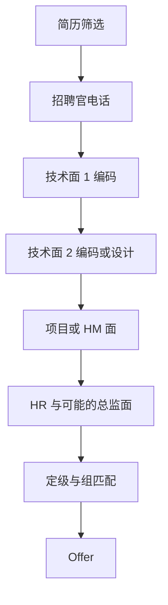

# TikTok · Senior Backend Software Engineer（US）—— 从这里开始

TikTok（和母公司 ByteDance）对有经验的后端工程师，用的是一串「过了才约下一场」的单轮淘汰面试：招聘官电话，两到三场技术面（编码、系统设计、后端基础八股，顺序不固定），然后是 hiring manager（HM，用人经理）面，最后是 HR 和定级、组匹配。每场约 45–60 分钟，面试官多数是将来的同事，常常在亚洲，有时是晚上。技术面的前 10–45 分钟先拷问简历和项目，剩下的时间写 1–2 道题。HM 那一轮同时决定你的级别和进哪个组。这一页告诉你：哪几件事会改变你的备考方式，每天先练什么、在哪练，以及流程长什么样。每一轮的细节在 [[LOOP_GUIDE]]。

## 先记住几件事

- **有经验的岗位没有 OA（在线笔试）**：OA 是应届生和实习生的流程。你的第一关是真人电话，所以备考从「讲项目」和「现场写代码」开始，不用刷 OA 题型。
- **每一小时的前面是简历拷问**：10–45 分钟问项目、选型、数字，再写题。简历拷问拖长，留给编码的只剩不到 20 分钟。每个项目要能压成 3 分钟，并且会说「我们回头再展开，先做题可以吗」。
- **代码必须能跑，测试要自己写**：编辑器是 HackerRank 或 Lark 代码板，没有起始类、没有默认输入。写完要自己造 3–5 个用例跑一遍；有思路但没写完，会被拒。
- **编码以 medium 为主，重点在追问**：题面常被改写成业务场景（调度器、限流、KV 存储），然后一路加追问：不许改输入、O(1) 额外空间、输入变成流式、加 TTL、加线程安全、先暴力后最优。hard 多出现在 onsite 和 HM。
- **支付类系统设计最可能被问到**：支付系统（幂等、对账、状态机 + 账本、异步结算、退款）排在第一位，紧跟其后的是礼物 / 金币结算、窗口聚合的排行榜、内容审核。你的 PayPal 经历正好对口，但面试官会盯住其中**一条流程**深挖，所以要讲得前后一致。
- **HM 决定级别**：HM 看你简历深挖和设计轮的表现，再对照组里有空缺的级别来定。你要让「范围、决策、指标」清楚地是**你的**，而不是团队的。HM 面有时用普通话，有时临场加一道题或一个高层设计。

## 每天练什么、在哪练

| 轮 | Anki | Obsidian |
|---|---|---|
| 编码 | `LeetCode Tops::24 TikTok 字节高频 · 整题答案`：先读，从 **模式识别** 和 **Python 工具箱** 两个分支开始；再做 `::25 TikTok 字节高频 · 拆分背诵` | [[interviews/core/leetcode/tiktok/map/patterns]] · [[interviews/core/leetcode/tiktok/map/python]] |
| 系统设计 | — | [[tiktok-sd-index]]：先练支付系统 |
| 后端基础（八股） | — | [[tiktok-fundamentals]] |
| 行为与项目深挖 | — | `behavioral/`：[[behavioral/00_how_it_works]] → [[behavioral/question_bank]] → [[behavioral/deep_dive]] → [[behavioral/bytestyle]] |
| 公司与反问 | — | [[01-company-brief]] · [[06-questions-to-ask]] |

顺序建议：每天先过一遍编码卡片的新卡，写一道 20 分钟的限时题（光板编辑器、自己造用例）；零碎时间口述两个故事或一个项目深挖；每两天读一篇系统设计。

## 流程

- **一轮接一轮**：上一轮通过，才会约下一轮；常见节奏是一周一轮，也有 2 天内连着两轮的。官方说法是从投递到 offer「通常一个月」，实际 2–6 周都有。
- **反馈**：一般 1–2 天；通过之后长时间没消息很常见，催招聘官，不要等。
- **级别阶梯**：1-2（入门）· 2-1（中级）· **2-2（Senior）** · 3-1（Staff / 技术负责人）。招聘官也可能用新编号（L1 / L2 / L3，大约比 Meta、Google 同级低两级）。同一套面试可能得到 2-1 或 2-2，所以第一通电话就问清这个 req（职位编号）对应哪个级别。
- **组匹配**：用人组各招各的；req 可能中途关闭，HM 面没过可能被转到另一个组重新面；跨组换面是常态。通过的轮次能不能带到新组，要问招聘官。
- **美国实体有两条招聘线**：TikTok 本体（广告、电商、增长、LIVE）和 USDS 合资公司（数据安全、内容审核）。目标岗位属于 TikTok 本体的 Innovative Growth 组，详见 [[01-company-brief]]。

## 面试前必须处理

1. 【待补：把简历上的两个旗舰项目（Amex 结算管线、interchange 数据源切换）各练出一个 3 分钟版和一个 30 分钟版，读 [[behavioral/deep_dive]]】
2. 【待补：中文版：HM 可能直接用普通话问，S1 和 S5 各准备一个 90 秒中文口述】
3. 【待补：一个真实的性能排查故事（见 [[behavioral/question_bank]] Q11）】
4. 【待补：为什么离开 PayPal、为什么选增长组、工作许可和地点，这三项只有你能答】
5. 第一通招聘官电话要问的四件事在 [[06-questions-to-ask]]。
