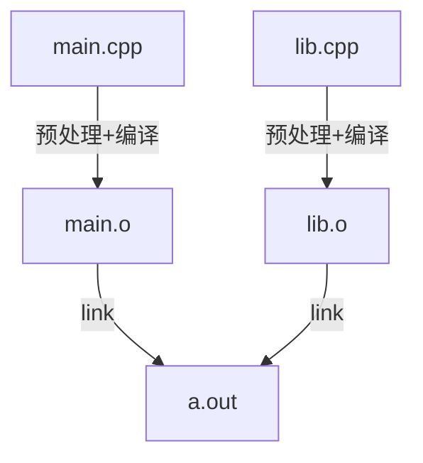
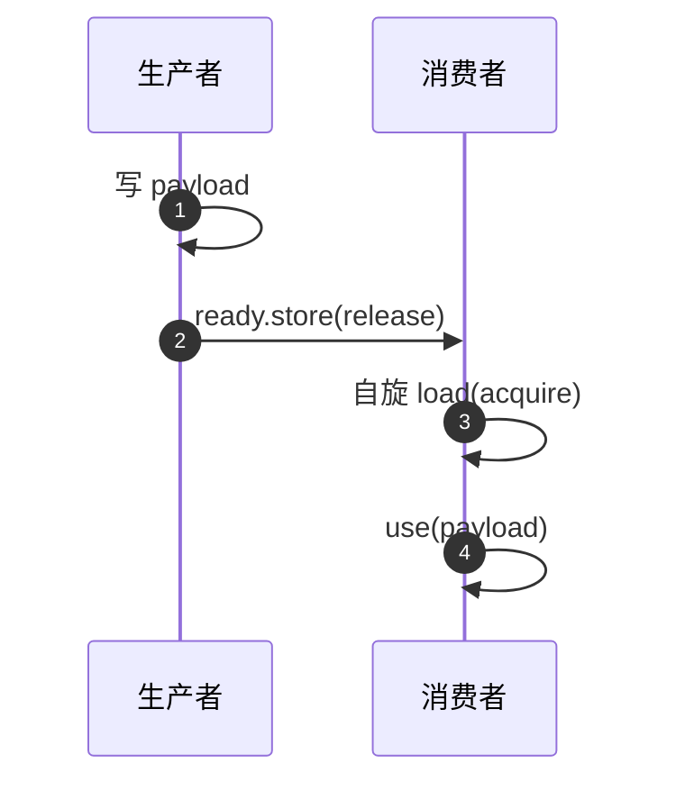

# C++ 语言深度题库 · 44 题

电话面里的语言深度题（为什么 C++ 快、C++11/14/17/20 的区别、智能指针、`malloc` vs `new`、`std::copy` vs `memcpy`、IPC 与共享内存、OS 与并发、现场修编译错误、框架里 debug 和位运算）都按 C++ 本来的问法准备。你日常写 Java，所以每个主题都带一个 Java 对照。

## 怎么用

- 每题固定四块：**一句话答案**（先背）→ **展开**（从零讲，带小代码和图）→ **60 秒口述**（英文，面试时直接说）→ **下一问**（面试官最可能追问的，附要点）。
- 难度：★ 必须秒答 · ★★ 电话面主力 · ★★★ 追问到这里算加分。
- 代码都能编译：`demos/qNN_*.cpp` 是完整可运行版本，题里贴的是节选。一键编译运行：`./build_demos.sh`（只看沙盒是否全绿：`./build_demos.sh quick`）。编译参数 `clang++ -std=c++20 -O2 -Wall -Wextra -fsanitize=address,undefined`；要看性能数字时用不带 sanitizer 的 `-O2`。
- 题里的输出是真实运行结果。数字只看量级和趋势（Apple Silicon、macOS、libc++；Linux/x86 上数字不同，结论一样）。
- 练法：盖住答案，计时 60 秒口述，再对照一句话答案补漏。

## 目录

| 组 | 题 | 主题 |
|---|---|---|
| A | Q01–Q06 | 为什么快：编译模型、优化器、虚函数、缓存局部性 |
| B | Q07–Q10 | C++11 / 14 / 17 / 20 / 23 |
| C | Q11–Q16 | 内存与所有权：RAII、malloc vs new、智能指针、移动、copy vs memcpy、布局 |
| D | Q17–Q19 | 容器与迭代器失效 |
| E | Q20–Q22 | 模板、完美转发、constexpr |
| F | Q23–Q27 | 未定义行为、sanitizer、修编译错误、位运算、debug |
| G | Q28–Q31 | 并发与内存模型 |
| H | Q32–Q35 | 虚拟内存、IPC、共享内存、上下文切换与 Linux 工具 |
| I | Q36–Q39 | 低延迟惯用法 |
| J | Q40–Q42 | Java ↔ C++，C++ ↔ Python |
| K | Q43–Q44 | 怎么诚实地谈 C++ 经验；CoderPad 现场 |

---

## [A] 为什么快：编译模型与性能

### Q01 · Why is C++ fast?

- **难度**：★
- **一句话答案**：C++ 提前（ahead-of-time）编译成原生机器码，**没有强制的运行时**（没有 GC、没有虚拟机、默认不检查数组边界），编译器看得见整个翻译单元所以能把抽象全部内联掉（"零开销抽象"），而且程序员能完全控制内存布局。

**展开**

C++ 的做法：能在编译期完成的工作都放到编译期，内存和打断交给程序员控制。四个具体做法：

1. **原生代码 + 全局视野的优化器**。源码经过前端变成中间表示，优化器内联、折叠常量、展开循环、向量化，最后生成机器码。
2. **零开销抽象**："不用的东西不付费，用到的东西手写也不会更快"。同样是 500 万个 `int` 排序：

```
std::sort : 81 ms     // 比较函数是模板参数，被内联进排序循环
qsort     : 303 ms    // 比较函数是函数指针，每次比较一次间接调用，无法内联
```

3. **布局控制**：`std::vector<Order>` 是一块连续内存，遍历是顺序读（缓存友好）。
4. **没有隐式成本**：不分配就没有 `malloc`；析构是确定的（RAII）；`v[i]` 默认不检查边界。

代价也要会说：没检查就有未定义行为；性能是"可以做到"，不是"自动得到"——`std::list`、到处 `shared_ptr`、热路径抛异常、`-O0` 的 debug 构建，都会很慢。

**60 秒口述**

- C++ compiles **ahead of time** to native code, and there is **no mandatory runtime** - no garbage collector, no VM, no bounds checks unless I ask for them.
- The optimizer sees the whole translation unit, so abstractions like templates and lambdas get **inlined away** - zero-overhead abstraction. `std::sort` took about 80 ms on five million ints versus 300 ms for `qsort`, because the comparator is inlined instead of called through a function pointer.
- I control **memory layout**: a `std::vector` of structs is one contiguous block, which is **cache friendly**.
- No hidden pauses: allocation is explicit, destruction is **deterministic** (RAII).
- The price is that the compiler may assume **no undefined behavior**, and speed is something you earn - lists of pointers, `shared_ptr` everywhere or exceptions in a hot loop are slow.

**下一问**

- **"Is C++ always faster than Java?"** — No. Hot loops in steady state can be close, because the JIT optimizes with runtime profile information. The gap is **tail latency** (GC and warm-up), object headers and pointer chasing, and control over layout.
- **"How would you check a claim like 'this got inlined'?"** — Read the assembly (`-S`) or profile; do not guess. Compare `-O0` and `-O2`.
- **"What do -O2, -O3, LTO and PGO add?"** — `-O3` adds more unrolling and vectorization; **LTO** optimizes across translation units; **PGO** uses a recorded profile for layout and branch hints; `-march=native` uses the local CPU's instructions but makes the binary non-portable.

---

### Q02 · Why is C++ faster than other compiled languages (Rust, Go, Java with AOT)?

- **难度**：★★
- **一句话答案**：不是"编译了就快"，而是**编译之后还剩多少运行时工作、你对内存布局有多少控制权**。C++ 和 Rust 把成本设计成"用才付费"；Go、Java 默认带 GC 和（Java）对象头；C++ 相对 Rust 的差别是成熟度和生态，不是机器码质量。

**展开**

编译只是把源码变成机器码。真正决定速度的是编译后还剩的东西：内存回收（C++/Rust 靠 RAII/所有权，Go/Java 靠 GC）、值类型能否内联进数组和对象（C++/Rust/Go 可以；Java 除原始类型外都是堆对象加引用）、数组边界检查（C++ 默认没有）、泛型实现（C++ 模板按类型展开；Java 擦除并装箱）。

结构性差距在**布局**：

```cpp
// demos/q02_contiguous.cpp（节选）
std::vector<Order> flat(4);                        // 4 个 Order 连续摆放
std::vector<std::unique_ptr<Order>> boxed;         // 4 个指针，Order 散落在堆上
```

```
sizeof(Order) = 16
flat[1]-flat[0]   = 16 bytes      <- 紧挨着
flat[2]-flat[1]   = 16 bytes
boxed elements are adjacent only by luck of the allocator (adjacent pairs: 0 of 3)
sizeof(unique_ptr<Order>) = 8: the vector stores addresses, not orders
```

Java 的 `ArrayList<Order>` 就是后一种。遍历前者是顺序读，后者每个元素多一次可能的缓存未命中（数字见缓存局部性一题）。

**60 秒口述**

- Compiling is not what makes code fast; what matters is **how much runtime work is left** and **how much control I have over memory**.
- C++ and Rust pay only for what you use. Java and Go have a **garbage collector**, and in Java everything except primitives is a heap object behind a reference - a list of orders is a list of pointers, so scanning it **chases pointers** instead of reading sequentially.
- In C++ a vector of structs is one **contiguous block**; I can see it: consecutive elements are exactly `sizeof(Order)` apart.
- Java gets some of that back with **JIT** optimizations a static compiler cannot do, and value types are coming, but today layout is the structural gap.
- Against Rust, machine code quality is similar - same LLVM backend; the difference is ecosystem and decades of tooling, not speed.

**下一问**

- **"Why not just write C?"** — Templates and inlining: `std::sort` beat `qsort` by roughly 4x in the test above, and RAII removes whole classes of leaks.
- **"Where does Go sit?"** — Fast start-up and good concurrency, but GC and bounds checks; peak throughput and tail latency usually behind C++.
- **"How do you get contiguous layout in Java?"** — Primitive arrays, parallel arrays, or off-heap buffers; it is manual and awkward.

---

### Q03 · Walk me through what happens between `g++ main.cpp` and a running program. Why do we have header files, and what is the One Definition Rule?

- **难度**：★★
- **一句话答案**：四步——预处理（展开 `#include` 和宏）、编译（每个 `.cpp` 单独变成目标文件 `.o`）、汇编、链接（把多个 `.o` 拼起来，解析符号）。**翻译单元（translation unit）** 是预处理后的一个 `.cpp`；声明可以出现很多次，定义（ODR）每个程序只能有一次。

**展开**



`main.cpp` 带着它的头文件（headers）。每个 `.cpp` 单独预处理 + 编译，互不影响；最后一起链接成 `a.out`。

- **头文件**是文本复制粘贴：`#include <iostream>` 展开后：

```
lines after preprocessing <iostream>:    84248
lines after preprocessing <cstdio>  :      711
```

  这就是 C++ 编译慢的原因，也是 C++20 modules 想解决的问题。
- 一个 `.cpp` 只知道它 `#include` 进来的**声明**。`lib.hpp` 里写 `int square(int x);`，调用方就能编译；真正的函数体在 `lib.cpp`，由链接器接上。
- **编译错误 vs 链接错误**：声明了没定义，编译通过、链接失败；两个 `.cpp` 都定义了同一个非 `inline` 函数，也是链接失败：

- **ODR**：一个程序里每个非 `inline` 函数、每个变量只能有一个定义。所以头文件里的函数要么标 `inline`，要么只放声明。现代 C++ 里 `inline` 的实际含义就是"允许每个翻译单元各带一份相同的定义，链接时合并"，不再是"请内联"。
- **模板为什么定义在头里**：模板要等到用具体类型时才能生成代码，编译器必须在使用点看到完整定义。

**60 秒口述**

- Four stages: **preprocess** - which literally pastes headers in; **compile** - each `.cpp` file separately into an object file; **assemble**; and **link**, which resolves symbols across object files.
- A **translation unit** is one `.cpp` after preprocessing. It only knows the **declarations** it includes; the linker connects calls to definitions. Declared but never defined gives an **undefined reference at link time**.
- The **One Definition Rule**: a non-inline function or variable may be defined once per program - two definitions give a duplicate-symbol link error, which is why header functions are `inline` and templates live in headers.
- Including `<iostream>` expands to about 84 thousand lines, which is why builds are slow and why modules exist.

**下一问**

- **"Declaration vs definition?"** — A declaration introduces a name and type; a definition also allocates storage or provides the body.
- **"What does `static` at namespace scope do?"** — Gives the name **internal linkage**: each translation unit has its own private copy. In an anonymous namespace it's the modern spelling.
- **"Static vs dynamic linking?"** — Static copies the library code into the executable (self-contained, bigger, no run-time lookup); dynamic loads a shared library at start-up (smaller, updatable, an extra indirection).

---

### Q04 · What does the optimizer actually do at `-O2`? How would you verify it?

- **难度**：★★
- **一句话答案**：内联、常量折叠、死代码删除、循环优化（展开、向量化、把循环改写成闭式）、去虚化、复制省略；验证方法是**读汇编（`-S`）或测量**，不要凭感觉。

**展开**

三个写法的求和（`q04_zero_overhead.cpp`）：手写 `for` 循环 `sum_loop`、`std::accumulate` 的 `sum_acc`、带 lambda 的 `sum_lambda`；另有 `gauss(n)`，循环体是 `s += i`。

用 `clang++ -O2 -S` 看汇编后统计：

```
sum_loop    -O0:  25 instructions, 0 calls | -O2:  75 instructions, 0 calls, 30 SIMD ops
sum_acc     -O0:  14 instructions, 1 calls | -O2:  80 instructions, 0 calls, 30 SIMD ops
sum_lambda  -O0:  14 instructions, 1 calls | -O2:  80 instructions, 0 calls, 30 SIMD ops

gauss(n) at -O2:  subs / b.lt / sub / mul / umulh / extr / add / ret      (没有循环)
```

读法：`-O0` 里 `accumulate` 版本保留了对模板函数的调用；`-O2` 里三者都内联并向量化（`.2d`、`.4s` 是 SIMD 寄存器）。`gauss` 里没有循环，只有一次乘法。

什么会挡住优化器：跨翻译单元的调用（没开 LTO）；通过基类指针的虚调用（类型未知）；指针别名（两个指针可能指向同一块内存，不敢重排）；`volatile`；异常路径。

**60 秒口述**

- At `-O2` the compiler does **inlining**, **constant folding**, dead-code elimination, **loop unrolling and vectorization**, and **copy elision**.
- Here's a concrete case: a hand-written loop, `std::accumulate`, and `accumulate` with a lambda all compile at `-O2` to code with **zero calls** and SIMD instructions, while at `-O0` the library versions keep a call. A loop summing `0..n-1` becomes a closed-form multiplication - eight instructions, no loop.
- I verify with `-S` or **Compiler Explorer**, and I measure with a benchmark, because the optimizer's decisions depend on what it can see: calls across translation units, virtual calls and **pointer aliasing** all limit it.
- That's what zero-overhead abstraction means in practice.

**下一问**

- **"What is strict aliasing?"** — Accessing an object through a pointer of an unrelated type is undefined; it lets the compiler assume `int*` and `float*` don't alias. Use `memcpy` or `std::bit_cast` for type punning.
- **"What does `inline` do?"** — Historically a hint; today it mainly allows multiple identical definitions. The compiler decides inlining on its own.
- **"What is `restrict` / `__restrict`?"** — A promise that pointers don't alias, so the compiler can vectorize more aggressively; non-standard in C++ but supported by the common compilers.

---

### Q05 · How do virtual functions work, and what do they cost?

- **难度**：★★
- **一句话答案**：每个有虚函数的类有一张**虚表（vtable）**，每个对象多一个指向它的**虚指针（vptr）**；虚调用 = 读 vptr → 读表项 → 间接调用，代价是对象变大、调用无法内联、间接跳转难预测；基类用于多态时析构函数必须是 `virtual`。

**展开**

`Shape* p = new Sq(3);`

* 对象：`[ vptr ][ s=3 ]`，`vptr` 指向 `Sq` 的 vtable。
* `p->area()`：load vptr；load slot 0；call indirect。

| vtable for Sq 的槽 | 内容 |
|---|---|
| slot 0 | `&Sq::area` |
| slot 1 | `&Sq::~Sq` |

热路径上的成本主要有三个：**不能内联**（编译器不知道具体类型）；**对象更大**；**混合类型时间接跳转预测失败**。下面 400 万个对象，5 遍求面积：

```
virtual, mixed types, boxed : 73 ms      // vector<unique_ptr<Shape>>，两种形状随机混合
CRTP, one type, contiguous  :  9 ms      // vector<SqT>，编译期绑定
```

**必须 `virtual` 的析构函数**：通过基类指针 `delete` 派生对象，基类析构不是 virtual 就是未定义行为。典型表现是派生类部分没被销毁：

```
non-virtual destructor, delete via Base*:
  ~BadBase                       <- ~BadDerived 没有运行
virtual destructor, delete via Base*:
  ~GoodDerived
  ~GoodBase
```

**60 秒口述**

- Each class with virtual functions has a **vtable**, and each object carries a hidden **vptr** to it. A virtual call loads the vptr, loads the slot, and makes an **indirect call**.
- Costs: the object grows - 4 bytes became 16 in my test; the call **cannot be inlined**; and with mixed types the indirect branch is hard to predict. On four million objects, virtual dispatch over boxed objects took 73 ms versus 9 ms for a **CRTP** version over a contiguous vector. Some of that is layout, which is the point: they come together.
- If the base class is used polymorphically, the destructor must be `virtual`; otherwise deleting through a base pointer is **undefined behavior** and the derived destructor does not run.
- On hot paths I'd use templates/CRTP, `final`, or `std::variant`.

**下一问**

- **"What happens if you call a virtual function in a constructor?"** — It calls the version of the class currently being constructed, not the most-derived override, because the derived part doesn't exist yet.
- **"Multiple inheritance?"** — The object holds one vptr per polymorphic base; casting between bases adjusts the pointer.
- **"What does `final` buy you?"** — It tells the compiler no further override exists, so a call through that type can be **devirtualized**.

---

### Q06 · Why can a `std::vector` scan beat a `std::list` scan by 20x even though both are O(n)? What is cache locality?

- **难度**：★★
- **一句话答案**：Big-O 不计内存访问成本。CPU 一次读一整条**缓存行（cache line，通常 64 字节）**，顺序访问时后面的数据已经在缓存里（还有预取）；链表节点散落在堆上，每个节点都可能是一次缓存未命中，单次约 100 ns 级别，比一次加法慢两个数量级。

**展开**

四百万个 `int`（`demos/q06_locality.cpp`）：

```
vector<int> scan            :   0.2 ms
std::list<int> scan         :   4.4 ms     // 节点按顺序分配，大致相邻，仍是 20 倍慢
shuffled pointer chase      :  28.4 ms     // 节点在内存里乱序：真实世界里"用了很久的链表"
```

只求和 `qty` 一个字段：AoS 每个元素 64 字节，SoA（只存一个 `vector<int>`）每个元素 4 字节：

```
sum one field, array of structs (64 B/elem): 1.2 ms
sum one field, struct of arrays (4 B/elem) : 0.1 ms
```

SoA 每条缓存行装 16 个 `qty`，AoS 只装 1 个；SoA 还能被 SIMD 向量化。如果每次都要用到全部字段，AoS 更好（一条缓存行带来全部数据）。

**60 秒口述**

- Big-O counts operations, not **memory accesses**. The CPU reads a whole **cache line** - 64 bytes - and the hardware **prefetches** sequential access, so a vector scan is nearly free per element.
- A linked list's nodes live all over the heap, so every step can be a **cache miss** costing around 100 nanoseconds. For four million ints: vector 0.2 ms, list 4 ms, and a list whose nodes were shuffled in memory about 28 ms.
- The same idea applies to layout: scanning one field of a **struct of arrays** was about ten times faster than an **array of structs**, because each cache line carries 16 useful values instead of one.
- So in latency-sensitive code I default to contiguous containers and keep hot data compact.

**下一问**

- **"When is a list still the right choice?"** — Rarely; when you need stable iterators/references and O(1) splice and the elements are large. Even then profile first.
- **"What is false sharing?"** — Two threads writing different variables on the same cache line make the line ping-pong between cores.
- **"What is a TLB miss?"** — The virtual-to-physical translation cache missed; huge pages reduce it.

---

## [B] 标准版本：C++11 / 14 / 17 / 20 / 23

### Q07 · What are the differences between C++11, 14, 17 and 20?

- **难度**：★★
- **一句话答案**：**11** 是现代 C++ 的起点（移动语义、`auto`、lambda、智能指针、线程与原子、`constexpr`、range-for）；**14** 是打磨（泛型 lambda、返回类型推导、`make_unique`）；**17** 补词汇类型和编译期工具（`optional`/`variant`/`string_view`、结构化绑定、`if constexpr`、保证的复制省略）；**20** 是第二次大改（concepts、ranges、coroutines、modules，外加 `span`、`<=>`、`jthread`、`format`）。

**展开**

| 版本 | 关键词（每条一句话） |
|---|---|
| **11** | **移动语义**（右值引用，免拷贝返回/传递）· `auto` 类型推导 · **lambda** · `unique_ptr`/`shared_ptr` · `std::thread`/`mutex`/`atomic` 与内存模型 · `constexpr` · `nullptr` · `enum class` · range-for · 初始化列表 `{}` · 可变参数模板 · `override`/`final` · `= default`/`= delete` · `unordered_map` |
| **14** | 泛型 lambda（`auto` 参数）· 函数返回类型推导 · `make_unique` · 变量模板 · 放宽的 `constexpr`（允许循环）· 数字分隔符 `1'000'000` · 二进制字面量 `0b101` |
| **17** | 结构化绑定 `auto [k, v]` · `if constexpr` · `optional`/`variant`/`any` · `string_view` · 类模板参数推导（CTAD）· 折叠表达式 · `inline` 变量 · **保证的复制省略** · `std::filesystem` · 并行算法 · `[[nodiscard]]` · `if (init; cond)` |
| **20** | **concepts**（约束模板）· **ranges**（惰性管道）· **coroutines** · **modules** · `std::span` · 三路比较 `<=>` · 指定初始化 · `consteval` · `std::jthread` · `std::format` · `<bit>`（`popcount`、`rotl`）· `std::erase_if` |
| **23** | `std::expected` · `std::print` · 显式 `this`（deducing this）· `ranges::to` · `flat_map` · `mdspan` · `std::unreachable` |

**60 秒口述**

- **C++11** is the big one: **move semantics**, `auto`, **lambdas**, smart pointers, `std::thread` and atomics with a real memory model, `constexpr`, `nullptr`, range-for.
- **C++14** polishes it: generic lambdas, return type deduction, `make_unique`, and relaxed `constexpr`.
- **C++17** adds vocabulary types - `optional`, `variant`, `string_view` - plus **structured bindings**, `if constexpr`, **guaranteed copy elision**, and `std::filesystem`.
- **C++20** is the second big release: **concepts**, **ranges**, coroutines and modules, plus `std::span`, the spaceship operator, `jthread`, and `std::format`. C++23 adds `std::expected`, `std::print` and deducing `this`.
- In practice I write C++17 as a baseline and use C++20 where the compiler allows; in latency-critical code I avoid exceptions, RTTI and `shared_ptr` on the hot path.

**下一问**

- **"Which feature changed how you write code the most?"** — **Move semantics** and RAII-based smart pointers: ownership became explicit in the type system and returning big objects by value became cheap.
- **"What is a structured binding / CTAD / `if constexpr`?"** — structured bindings unpack pairs and tuples (`auto [k, v]`), CTAD deduces template arguments from constructor arguments, and `if constexpr` selects a branch at compile time.
- **"Which would you reach for first for an `Optional` return?"** — `std::optional` for "may be absent"; `std::expected` (C++23) when you also need the error.

---

### Q08 · C++11 in practice: what are `auto`, lambdas, `nullptr`, `enum class`, and brace initialization, and what are the traps?

- **难度**：★★
- **一句话答案**：`auto` 从初始化表达式推导类型（**会丢掉 `const` 和引用**）；lambda 是带捕获的匿名函数对象；`nullptr` 有自己的类型，不会被当成整数；`enum class` 不隐式转 `int`；花括号初始化禁止窄化，但会优先选 `initializer_list` 构造函数。

**展开**

- **lambda** 的捕获：`[x]` 按值（拷贝）、`[&x]` 按引用、`[=]`/`[&]` 全部按值/按引用。按引用捕获的局部变量在 lambda 比它活得久时会悬空。
- **`auto` 的陷阱**：

```cpp
std::vector<int> brace{3, 4};          // 花括号：优先 initializer_list 构造 -> 2 个元素：3, 4
std::vector<int> paren(3, 4);          // 圆括号：3 个元素，每个都是 4
int x = 1;  const int& rx = x;
auto copy = rx;                        // auto 丢掉 const 和引用 -> 普通 int 拷贝
```

```
vector<int>{3,4} has 2 elements; vector<int>(3,4) has 3
auto copy changed to 2, original still 1
```

  想保留引用就写 `auto&` / `const auto&`。

**60 秒口述**

- **`auto`** deduces from the initializer but **drops const and references**, so I write `const auto&` when I want a reference.
- **Lambdas** are anonymous function objects with a capture list - by value or by reference; a by-reference capture that outlives the variable is a **dangling reference**.
- **`nullptr`** has its own type, fixing the `NULL`-is-zero overload problem; **`enum class`** is scoped and doesn't convert to int.
- **Brace initialization** forbids narrowing but prefers the `initializer_list` constructor: `vector<int>{3,4}` has two elements, `vector<int>(3,4)` has three.
- And the biggest C++11 change is **move semantics**, which makes returning and passing large objects cheap.

**下一问**

- **"What does a lambda compile to?"** — A compiler-generated class with `operator()` and a member for each capture; non-capturing lambdas convert to function pointers.
- **"What's `decltype(auto)` / `auto&&`?"** — `auto&&` is a forwarding reference; `decltype(auto)` preserves the exact type including references.
- **"`std::thread` destructed while joinable?"** — Calls `std::terminate`.

---

### Q09 · What do C++14 and C++17 add that you'd use every day? (`optional`, `variant`, `string_view`, structured bindings, `if constexpr`, CTAD)

- **难度**：★★
- **一句话答案**：14：泛型 lambda、返回类型推导、`make_unique`、变量模板。17：`optional`（可能没有值）、`variant`（类型安全的 union）、`string_view`（不拥有的字符串视图）、结构化绑定、`if constexpr`（编译期分支）、类模板参数推导、折叠表达式、保证的复制省略。

**展开**

```cpp
// demos/q09_cpp14_17.cpp（节选；-std=c++17 可编译）
auto add = [](auto a, auto b) { return a + b; };            // 14: 泛型 lambda
auto u = std::make_unique<int>(7);                          // 14
template <class T> constexpr T pi_v = T(3.14159265358979L); // 14: 变量模板

std::map<std::string, int> m{{"AAPL", 190}, {"MSFT", 410}};
for (const auto& [sym, px] : m) { ... }                     // 17: 结构化绑定
if (auto it = m.find("AAPL"); it != m.end()) { ... }        // 17: if 里带初始化语句

template <class T> auto describe(const T& x) {
    if constexpr (std::is_integral_v<T>) return std::string("integer ") + std::to_string(x);  // 编译期选择分支
    else return std::string("other");
}
std::optional<int> parse(std::string_view s) { if (s.empty()) return std::nullopt; return static_cast<int>(s.size()); }
std::variant<int, std::string> var = std::string("hi");
std::visit(Print{}, var);                                    // 按当前持有的类型调用对应重载
auto sum_all = [](auto... xs) { return (xs + ...); };        // 17: 折叠表达式
std::pair p(1, 2.5);  std::vector w{1, 2, 3};                // 17: CTAD，推导出 pair<int,double>、vector<int>
```

- **`string_view`**：指针 + 长度，不拥有数据，不拷贝。**陷阱：指向的字符串先销毁就悬空**（ASan 会报 `heap-use-after-free`）。作参数时用，作成员/返回值要小心生命周期。

**60 秒口述**

- From **C++14** I use generic lambdas, `make_unique`, and relaxed `constexpr`.
- **C++17** gives me **vocabulary types**: `std::optional` instead of sentinel values, `std::variant` with `std::visit` as a type-safe union - cheaper than virtual dispatch because there's no heap or indirect call - and `string_view`, a non-owning pointer-plus-length. The trap with `string_view` is **lifetime**: it dangles if the string dies first.
- Syntax: **structured bindings** for maps and pairs, `if` with an initializer, **`if constexpr`** to pick code at compile time, class template argument deduction, and fold expressions.
- And guaranteed copy elision means returning a temporary does no copy at all.

**下一问**

- **"`if constexpr` vs `if`?"** — The discarded branch isn't even instantiated, so it may contain code that wouldn't compile for that type.
- **"Cost of `std::variant`?"** — Size of the largest alternative plus a tag; `visit` is a jump table or switch.
- **"`optional<T&>`?"** — Not allowed; use a pointer or `optional<std::reference_wrapper<T>>`.

---

### Q10 · What's new in C++20 and C++23, and which of it would you use? (concepts, ranges, span, `<=>`, coroutines, `std::expected`)

- **难度**：★★
- **一句话答案**：20 的四大件是 concepts（给模板写约束，错误信息变可读）、ranges（惰性管道）、coroutines、modules；常用小件有 `span`、`<=>`、`jthread`、`format`、`<bit>`、`consteval`。23 的 `std::expected`、`std::print`、显式 `this` 已经能用。

**展开**

```cpp
// demos/q10_cpp20.cpp（节选）
template <std::integral T> T gcd_of(T a, T b) { return b == 0 ? a : gcd_of(b, a % b); }   // concept 约束 T

struct Version { int major, minor; auto operator<=>(const Version&) const = default; };    // 生成全部比较运算符
Params p{.depth = 5};                                        // 指定初始化

auto evens_squared = v | std::views::filter([](int x) { return x % 2 == 0; })
                       | std::views::transform([](int x) { return x * x; });               // 惰性管道
int sum(std::span<const int> s);                             // 指针 + 长度，数组、vector 都能传
std::erase_if(v, [](int x) { return x % 3 == 0; });
std::popcount(255u); std::countl_zero(1u); std::bit_ceil(100u); std::rotl(0x80000001u, 1);
std::format("format: {:>6} | {:08b} | {:.2f}", "px", 37u, 3.14159);
std::jthread t([] { ... });                                  // 析构时自动 join
```

C++23（`-std=c++23`，完整示例 `demos/q10_cpp23.cpp`）：`std::expected<int, Err>` 返回"值或错误"，失败时 `return std::unexpected(Err::Empty);`；`int get(this const Counter& self)` 是显式 this；`... | std::ranges::to<std::vector>()` 把惰性管道物化成 vector；`std::println("{}", v)` 直接打印容器。

**concepts 的价值**在错误信息上。**coroutines** 和 **modules** 是更大的特性：协程是可挂起的函数（`co_await`/`co_yield`，用于异步 I/O 和生成器）；modules 用 `import` 取代 `#include`，缓解 `<iostream>` 展开 8 万行的问题。面试时分清楚哪些你写过、哪些只了解概念，并如实说。

**60 秒口述**

- **C++20's big four**: **concepts**, which constrain templates and turn page-long errors into one readable line; **ranges**, lazy pipelines like filter-then-transform; **coroutines** for suspendable functions; and **modules** to replace headers.
- Everyday small features: `std::span` as a pointer-plus-length view, the **spaceship operator** to generate all comparisons, designated initializers, `consteval`, `std::jthread` that joins automatically, `<bit>` for popcount and rotates, and `std::format`.
- **C++23** gives us `std::expected` for value-or-error without exceptions, `std::print`, and deducing `this`.
- Concepts, `span`, `<bit>` and `expected` are drop-in wins; coroutines and modules are bigger commitments, and I'd be upfront about which of these I have shipped and which I know at the concept level.

**下一问**

- **"What problem do concepts solve?"** — Templates were duck-typed: a wrong type produced an error deep inside the template body. Concepts check the requirements at the call site.
- **"Ranges: are they lazy?"** — Views are lazy and non-owning: nothing is computed until you iterate.
- **"`std::expected` vs exceptions?"** — Explicit in the signature, no unwinding cost, forces callers to look at the error.

---

## [C] 内存与所有权

### Q11 · What is RAII, and how does it replace `finally` / try-with-resources? Where do objects live: stack, heap, static?

- **难度**：★
- **一句话答案**：RAII（Resource Acquisition Is Initialization）：构造函数获取资源，析构函数释放资源；对象离开作用域时（正常返回或异常展开）析构函数**一定**按构造的逆序运行。所以文件、锁、内存都不需要 `finally`。

**展开**

`FileHandle` 在构造函数里 `fopen`、析构函数里 `fclose`，并删除拷贝（只能有一个所有者）；`Noisy` 打印构造/析构；`work(fail)` 依次创建 `a`、`lock_guard`、`b`、`FileHandle`，`fail` 为真时抛异常（栈对象离开作用域自动销毁；堆对象要配对释放或交给智能指针；全局/`static` 对象在程序开始构造、结束销毁）。输出：

```
normal path:                      exception path:
  ctor a                            ctor a
  ctor b                            ctor b
  open /tmp/kq_raii.txt             open /tmp/kq_raii.txt
  normal return                     close                <- 异常展开时文件仍被关闭
  close                             dtor b
  dtor b                            dtor a
  dtor a                          caught boom
                                  mutex is free again: yes
```

规则：

- **零法则（Rule of Zero）**：成员都用 RAII 类型（`vector`、`string`、`unique_ptr`），就不需要自己写析构/拷贝/移动。
- 自己管资源才需要**五法则（Rule of Five）**：析构、拷贝构造、拷贝赋值、移动构造、移动赋值要么都写要么都删。
- **析构函数不能抛异常**：析构默认 `noexcept`；在异常展开过程中再抛一个会 `std::terminate`。

**60 秒口述**

- **RAII** means the constructor acquires a resource and the destructor releases it, and destructors are guaranteed to run, in **reverse order of construction**, when the scope exits - whether normally or by exception.
- That's why C++ has no `finally`: a `lock_guard` unlocks the mutex, a file handle closes the file, a `unique_ptr` frees memory. In my test, throwing in the middle still closed the file and released the lock.
- Practical rules: follow the **Rule of Zero** - build classes from standard RAII members; if I do own a resource I implement or delete all **five** special members. Destructors must not throw.
- Compared with Java's try-with-resources it's automatic and enforced by the type, not by the caller's discipline.

**下一问**

- **"What if a constructor throws?"** — Members already constructed are destroyed; the object's own destructor does not run. That's why resource-owning members should themselves be RAII types.
- **"Stack vs heap cost?"** — Stack allocation is a pointer bump and cache-hot; heap needs the allocator, may take locks, and can fault in pages.
- **"Stack overflow?"** — Deep recursion or large local arrays; the stack is typically 8 MB on Linux main thread.

---

### Q12 · What's the difference between `malloc` and `new`?

- **难度**：★
- **一句话答案**：`malloc` 是 C 函数，只分配**未初始化的原始字节**，返回 `void*`，失败返回 `NULL`，用 `free` 释放；`new` 是 C++ 运算符 = `operator new`（分配）+ **调用构造函数**，返回有类型的指针，失败抛 `std::bad_alloc`，用 `delete` 释放（会调用析构函数），`new[]` 配 `delete[]`。两套不能混用。

**展开**

```cpp
// demos/q12_malloc_new.cpp（节选）
struct Widget { std::string name = "default-name-longer-than-small-string-buffer";
                Widget() { puts("  Widget ctor"); }  ~Widget() { puts("  Widget dtor"); } };

Widget* a = new Widget;  delete a;                       // ctor ... dtor
void* raw = std::malloc(sizeof(Widget));                 // 只有字节，没有 Widget
Widget* b = new (raw) Widget;                            // placement new：在已有内存上构造
b->~Widget();  std::free(raw);                           // 手动析构，再释放

volatile std::size_t big = ~std::size_t{0} / 2;
void* huge = std::malloc(big);                           // -> NULL
try { operator new(big); } catch (const std::bad_alloc&) { ... }   // -> 抛异常
```

- **`new Widget` 的步骤**：`operator new(sizeof(Widget))` 拿内存 → 在那块内存上调用构造函数；构造函数抛异常时内存会被自动归还。`delete` 反过来：先析构再 `operator delete`。
- **只对 trivially copyable 的类型，在原始内存上用 `malloc` 才没问题**；对有构造函数的类型（`std::string` 之类）用 `malloc` 得到的是"不是对象的字节"，使用是未定义行为。
- **混用**：`new[]` 配 `delete`、`malloc` 配 `delete` 都是未定义行为（ASan 报 `alloc-dealloc-mismatch`）。
- 现代 C++ 里**几乎不直接写 `new`/`delete`**：用 `std::make_unique`、容器。

**60 秒口述**

- `malloc` is a **C function**: it gives me raw, uninitialized bytes as a `void*`, returns **NULL on failure**, and I release it with `free`.
- `new` is a **C++ operator**: it calls `operator new` to allocate and then runs the **constructor**; it returns a typed pointer, **throws `std::bad_alloc`** on failure, and `delete` runs the destructor before freeing. Arrays need `new[]` with `delete[]`; mixing the families is undefined behavior.
- You can overload `operator new`, and **placement new** constructs an object in memory you already own.
- Using `malloc` for a type with a constructor, like a `std::string` member, gives you bytes that aren't an object.
- In modern code I rarely write `new` at all - `make_unique` and containers.

**下一问**

- **"What does `new[]` do that `new` doesn't?"** — Allocates room for N objects, constructs each one, and remembers N so `delete[]` can destroy them all.
- **"When would you use placement new?"** — Memory pools, arenas, shared memory: construct an object at a known address.
- **"Can `realloc` be used on C++ objects?"** — Only for trivially relocatable bytes; otherwise use `vector`.

---

### Q13 · What are smart pointers? Compare `unique_ptr`, `shared_ptr` and `weak_ptr`.

- **难度**：★★
- **一句话答案**：智能指针是 RAII 的指针：`unique_ptr` 独占所有权（和裸指针一样大、零开销、只能移动）；`shared_ptr` 共享所有权（引用计数，16 字节，计数是原子操作）；`weak_ptr` 观察 `shared_ptr` 管理的对象而不延长它的寿命，用来打破循环引用。默认用 `unique_ptr`。

**展开**

```
sizeof: raw=8 unique_ptr=8 shared_ptr=16
after move: u=null u2=5
allocations: shared_ptr(new int) = 2, make_shared = 1
use_count = 2
after both reset: weak expired = 1, lock() null
```

**循环引用**：两个对象互相持有 `shared_ptr`，引用计数永远不归零，析构函数不运行，内存泄漏（Linux 上 LeakSanitizer 会报告）。两个节点互指 `shared_ptr`，离开作用域后 `a.use_count` 仍是 2，一行 `~Leaky` 都不输出；一边改成 `weak_ptr`（"反向/观察"关系）就正常析构。

**使用规则**

- 函数只是**使用**对象：传 `T&` 或 `T*`（裸指针/引用表示"不拥有"）；要**接管所有权**：按值传 `unique_ptr`；要**共享**：传 `shared_ptr`（只读时用 `const shared_ptr&`，避免多余的原子加减）。
- `shared_ptr` 的**控制块是线程安全的，被指对象不是**；多线程改同一个对象仍要加锁。

**60 秒口述**

- Smart pointers are **RAII for heap objects**. **`unique_ptr`** is exclusive ownership: same size as a raw pointer, zero overhead, **move-only**. It's my default.
- **`shared_ptr`** is shared ownership with a **reference count** in a control block - 16 bytes, atomic increments. `make_shared` does one allocation instead of two: I saw 1 versus 2. The control block is thread-safe; the pointee is not.
- **`weak_ptr`** observes without owning, and breaks **cycles** - I built two nodes pointing at each other with `shared_ptr` and the destructors never ran.
- Guideline: raw pointers and references mean "borrowing"; pass a `unique_ptr` by value to transfer ownership; avoid `shared_ptr` on latency-critical paths because of the atomic count.

**下一问**

- **"Is `shared_ptr` thread-safe?"** — Copying and destroying distinct `shared_ptr`s to the same object is safe; mutating the same `shared_ptr` object from two threads, or the pointee, is not.
- **"What is `enable_shared_from_this`?"** — Lets an object hand out a `shared_ptr` to itself safely, sharing the existing control block.
- **"Custom deleter?"** — `unique_ptr<FILE, decltype(&fclose)>` wraps a C resource; for `shared_ptr` the deleter is type-erased into the control block.

---

### Q14 · What is move semantics? What does `std::move` really do? When does the compiler elide copies?

- **难度**：★★★
- **一句话答案**：移动 = "偷"临时对象或即将销毁对象的内部资源（指针换手）而不是复制。**`std::move` 本身不移动任何东西，只是把表达式转成右值引用**，真正的移动由移动构造函数完成；`noexcept` 的移动才会被 `vector` 增长时使用；返回局部变量不要写 `std::move`，因为会阻止复制省略。

**展开**

```
after move: a.size()=0 (valid but unspecified), b.size()=40
move from const: c.size()=40 (still full: it was copied)
```

被移走的对象处于"有效但未指定"的状态：可以安全销毁或重新赋值，不要读它的值。

**`noexcept` 与 `vector` 增长**：`vector` 扩容要把旧元素搬到新内存。为了保持强异常保证，只有移动构造函数是 `noexcept` 时才用移动，否则退回拷贝：

```
vector<Buf> noexcept move  : copies=0 moves=7
vector, move not noexcept  : copies=7 moves=0
```

**复制省略（copy elision）**

```
return prvalue               ctor=1 copy=0 move=0     // C++17 起保证：直接构造在调用者的位置
return named local (NRVO)    ctor=1 copy=0 move=0     // 命名返回值优化：允许但不保证，clang 做了
Pinned (no copy, no move) returned by value: compiles // 既不可拷贝也不可移动的类型也能从函数里返回临时对象
```

左值引用 `T&`、右值引用 `T&&`、值：右值（rvalue）是临时的、没有名字的东西；有名字的变量（包括类型是 `T&&` 的参数）是左值，要再次变成右值需要 `std::move` / `std::forward`。

**60 秒口述**

- **Move semantics** transfer a resource from a temporary or dying object instead of copying: the move constructor steals the pointer and nulls the source. Moved-from objects are **valid but unspecified**.
- **`std::move` is just a cast to an rvalue reference** - it moves nothing itself. Moving from a `const` object silently falls back to a copy; I checked: the source stayed full.
- Mark move operations **`noexcept`**: `vector` growth only moves if the move can't throw, otherwise it copies. In my test it was 7 moves versus 7 copies for 8 elements.
- Return locals **by value without `std::move`**: since C++17, returning a temporary involves no copy at all, and `return std::move(x)` actually blocks elision - the compiler warns about it.
- Rule of Zero where possible, Rule of Five when I own a resource.

**下一问**

- **"What's the difference between `std::move` and `std::forward`?"** — `move` always casts to rvalue; `forward<T>` casts to rvalue only if the argument was an rvalue.
- **"When does the compiler generate a move constructor?"** — Only if you declared no copy operations or destructor yourself.
- **"Pass by value and move, or const reference?"** — For sink parameters (stored by the callee), take by value and `std::move` into the member; for read-only use, `const T&`.

---

### Q15 · What's the difference between `std::copy`, `memcpy` and `memmove`?

- **难度**：★★
- **一句话答案**：`memcpy`/`memmove` 复制**原始字节**，只对 trivially copyable 的类型安全，`memcpy` 的两块内存**不能重叠**（`memmove` 可以）；`std::copy` 是类型感知的，对每个元素调用赋值运算符，对 trivially copyable 的类型编译器/标准库会自动退化成 `memmove`——所以用 `std::copy` 又安全又不慢。

**展开**

对 `int` 数组 `-O2 -S` 看汇编，`std::copy` 就是一次 `bl _memmove`：

```
std::copy of int[] compiles to:  bl _memmove
```

对 `std::string` 数组，`std::copy` 逐个调用字符串的赋值；如果用 `memcpy`，两个对象会共享同一块堆缓冲，析构时 double free。

字节拷贝为什么会错——对象里有指向自己内部的指针：

```cpp
struct SelfRef { char buf[8] = "abc"; char* p = buf; /* 正确的拷贝构造会重新指向自己的 buf */ };
// memcpy 之后：memcpy copy's p points into the ORIGINAL: yes (bug)
```

**60 秒口述**

- `memcpy` copies **raw bytes** and the ranges **must not overlap** - that's undefined; `memmove` handles overlap. Both are only valid for **trivially copyable** types.
- `std::copy` is **type-aware**: it assigns element by element, so it's correct for strings and anything with a copy operator, and it works with any iterator.
- It's not slower: for trivially copyable types the library dispatches to `memmove` - I looked at the assembly for an `int` array and it was a single call to `memmove`.
- Why raw copying breaks non-trivial types: an object holding a pointer into itself, or a `std::string` with its heap buffer, would end up shared or pointing at the original.
- For type punning I use `std::bit_cast`, not pointer casts.

**下一问**

- **"Why is `std::pair<int,int>` not trivially copyable?"** — Its assignment operators are user-provided, so it fails the trivially-copyable requirement even though it holds two ints.
- **"`std::copy` vs `std::copy_n` vs `std::ranges::copy`?"** — Count-based variant; the ranges version takes a range and returns both iterators.
- **"How do you serialize a struct to the wire?"** — Don't `memcpy` the struct blindly: padding, endianness, and layout vary; write fields explicitly or use a fixed-layout packed message.

---

### Q16 · What do `sizeof`, `alignof` and padding mean? How would you lay out a hot struct?

- **难度**：★★
- **一句话答案**：CPU 要求每种类型放在对齐的地址上，编译器在成员之间插**填充（padding）**，整个结构体大小是最大对齐的倍数；**把大的成员放前面**可以消除多余填充；`alignas(64)` 可以让对象独占一条缓存行。

**展开**

```cpp
// demos/q16_layout.cpp（节选）
struct Bad  { char a; double b; char c; int d; };     // 逐个看：a(1) +7填充 b(8) c(1) +3填充 d(4) -> 24
struct Good { double b; int d; char a; char c; };     // b(8) d(4) a(1) c(1) +2填充 -> 16
struct alignas(64) Line { std::int64_t v; };          // 大小被补到 64
```

- 热路径结构体的原则：**常用字段放一起、大成员放前面、总大小尽量 ≤ 一条缓存行（64 字节）、不同线程写的字段放不同缓存行**（避免伪共享）。

**60 秒口述**

- Every type has an **alignment**; the compiler inserts **padding** so each member sits at an aligned offset, and the struct's size is rounded to its largest alignment.
- So member order matters: the same four fields were **24 bytes** with a char first and a double second, and **16 bytes** with the double first. Rule: **largest first**.
- `alignas(64)` puts an object on its own cache line, which I use to avoid **false sharing**.
- For hot data I keep structs compact, hot fields together, ideally within one **64-byte cache line**, and I use fixed-width types from `<cstdint>`. I don't `memcpy` a struct onto the wire because padding and endianness vary.

**下一问**

- **"Why does the compiler pad instead of packing?"** — Misaligned loads are slower or fault on some CPUs, and atomics need alignment.
- **"What is `offsetof`?"** — Gives a member's byte offset (valid for standard-layout types); I used it to print the layout.
- **"Size of an empty class?"** — 1 byte; empty base optimization makes it zero as a base class.

---

## [D] 容器与迭代器失效

### Q17 · How does `std::vector` grow? What invalidates iterators, pointers and references?

- **难度**：★★
- **一句话答案**：`vector` 是一块连续内存，`size`（元素个数）≤ `capacity`（已分配的容量）；放满后分配约 2 倍（libc++/libstdc++ 是 2 倍，MSVC 是 1.5 倍）的新内存、把元素搬过去、释放旧内存，所以 `push_back` **可能让所有迭代器、指针、引用失效**；知道大小就先 `reserve`。

**展开**

```
capacity as push_back grows: 1 2 4 8 16 32 64 128
reserve moved the buffer: yes (old pointers dangle)
push_back within reserve kept the buffer: yes
erase returned iterator to 30, size=3 capacity>=size: 1
clear: size=0 capacity=4 (memory kept)
shrink_to_fit: capacity=0
sizeof(vector<bool>::reference) = 16
```

- 均摊 O(1)：每次翻倍，搬运总量 ≈ 2n。但某一次 `push_back` 是 O(n)，延迟敏感的路径要 `reserve`：1000 次 `push_back`，不 `reserve` 要分配 11 次，`reserve(1000)` 之后只分配 1 次。

**失效规则**（背这张表）

典型 bug：拿着旧迭代器再 `push_back`。ASan 直接指出：

```cpp
auto first = v.begin();
v.push_back(4);                   // capacity 3 -> 重新分配
std::printf("%d\n", *first);      // 悬空
```

**60 秒口述**

- A `std::vector` is **one contiguous buffer** with a size and a capacity. When it fills up it allocates a new buffer - twice as big in libc++ and libstdc++ - moves the elements, and frees the old one. That makes `push_back` **amortized O(1)** but occasionally O(n).
- Consequence: any `push_back` that reallocates **invalidates all iterators, pointers and references**. I've seen it as a `heap-use-after-free` under AddressSanitizer, pointing straight into the reallocation path.
- Rules: `erase` invalidates from the erase point on and returns the next valid iterator; `insert` likewise.
- If I know the size I `reserve` first - in the demo, 11 allocations became one - and I keep indices rather than pointers if the container may grow.

**下一问**

- **"vector vs deque vs list?"** — `deque` has stable references on push at the ends but is chunked; `list` has stable iterators but terrible locality.
- **"`emplace_back` vs `push_back`?"** — `emplace_back` constructs in place from arguments.
- **"Why 2x vs 1.5x?"** — 1.5x lets freed blocks be reused for later growth; 2x grows faster. Either is amortized O(1).

---

### Q18 · `std::map` vs `std::unordered_map` vs a sorted `vector`: how do they work and when do you use each?

- **难度**：★★
- **一句话答案**：`map` 是红黑树（有序，O(log n)，节点式、引用稳定）；`unordered_map` 是哈希表（平均 O(1)，无序，**rehash 会使迭代器失效但不使指向元素的引用/指针失效**）；小数据或读多写少时排序 `vector` + 二分常常最快。`operator[]` 会**插入**默认值。

**展开**

```
after reading m["missing"]: size=1 value=0
find("other") -> end, size still 1
try_emplace twice keeps first value: 1
k missing <- map iterates in key order
rehash happened: buckets 2 -> 1597; reference still valid: 100
```

100 万个随机 key 的建表和查询（`-O2`，Apple Silicon，量级参考）：

| 1M 个 key | `std::map` | `unordered_map` | sorted vector |
|---|---|---|---|
| build | 159 ms | 26 ms | 45 ms |
| lookup | 146 ms | 13 ms | 45 ms |

**60 秒口述**

- `std::map` is a **red-black tree**: ordered, O(log n), node-based, with stable references. `std::unordered_map` is a **hash table**: average O(1), unordered, and a **rehash invalidates iterators** - but not references to elements, which I verified.
- `operator[]` **inserts** a default value if the key is missing, so for lookups I use `find` or `contains`.
- With a million keys the hash map was about ten times faster than the tree for lookups, and a **sorted vector with binary search** was in between and needs no per-node allocation.
- I'd choose the hash map for pure lookup, the tree when I need ordered iteration or range queries like an order book's price levels, and a flat sorted array for small, read-mostly data.
- For latency-critical lookups I'd consider an open-addressing table, since the standard one allocates per node.

**下一问**

- **"How does `unordered_map` resolve collisions?"** — Separate chaining: each bucket is a linked list of nodes; load factor controls rehashing.
- **"Complexity of `map::lower_bound`?"** — O(log n); it returns the first element not less than the key.
- **"Order book data structure?"** — `std::map` per side keyed by price, or a flat array indexed by tick when the price range is bounded; plus a hash map from order id to its location.

---

### Q19 · How do you erase elements from a container correctly? (erase-remove idiom, erase in a loop, `std::erase_if`)

- **难度**：★★
- **一句话答案**：`std::remove_if` 只是把要保留的元素前移，**不改变容器大小**，所以要和 `erase` 配合（erase-remove 惯用法）；循环里删除要用 `erase` 返回的迭代器；C++20 直接 `std::erase_if(c, pred)`；顺序无所谓时用 swap-and-pop 是 O(1)。

**展开**

```cpp
// demos/q19_erase.cpp（节选）
auto new_end = std::remove_if(a.begin(), a.end(), [](int x) { return x % 2 == 0; });
a.erase(new_end, a.end());                       // erase-remove

for (auto it = b.begin(); it != b.end();) {
    if (*it % 2 == 0) it = b.erase(it);          // 用返回值，不要再 ++
    else ++it;
}

auto n = std::erase_if(c, [](int x) { return x % 2 == 0; });    // C++20，返回删除个数

for (std::size_t i = 0; i < d.size();) {                         // swap-and-pop：O(1)，打乱顺序
    if (d[i] % 2 == 0) { d[i] = d.back(); d.pop_back(); } else ++i;
}
```

- 错误写法：`for (auto x : v) if (...) v.erase(...)`——range-for 里改容器，迭代器失效，未定义行为。`v.erase(it); ++it;` 也错：`it` 已经失效。
- `vector::erase` 是 O(n)（后面元素前移）；`map`/`set`/`list` 的 `erase(it)` 只让被删的那个迭代器失效，所以循环模式是 `it = m.erase(it)`。

**60 秒口述**

- `std::remove_if` doesn't shrink the container; it moves the elements to keep to the front and returns the new logical end. You must follow it with `erase` - the **erase-remove idiom**. In my test the size stayed 6 after `remove_if` and became 3 after `erase`.
- In a loop I use the iterator that `erase` returns instead of incrementing the invalidated one. In C++20 it's simply `std::erase_if(container, pred)`, which also returns the count.
- If order doesn't matter I **swap with the last element and pop**, which is O(1) instead of O(n).
- And I never erase inside a range-for - the iterator is invalidated.

**下一问**

- **"Complexity of erasing from a `vector`?"** — O(n) from the shifted elements; from the end O(1).
- **"What does `unordered_map::erase` invalidate?"** — Only the erased element's iterator.
- **"Why not `remove` on a `std::set`?"** — Algorithms that reorder need mutable elements; set elements are const, so use the member `erase` or `erase_if`.

---

## [E] 模板

### Q20 · How do C++ templates differ from Java generics? What are concepts and SFINAE?

- **难度**：★★
- **一句话答案**：Java 泛型靠**类型擦除**：编译成同一份字节码，容器里装引用，原始类型要装箱；C++ 模板是**编译期代码生成**：每个具体类型各自实例化一份代码，没有装箱、没有擦除，可以对 `T` 做任何编译通过的操作（"编译期鸭子类型"）。代价是代码膨胀和难读的错误；C++20 的 **concepts** 用于给模板参数写约束。

**展开**

```cpp
// demos/q20_templates.cpp（节选）
template <class T> T my_max(T a, T b) { return a < b ? b : a; }       // my_max<int>、my_max<double>、my_max<string> 各一份
template <class T> struct Box { T v; static constexpr std::size_t bytes = sizeof(T); };

template <class T>
concept Priceable = requires(T t) { { t.price() } -> std::convertible_to<double>; };
template <Priceable T> double mark(const T& t) { return t.price(); }
template <class T> auto mark_old(const T& t) -> decltype(t.price()) { return t.price(); }   // C++11 的 SFINAE 写法
```

**错误信息对比**：同样的错误——传了一个没有 `price()` 的类型——

```
// 带 concept：错误出现在调用处，并给出原因
error: no matching function for call to 'mark'
note: candidate template ignored: constraints not satisfied [with T = Rock]
note: because 'Rock' does not satisfy 'Priceable'
note: because 't.price()' would be invalid: no member named 'price' in 'Rock'

// 不带 concept：错误出现在模板体内部，追溯到实例化点
error: no member named 'price' in 'Rock'
note: in instantiation of function template specialization 'mark<Rock>' requested here
```

**60 秒口述**

- Java generics use **type erasure**: one compiled body, containers hold references, primitives get boxed. C++ templates are **compile-time code generation**: every type used gets its own instantiation, so `vector<int>` holds real ints with **no boxing** and the compiler can inline everything.
- The costs are **code bloat**, longer compile times, and the fact that a template body is only checked when instantiated - historically giving page-long errors.
- **Concepts** in C++20 fix that: I state requirements like "has a `price()` returning something convertible to double", and a wrong type fails at the call site with a one-line reason. Before concepts that was done with **SFINAE** and `enable_if`.
- Templates also take non-type parameters - `std::array<int, 16>` - which Java can't.

**下一问**

- **"Template specialization?"** — Provide a different implementation for a specific type (full) or family of types (partial, for class templates), e.g. `std::hash<Point>`.
- **"Why can't I put a template definition in a `.cpp`?"** — The compiler needs the body where it's instantiated; otherwise use explicit instantiation.
- **"What is `typename` needed for?"** — To tell the compiler a dependent name like `C::value_type` is a type.

---

### Q21 · What are forwarding references and perfect forwarding? `std::move` vs `std::forward`; `emplace_back` vs `push_back`?

- **难度**：★★★
- **一句话答案**：在被推导的模板参数上，`T&&` 是**转发引用**，既能绑定左值也能绑定右值；它在函数体里有名字所以是左值，要保持调用者给的"左值/右值"属性就必须写 `std::forward<T>(x)`；`emplace_back(args...)` 用转发就地构造，省掉一次临时对象的移动。

**展开**

```cpp
// demos/q21_forwarding.cpp（节选）
void sink(const std::string&) { puts("  sink(const&)  -> copy"); }
void sink(std::string&&)      { puts("  sink(&&)      -> move"); }

template <class T> void wrong(T&& x) { sink(x); }                    // x 有名字 -> 左值 -> 永远走拷贝
template <class T> void right(T&& x) { sink(std::forward<T>(x)); }   // 保持原本的值类别
```

- **`std::move(x)`** 无条件转成右值；**`std::forward<T>(x)`** 只在原本是右值时才转成右值。写通用包装函数用 `forward`，明确要放弃一个对象用 `move`。
- **`emplace_back` vs `push_back`**：

```cpp
v.push_back(Order("MSFT", 1));     // 先构造临时 Order，再移动进 vector
v.emplace_back("MSFT", 1);         // 把参数转发给 Order 的构造函数，在 vector 的内存里直接构造
```

```
push_back(Order(...))      ctor=1 copy=0 move=1
emplace_back(args...)      ctor=1 copy=0 move=0
```

**60 秒口述**

- In a deduced template parameter, **`T&&` is a forwarding reference**: it binds to lvalues and rvalues alike. Inside the function the parameter has a name, so it's an lvalue; to pass it on **with its original value category** I use `std::forward<T>`.
- In my test the wrapper without `forward` copied even when I handed it a temporary, and with `forward` it moved.
- `std::move` always casts to rvalue; `std::forward` does so only if the caller passed an rvalue.
- That's how **`emplace_back`** works: it forwards its arguments to the element's constructor and builds the object in place, so I saw zero moves versus one for `push_back(Order(...))`.
- `make_unique` and `make_shared` are built the same way.

**下一问**

- **"What is reference collapsing?"** — `& &`, `& &&`, `&& &` all become `&`; only `&& &&` stays `&&`.
- **"Can `auto&&` be a forwarding reference?"** — Yes, e.g. in a range-for or a generic lambda.
- **"Does `emplace_back` always beat `push_back`?"** — Not for trivial types, and it may hide implicit conversions or `explicit` constructors.

---

### Q22 · What's `constexpr`? How is it different from `const`, `consteval` and `static_assert`? What is CRTP?

- **难度**：★★
- **一句话答案**：`const` = 运行期不可修改；`constexpr` = 可以（且在需要常量的地方必须）**在编译期求值**；`consteval`（C++20）= 必须在编译期求值；`static_assert` = 编译期断言。把表和配置算在编译期，运行时零成本。CRTP 是用模板实现的静态多态。

**展开**

```cpp
// demos/q22_constexpr.cpp（节选）
constexpr std::array<int, 16> make_popcount_table() {
    std::array<int, 16> t{};
    for (int i = 0; i < 16; ++i) { int c = 0; for (int b = i; b; b >>= 1) c += b & 1; t[i] = c; }
    return t;
}
constexpr auto kTable = make_popcount_table();          // 编译器算好，放在只读数据段
static_assert(kTable[15] == 4 && kTable[8] == 1);       // 错了就编译失败

constexpr unsigned long long fib(int n) { unsigned long long a = 0, b = 1; for (int i = 0; i < n; ++i) { auto t = a + b; a = b; b = t; } return a; }
constexpr auto kFib50 = fib(50);                        // 编译期算出 12586269025

template <class D> struct Base { int run() { return static_cast<D*>(this)->step() + 1; } };
struct Impl : Base<Impl> { int step() { return 41; } };  // CRTP
```

- CRTP：派生类把自己作为模板参数传给基类，基类通过 `static_cast<D*>(this)` 调用派生类的函数，**编译期绑定、可内联、没有 vptr**；代价是失去运行时多态（不同派生类不是同一个类型）。

**60 秒口述**

- `const` means read-only at run time; **`constexpr`** means the value or function *can* be evaluated at **compile time**, and must be when a constant is required; `consteval` forces compile time; `static_assert` checks a condition during compilation.
- I use it to build **lookup tables** and constants at compile time - e.g. a popcount table is computed by the compiler and sits in read-only data - and to turn invariants into compile errors. Compile-time loops are allowed since C++14.
- **CRTP** is static polymorphism: the base class template calls into the derived class via a cast, so calls are resolved at compile time and can be inlined, with no vtable. The trade-off is that different derived types are unrelated types.

**下一问**

- **"constexpr vs macros?"** — Typed, scoped, debuggable, and usable in templates; prefer them over `#define`.
- **"Does `constexpr` guarantee compile-time evaluation?"** — No, only when used where a constant expression is required; use `consteval` or assign to a `constexpr` variable to force it.
- **"CRTP vs virtual?"** — CRTP for hot paths with a statically known type; virtual when the type is only known at run time or you need heterogeneous containers.

---

## [F] 未定义行为、sanitizer、编译错误、位运算、debug

### Q23 · What is undefined behavior? Why does C++ have it? Give examples.

- **难度**：★★
- **一句话答案**：未定义行为（UB）= 标准对这个程序**不作任何规定**，编译器可以假设它永远不会发生，并据此做优化；结果可能是"正常"、崩溃、或者莫名其妙的错误结果，而且 `-O0` 和 `-O2` 可以不同。C++ 保留它是为了不为"检查"付费。

**展开**

常见 UB：有符号整数溢出；数组/容器越界访问；解引用空指针或悬空指针；读未初始化的变量；移位量 ≥ 位宽或为负；数据竞争；严格别名违规；非 `void` 函数没有 `return` 就结束；修改 `const` 对象；违反 ODR。

**最能说明问题的例子**：因为有符号溢出是 UB，编译器可以把 `x + 1 > x` 当成恒真：

```
-O0:  always_bigger(INT_MAX) = 0     <- 真的溢出了，回绕成负数，比较为假
-O2:  always_bigger(INT_MAX) = 1     <- 优化器已经把整个函数折叠成 return true
-O2 -fsanitize=undefined:
      runtime error: signed integer overflow: 2147483647 + 1 cannot be represented in type 'int'
      always_bigger(INT_MAX) = 0
```

同一段代码，不同优化级别，两个答案——这就是 UB。需要检查溢出时用 `__builtin_add_overflow`（clang/gcc）；无符号溢出有定义（回绕）。

**60 秒口述**

- **Undefined behavior** means the standard places no requirements on the program, so the compiler may assume it never happens and optimize on that assumption. C++ has it so that checks - bounds, overflow, null - cost nothing unless I ask for them.
- Examples: signed overflow, out-of-bounds access, dangling pointers, reading uninitialized memory, shifting by the width or more, data races, and falling off the end of a non-void function.
- A concrete case: `x + 1 > x` for a signed int. At `-O0` with `INT_MAX` it returns false because it wrapped; at `-O2` it returns **true** because the compiler folded it to a constant. Unsigned overflow is defined and wraps.
- I catch these with **UBSan** and **ASan**, and use `__builtin_add_overflow` when I need checked arithmetic.

**下一问**

- **"Implementation-defined vs unspecified vs undefined?"** — Implementation-defined must be documented, e.g. `sizeof(int)`; unspecified is any of several valid outcomes, e.g. argument evaluation order; undefined has no constraints.
- **"Is unsigned overflow UB?"** — No, it wraps modulo 2^N.
- **"How to avoid signed overflow in practice?"** — Use wider types or unsigned where wrap is wanted, check before the operation, or use the overflow builtins.

---

### Q24 · What are sanitizers? What do AddressSanitizer, UBSan and ThreadSanitizer catch?

- **难度**：★★
- **一句话答案**：Sanitizer 是编译器插桩的运行时检查器：**ASan** 抓堆/栈/全局缓冲区溢出、use-after-free、重复释放；**UBSan** 抓有符号溢出、移位越界、未对齐访问等；**TSan** 抓数据竞争；**MSan**（Linux）抓读未初始化内存。编译时加 `-fsanitize=...`（`-g` 让报告带行号），运行慢约 2 倍（TSan 慢得多）。

**展开**

```
编译:  clang++ -std=c++20 -g -O1 -fno-omit-frame-pointer -fsanitize=address,undefined x.cpp
       clang++ ... -fsanitize=thread x.cpp         # TSan 不能和 ASan 同时开
```

1. **堆缓冲区溢出**（`for (i = 0; i <= 4; ++i) a[i] = i;`，数组只有 4 个元素）：

```
ERROR: AddressSanitizer: heap-buffer-overflow on address 0x602000000940 …
WRITE of size 4 at 0x602000000940 thread T0
    #0 … in main q24_asan_overflow_bad.cpp:6
0x602000000940 is located 0 bytes after 16-byte region [0x602000000930,0x602000000940)
allocated by thread T0 here:
    #1 … in main q24_asan_overflow_bad.cpp:5
SUMMARY: AddressSanitizer: heap-buffer-overflow q24_asan_overflow_bad.cpp:6 in main
```

   读法：先看第一行的**错误类型**，再看第一个栈帧（出错的那一行），再看 "allocated by / freed by" 找到对象的来历。

用 `string_view` 指向已销毁的 `string` 再读取，同样报 `heap-use-after-free`，并附 `freed by thread T0 here: ~basic_string()`。
2. **数据竞争**（两个线程对同一个 `int` 做 `++counter`）：TSan 报 `WARNING: ThreadSanitizer: data race`，列出两个写操作所在的线程和代码行；

   用 `std::mutex` 或 `std::atomic` 修好之后警告为 0。

其他：LSan 查泄漏，Linux 上随 ASan 启用，Apple Silicon 上会提示 `detect_leaks is not supported on this platform`；MSan 查未初始化读，仅 Linux；Valgrind 不用重编译，慢几十倍；UBSan 默认打印后继续，`-fno-sanitize-recover=undefined` 让它直接终止。

**60 秒口述**

- Sanitizers are compiler instrumentation that checks at run time. **AddressSanitizer** catches heap, stack and global buffer overflows, use-after-free and double free; **UBSan** catches signed overflow, bad shifts and misaligned access; **ThreadSanitizer** catches **data races**. I build with `-g -fsanitize=...` and run my tests under them.
- Reading an ASan report: first line is the **error kind**, the first frame is the **faulting line**, and "allocated by" and "freed by" tell the object's history. For example, a dangling `string_view` showed up as heap-use-after-free pointing at the destructor of the string.
- TSan flagged two threads incrementing a plain `int`, and was silent after I fixed it with a mutex.
- They are 2x slower for ASan and much slower for TSan, so they're for testing, not production.

**下一问**

- **"How does ASan work?"** — Shadow memory tracks which bytes are addressable; allocations get poisoned **redzones** around them; instrumented loads and stores check the shadow.
- **"Can sanitizers prove the code is correct?"** — No, they only report bugs on paths that actually execute.
- **"Which would you use for a crash in production?"** — Core dump + debugger first; reproduce under ASan/TSan in a test environment.

---

### Q25 · You get a compile error live in the interview. How do you fix it quickly? What are the most common ones?

- **难度**：★★
- **一句话答案**：**从第一个错误开始读，修一个就重新编译**（后面的错误经常是连锁反应）；先看错误行号和 `note:` 行；记住十来种常见错误的形状。写代码时从一个能编译的最小 `main` 起步，小步编译。

**展开**

每个错误都对应 `demos/q25_err_*.cpp` 里一个真实的坏文件，`q25_fixed.cpp` 是全部修好的版本。

| 现象（编译器原话） | 原因 | 修复 |
|---|---|---|
| `use of undeclared identifier 'std'` / `expected '(' for function-style cast…`（`std::vector<int> v;` 一行引出 4 个错误） | 忘了 `#include <vector>`——一个缺失产生连锁错误 | 补 `#include`；只修第一个再重编 |
| `'this' argument to member function 'length' has type 'const Book', but function is not marked const` | 常量引用上调用了非 `const` 成员函数 | 给只读成员函数加 `const` |
| `non-constant-expression cannot be narrowed from type 'long' to 'int' in initializer list` | 花括号初始化禁止窄化转换（`int x{big}`；`vector<int>{1, 2.5}`） | 用 `static_cast<int>(...)` 明确写出，或改类型 |
| `missing 'typename' prior to dependent type name 'C::value_type'` | 模板里依赖名字要标明是类型 | `typename C::value_type x = …` |
| `Undefined symbols … "square(int)", referenced from: _main` | 声明了没定义，或没链接那个 `.cpp` | 补定义 / 把文件加进编译命令 |

读错误信息的几条规则：

- 模板错误很长：看**第一条 `error:`**，再看 "in instantiation of … requested here" 找到是你的哪一行调用。
- 在 CoderPad 里：先写一个能编译运行的最小骨架（`#include`、`using`、`main`），再逐步加功能。常用头文件：`<iostream> <vector> <string> <map> <unordered_map> <algorithm> <cstdint> <optional> <memory>`。

**60 秒口述**

- I read from the **first error** - later ones are often cascades; one missing `#include <vector>` produced four errors - fix it, and rebuild.
- I know the usual shapes: missing include or `std::`; **const-correctness** - calling a non-const member on a const reference; **narrowing** in brace initialization; "no matching function" where the `note:` lines show the candidate signatures; a missing `typename` for dependent types in templates; a missing semicolon after a struct; and the **link-time** ones - undefined reference and duplicate symbol.
- I compile with `-Wall -Wextra`, and in a live environment I start from a minimal `main` that builds, then add code in small steps so an error is always in the last few lines.

**下一问**

- **"Compile error vs link error?"** — Compile errors come from a single translation unit; link errors come from combining objects: missing or duplicate definitions.
- **"What does `-Werror` do?"** — Turns warnings into errors; good for CI, noisy when pasting someone else's code.
- **"How do you read a template error?"** — Start at the first `error:` line, then the instantiation-trace note that names your call site.

---

### Q26 · Bitwise operations on a register: set, clear, toggle, test, shifts, rotate, popcount. What are the traps?

- **难度**：★★
- **一句话答案**：用**无符号**类型（`uint32_t`）和**无符号常量**（`1u << b`）；置位 `r | mask`，清位 `r & ~mask`，翻转 `r ^ mask`，测试 `(r >> b) & 1`；位移量必须小于类型位宽；小于 `int` 的类型运算前会先**提升**成 `int`。

**展开**

`<bit>`（C++20）：`std::popcount`、`std::countr_zero`（ctz）、`std::countl_zero`（clz）、`std::rotl`/`std::rotr`、`std::bit_ceil`、`std::has_single_bit`。

**陷阱清单**（"框架里 debug 位运算"就是找这些）：

```
~uint8_t(0x0F) has value -16, type size 4 (not 0xF0)        <- uint8_t 先提升成 int，~ 的结果是 int（0xFFFFFFF0）
(uint8_t)~b = 240                                            <- 要截回去必须显式转换
printing a uint8_t with cout would print a char; with printf use %u: 15
-16 >> 2 = -4 (arithmetic on this platform), as unsigned >> 2 = 1073741820
1u << 31 = 2147483648     (1 << 31 会移进 int 的符号位)
sizeof(1 << 3)=4 sizeof(1LL << 40)=8                         <- 字面量 1 是 int；要移 ≥ 32 位用 1ULL
```

- 移位量 ≥ 位宽、或为负：未定义行为。必须按题目语义特殊处理（如"≥ 32 结果为 0"）。
- 运算符优先级：`==` 比 `&` 高。`if (x & mask == 0)` 是 `x & (mask == 0)`；要写 `(x & mask) == 0`。
- `1 << b` 里的 `1` 是 `int`：`b == 31` 移进符号位，`b >= 32` 是未定义行为；写成 `std::uint32_t{1} << b`。

**60 秒口述**

- I use **unsigned fixed-width** types and unsigned literals. Set is OR with a mask, clear is AND with the **inverted** mask, toggle is XOR, test is shift-then-AND-one. Rotate is `(r << n) | (r >> (32 - n))` with `n` masked and the zero case handled, or `std::rotl` in C++20; `std::popcount`, `countr_zero` and `countl_zero` are in `<bit>`.
- The traps I check first: **shifting by the width or more is undefined** so I guard it; `uint8_t` values are **promoted to int** so `~b` is a negative int; right shift of a **signed** value is arithmetic; precedence - `==` binds tighter than `&`, so I parenthesize; and `1 << 31` lands in the sign bit, so I write `1u`.
- Tricks: `x & (x-1)` clears the lowest set bit, `x & -x` isolates it, and a power of two test is `x && !(x & (x-1))`.

**下一问**

- **"Swap two ints without a temp?"** — `a ^= b; b ^= a; a ^= b;` — works for distinct objects, breaks if both are the same variable; no real advantage over `std::swap`.
- **"Sign-extend an N-bit field?"** — Shift left to put the field's top bit in the sign position, then arithmetic shift right (`(int32_t)(x << (32-N)) >> (32-N)`).
- **"Count bits without `popcount`?"** — Kernighan's loop is O(number of set bits); a lookup table or the SWAR trick is constant time.

---

### Q27 · You're given a code framework with a bug. How do you debug it in C++?

- **难度**：★★
- **一句话答案**：先**复现并缩小**，再读契约和调用方，用 `assert`/日志验证假设，必要时用 `-g -O0` + 调试器（lldb/gdb）和 sanitizer；每次只改一处并重跑；说出你的思路比立刻找到 bug 更重要。

**展开**

一个典型的小 bug（`demos/q27_debug_target.cpp`）：求最近 k 个价格的平均值。

```cpp
double avg_last(const std::vector<double>& px, std::size_t k) {
    assert(k > 0 && k <= px.size());                              // 契约：写进代码，debug 构建下会触发
    double sum = 0;
    for (std::size_t i = px.size() - k + 1; i < px.size(); ++i)   // BUG: 应从 px.size() - k 开始
        sum += px[i];
    return sum / static_cast<double>(k);
}
// px = {10, 20, 30, 40}, k = 2
```

```
avg of last 2 = 20.00 (expected 35.00)
```

排查步骤：

1. **最小用例**：`{10,20,30,40}`、k = 2，期望 (30+40)/2 = 35，实际 20 = 40/2——只加了一个元素，说明循环少跑一次。
2. **缩小范围**：在循环里打印 `i` 的取值范围（`std::cerr << i << '\n'`），或者用调试器单步，看到 `i` 从 3 开始。
3. **找到起点错误**：下标起点差 1，应是 `size - k`。
4. 写一个更多边界的测试：k = 1、k = size、k = 0（触发 `assert`）。

工具：`assert` 写前置条件（`-DNDEBUG` 会去掉，别放有副作用的代码）；往 `stderr` 打印；`clang++ -g -O0` + lldb/gdb；`-fsanitize=address,undefined` / `thread`；libc++ 加固模式 `-D_LIBCPP_HARDENING_MODE=_LIBCPP_HARDENING_MODE_DEBUG`（`v[i]` 越界直接终止）；只在 `-O2` 才出现的 bug 几乎一定是 UB 或未初始化变量。

libc++ 加固模式的真实输出：

```
libc++ Hardening assertion __n < size() failed: vector[] index out of bounds
```

**60 秒口述**

- First I **reproduce and shrink** the failing case, and read the contract - the header comments and the preconditions - because in a framework the bug is often a misuse of the interface.
- Then I form a hypothesis and test it cheaply: an `assert` on the precondition, a print of the loop bounds, or a debugger breakpoint with `-g -O0`. In a toy example, the average of the last two prices came out as 20 instead of 35; printing the index showed the loop started one element too late.
- For memory problems I rebuild with **ASan and UBSan**, for races **TSan**, and libc++'s hardened mode makes `operator[]` out-of-range abort with a message. A bug that only appears at `-O2` is almost always undefined behavior or an uninitialized variable.
- I change one thing at a time, keep the failing case as a regression test, and narrate my reasoning as I go.

**下一问**

- **"Release-only crash, no debugger?"** — Get a core dump and symbols, inspect the backtrace; rebuild with `-O2 -g` to keep optimization but have line info.
- **"What does `assert` do in a release build?"** — Nothing if `NDEBUG` is defined, so never put side effects in it.
- **"Watchpoint?"** — A hardware-assisted breakpoint on a memory write; finds who corrupts a variable.

---

## [G] 并发与内存模型

### Q28 · How do you synchronize threads in C++? `mutex`, `lock_guard`, `scoped_lock`, `condition_variable`, deadlock.

- **难度**：★★
- **一句话答案**：用 `std::mutex` 保护共享数据，永远通过 RAII 加锁（`lock_guard` / `unique_lock` / `scoped_lock`）；等待条件用 `condition_variable` 加**谓词**（防虚假唤醒）；一次要锁多个互斥量用 `scoped_lock`（内部避免死锁）。

**展开**

有界生产者–消费者队列（`demos/q28_mutex_cv.cpp`）：

```cpp
class BoundedQueue {
    std::mutex m_;
    std::condition_variable not_full_, not_empty_;
    std::deque<int> q_;
    const std::size_t cap_;
public:
    void push(int v) {
        std::unique_lock lk(m_);
        not_full_.wait(lk, [&] { return q_.size() < cap_; });    // 谓词：醒来后重新检查条件
        q_.push_back(v);
        not_empty_.notify_one();
    }
    int pop() {
        std::unique_lock lk(m_);
        not_empty_.wait(lk, [&] { return !q_.empty(); });
        int v = q_.front(); q_.pop_front();
        not_full_.notify_one();
        return v;
    }
};
```

- **为什么要谓词**：`wait` 可能**虚假唤醒**（没人 notify 也醒），也可能在你拿到锁之前条件又被别人改掉。`wait(lk, pred)` 等价于 `while (!pred()) wait(lk);`。

死锁：线程 1 先锁 A 再锁 B，线程 2 先锁 B 再锁 A。两个方向互转账时，用 `std::scoped_lock lk(from.m, to.m);` 同时锁两个互斥量，无论参数顺序都不会死锁（各转 10 万次后余额仍是 1000 + 1000）。

**60 秒口述**

- I protect shared state with a `std::mutex`, always locked through **RAII** - `lock_guard` for simple cases, `unique_lock` when I need to wait or unlock early, and **`scoped_lock`** when I need several mutexes at once, since it avoids deadlock internally.
- For waiting I use a **condition variable with a predicate**, because of **spurious wakeups** and because the condition may change before I reacquire the lock. I wrote a bounded queue that way and verified the consumed sum.
- Deadlock needs circular wait; I prevent it with **consistent lock ordering** or `scoped_lock` - two threads transferring in opposite directions ran fine.
- C++ mutexes aren't reentrant, unlike Java's `synchronized`.

**下一问**

- **"notify with or without holding the lock?"** — Both are correct; notifying after unlocking can avoid the woken thread immediately blocking, but the predicate must be changed under the lock.
- **"`lock_guard` vs `unique_lock` overhead?"** — Negligible; `unique_lock` stores a flag so it can unlock.
- **"Reader-writer lock?"** — `std::shared_mutex` with `shared_lock` for readers and `unique_lock` for writers; only worth it when reads dominate and the critical section is long.

---

### Q29 · What is `std::atomic`? Explain the memory orders (`relaxed`, `acquire`/`release`, `seq_cst`).

- **难度**：★★★
- **一句话答案**：`std::atomic<T>` 让读-改-写成为不可分割的一步，并且规定了**内存序**：`seq_cst`（默认，所有线程看到同一个全局顺序）；`release` 写 + `acquire` 读 = 把"写之前的所有内存操作"安全地发布给读到这个值的线程；`relaxed` 只保证原子性，不保证和其他变量的顺序（适合计数器）。

**展开**

```cpp
// demos/q29_atomics.cpp（节选）
std::atomic<long> counter{0};
counter.fetch_add(1, std::memory_order_relaxed);       // 4 个线程 x 100 万次 -> 4000000

std::atomic<int> maxv{0};                              // CAS 循环：无锁地维护最大值
int cur = maxv.load(std::memory_order_relaxed);
while (cur < v && !maxv.compare_exchange_weak(cur, v, std::memory_order_relaxed)) {}   // 失败时 cur 被刷新
```

**发布数据的 release/acquire**：



1. 生产者：`payload = {round, round*2};`
2. 生产者：`ready.store(true, release);`
3. 消费者：`while (!ready.load(acquire)) {}`
4. 消费者：`use(payload);`，一定能看到 payload 的新值。

为什么需要它：CPU 和编译器都会**重排**内存操作。没有 release/acquire，消费者可能看到 `ready == true` 但 `payload` 还是旧值。x86 的硬件顺序较强（几乎只重排 store→load），弱序的 ARM 上不加正确的序更容易暴露问题——所以"在 x86 上测过"不能证明内存序正确。

`fetch_add` 在 ARM64 上：`seq_cst` 编译成 `ldaddal`（带 acquire+release 语义），`relaxed` 编译成 `ldadd`。两千万次无竞争的调用，两者都是 26 ms——差别出现在被竞争的场景和周围内存操作的排序上。不要凭印象选 `relaxed`，除非你能证明它正确。

- **ABA 问题**：CAS 看到值还是 A，但中间被改成 B 又改回 A；用带版本号的指针解决。

**60 秒口述**

- `std::atomic` gives indivisible read-modify-write operations plus defined **memory ordering**. The default is **sequentially consistent**: one global order, easiest to reason about.
- **Release/acquire** is the key pair: a release store publishes everything written before it to any thread whose acquire load sees that value. I ran a flag-and-payload handoff 20,000 times with zero bad reads. **Relaxed** only guarantees atomicity, which is enough for a statistics counter - four threads, four million increments, exact result.
- Why it matters: both the compiler and the CPU **reorder** memory operations, and x86 is stronger than ARM, so passing on x86 proves little.
- For lock-free structures I use compare-and-swap loops and think about the **ABA problem**. When unsure, I use `seq_cst` or a mutex.

**下一问**

- **"`compare_exchange_weak` vs `strong`?"** — `weak` may fail spuriously and is cheaper in a loop on some architectures; `strong` fails only if the value differs.
- **"What is a memory fence?"** — `std::atomic_thread_fence` orders surrounding operations without an associated variable; prefer ordered atomics.
- **"Is `atomic<std::shared_ptr>` lock-free?"** — No; it's implemented with a lock in common libraries.

---

### Q30 · Is `volatile` thread-safe in C++? What is a data race?

- **难度**：★★
- **一句话答案**：**不是**。C++ 的 `volatile` 只告诉编译器"每次访问都要真读写、别优化掉"，**不提供原子性，也不提供线程间顺序**（Java 的 `volatile` 才有）。**数据竞争**（两个线程同时访问同一位置、至少一个是写、且没有同步）是**未定义行为**，即使看起来"无害"。

**展开**

4 个线程各对计数器加 50 万次（共 200 万）：`volatile int` 用 `v = v + 1`，另两个分别用 `std::atomic<int>::fetch_add` 和 `mutex` + 普通 `int`。

```
expected 2000000
volatile int : 1995942  <- lost updates
atomic<int>  : 2000000
mutex + int  : 2000000
```

每次运行 `volatile` 的数字不同，这就是竞争。

- **更隐蔽的是编译器优化**：对普通（非 atomic）变量，编译器可以假设没有别的线程改它，`while (!done) {}` 里可以把 `done` 的读取提到循环外，变成死循环。`volatile` 能阻止这种优化，但仍然不保证别的数据的可见顺序——正确做法是 `std::atomic<bool>`。
- 修复：`std::atomic`（单个变量）、`std::mutex`（一段逻辑）、或让每个线程用自己的局部计数最后相加（无共享）。

**60 秒口述**

- In C++, **`volatile` is not for threading**. It only stops the compiler from optimizing accesses away. It gives **no atomicity and no ordering** - unlike Java's `volatile`.
- A **data race** - two threads touching the same location, one writing, with no synchronization - is **undefined behavior** even if it looks harmless. In my test, four threads incrementing a volatile counter two million times in total lost updates - 1,995,942 on one run, different every run - while `atomic` and `mutex` versions gave the exact answer.
- A second danger is the optimizer: a plain flag read in a loop can be hoisted out and the loop never ends.
- The fix is `std::atomic` for a single variable or a mutex for a larger invariant, and I check with **ThreadSanitizer**. `volatile` I reserve for memory-mapped hardware.

**下一问**

- **"Is a 'benign' race acceptable?"** — Not in standard C++: it's UB, and the compiler is allowed to transform the code in surprising ways.
- **"Double-checked locking?"** — Broken without atomics/acquire-release; use `std::call_once` or a function-local `static` (initialization is thread-safe since C++11).
- **"`i++` on an `atomic<int>`?"** — Atomic read-modify-write, equivalent to `fetch_add(1)`.

---

### Q31 · What is false sharing? How would you detect and avoid it?

- **难度**：★★★
- **一句话答案**：两个线程各自写**不同的变量**，但这两个变量在同一条缓存行（通常 64 字节）上，缓存一致性协议让这条线在核之间来回搬运，性能暴跌；解决：让各线程的热变量**各占一条缓存行**（`alignas(64)` 或填充）。

**展开**

```cpp
// demos/q31_false_sharing.cpp（节选）
template <std::size_t Pad> struct Slot { alignas(Pad) std::atomic<long> v{0}; };
Slot<Pad> slots[4];       // 4 个线程各自累加自己的 slots[t].v，各 2000 万次
```

```
sizeof(atomic<long>) = 8; hardware_destructive_interference_size = 256
4 threads, adjacent counters (8 B apart)  :    404 ms
4 threads, 64 B apart                      :     30 ms
4 threads, 128 B apart                     :     30 ms
```

**13 倍的差距，代码逻辑完全相同。**（`std::hardware_destructive_interference_size` 是标准给出的"避免伪共享所需的间隔"常量；libc++ 在这里给出的是保守的 256。x86 的缓存行是 64 字节；Apple 芯片 L1 行 64 字节、L2 行 128 字节，这个实验里 64 字节间隔已经够用。）

- **检测**：症状是"加线程反而变慢""多线程吞吐不随核数增长"；Linux 上用 `perf c2c` 或 `perf stat` 看缓存未命中；代码审查时找"数组里按线程下标分槽"、"相邻的原子变量"、"紧挨着放的生产者/消费者索引"。
- **避免**：`alignas(64)`（或 `std::hardware_destructive_interference_size`）；每线程私有累加器，最后合并；把只读数据和被写数据分开放（SPSC 队列的 `head` 和 `tail` 分开放）。
- **真共享（true sharing）**是多个线程确实在写同一个变量，只能靠减少共享或批处理解决。

**60 秒口述**

- **False sharing** is when threads write *different* variables that live on the **same cache line**. The coherence protocol must move that line between cores on every write, so the threads serialize even though they share no data.
- I measured four threads incrementing their own atomic counters: adjacent counters took about 400 ms, and the same code with each counter on its own 64-byte line took about 30 ms - a **13x** difference.
- I look for it when scaling is poor with more threads or when I see per-thread slots in an array. The fix is `alignas(64)` padding or per-thread local state merged at the end; in a queue, the producer's and consumer's indices go on **separate lines**.
- The cost is memory, so I only pad hot, contended variables.

**下一问**

- **"Cache line size?"** — 64 bytes on x86 and most ARM servers; Apple's recent cores use 128-byte L2 lines; use the standard constant or a measured value.
- **"What is MESI?"** — The coherence protocol states: Modified, Exclusive, Shared, Invalid.
- **"Does it affect reads?"** — Only if someone is writing the line; read-only shared data is fine.

---

## [H] 操作系统、IPC 与 Linux

### Q32 · Process vs thread. What is virtual memory, a page fault, and what happens on `malloc(1 GB)`?

- **难度**：★★
- **一句话答案**：进程有独立的地址空间；线程共享所在进程的地址空间（堆、全局变量），只有各自的栈和寄存器。每个进程看到的是**虚拟地址**，由 MMU 通过页表映射到物理页；内存是**按需分配**的——`malloc`/`mmap` 一大块只是登记地址范围，第一次真正写到某页时才发生**缺页（page fault）**，由内核分配物理页。

**展开**

`mmap` 512 MB 匿名内存，再每页写一个字节：

```
after mmap(512 MB): page faults +0, max RSS 1 MB
after touching every page: page faults +32768 (= 32768 pages), max RSS 513 MB
page size = 16384 bytes
```

映射 512 MB 时缺页数是 0、常驻内存（RSS）约 1 MB；每页碰一下就产生 32768 次缺页，RSS 才涨到 513 MB。（页大小：Apple 芯片 16 KB，x86 Linux 通常 4 KB。）

**对延迟的含义**：第一次碰一块新内存要付缺页代价（微秒级）。低延迟系统启动时就把要用的内存**预先触碰（pre-fault）**，或用 `mlock` 防止被换出，用大页减少 TLB 未命中。

**进程 vs 线程**

`fork()` 后子进程把 `value` 改成 99，父进程的 `value` 不变；同一进程里线程改 `value = 42` 则互相可见：

```
after fork+child write: parent value = 1 (separate address space)
after thread write    : value = 42 (shared address space)
```

**`malloc(1 GB)`** 通常不会立刻占用 1 GB 物理内存：分配器向内核要（大块用 `mmap`），内核只记账；用到才缺页。Linux 默认允许**超额承诺**（overcommit），物理内存真不够时 OOM killer 会杀进程。

**60 秒口述**

- Processes have **separate address spaces**; threads share one and only have their own stacks and registers. Each process sees **virtual addresses**, translated through page tables, and memory is allocated **lazily**.
- In an experiment I mapped 512 MB: zero page faults and about 1 MB resident. Touching one byte per page then produced 32,768 **page faults**, and resident memory rose to 513 MB. After `fork` a child's write to a variable didn't change the parent's copy, while a thread's write did.
- For latency this matters: the first touch of memory is a fault costing microseconds, so low-latency systems **pre-fault** and often lock their memory, and use **huge pages** to reduce TLB misses.
- `malloc(1 GB)` just reserves address space; the OS may overcommit and the OOM killer steps in if it can't back it.

**下一问**

- **"What is copy-on-write?"** — `fork` shares pages read-only; the first write to a page copies it.
- **"Context switch cost?"** — Saving/restoring registers, scheduler work, and — across processes — TLB and cache effects; a hand-off through a condition variable costs microseconds, versus tens of nanoseconds when spinning on an atomic.
- **"What is a system call?"** — A controlled transition to kernel mode (`read`, `mmap`, `futex`): hundreds of nanoseconds plus whatever the kernel does.

---

### Q33 · What IPC (inter-process communication) methods do you know? When would you pick each?

- **难度**：★★
- **一句话答案**：管道（pipe / FIFO）、Unix 域套接字和 TCP/UDP 套接字、共享内存、消息队列、信号、文件/`mmap`。**共享内存最快**（稳态下没有系统调用、没有拷贝），但要自己做同步；套接字最通用（可跨机器）；管道最简单。

**展开**

| 方式 | 数据怎么走 | 优点 | 缺点 / 适用 |
|---|---|---|---|
| 匿名管道 `pipe` | 内核缓冲区，字节流，单向 | 简单；父子进程；shell 里的管道符就是它 | 只能有亲缘关系；单向 |
| Unix 域套接字 / `socketpair` | 内核缓冲区，双向 | 双向、可传文件描述符、有流/报文模式 | 同机；有系统调用和拷贝 |
| TCP/UDP 套接字 | 经网络栈 | 跨机器；标准 | 最慢；回环也要走协议栈 |
| 共享内存 `shm_open`+`mmap` | 两个进程映射同一物理页 | **最快**：无系统调用、无拷贝 | 同步全靠自己（原子量/信号量）；布局有限制（不能放指针等） |

管道和 socketpair 的运行结果（`demos/q33_ipc_pipes.cpp`）：

```
pipe: parent read 13 bytes: "price=190.25"
socketpair: round trip "ping-ack"
```

**60 秒口述**

- The main options are **pipes** and FIFOs, **Unix domain sockets** and TCP/UDP sockets, **shared memory**, message queues, signals, and memory-mapped files.
- Pipes are simplest - one direction, related processes. Unix sockets are bidirectional and can pass file descriptors. TCP works across machines but is slowest.
- **Shared memory is the fastest** because after setup there are no system calls and no copies - both processes map the same physical pages - but I have to provide synchronization myself, for example atomics in a ring buffer.
- For a latency-critical hand-off on one machine I would choose shared memory with a lock-free queue; for control traffic, sockets. Whichever I choose, I must handle **partial reads**, message framing on byte streams, and closing unused descriptors.

**下一问**

- **"Pipe vs socket?"** — Pipes are unidirectional byte streams; sockets are bidirectional and more flexible; both go through the kernel.
- **"How do you do request/response over a byte stream?"** — Length-prefixed messages and a loop that reads exactly N bytes.
- **"How does the kernel copy data for a pipe?"** — User buffer → kernel buffer → user buffer: two copies and two syscalls per hop; shared memory has none.

---

### Q34 · How does shared memory work between processes, and what are the pitfalls?

- **难度**：★★★
- **一句话答案**：`shm_open` 创建一个命名的内存对象，`ftruncate` 定大小，各进程 `mmap(MAP_SHARED)` 映射同一份物理页；之后读写就是普通内存访问。要点：共享区里**不能放指针、虚函数、`std::string`/`vector`** 这类依赖进程私有地址的东西，只放纯数据 + 无锁 `std::atomic`；同步靠原子量的 acquire/release；结束时 `shm_unlink`。

**展开**

```cpp
// demos/q34_shm_ring.cpp（节选）
struct Ring {                                         // 只有纯数据和原子量：没有指针、没有 std::string
    static constexpr std::uint32_t N = 1024;          // 2 的幂
    alignas(64) std::atomic<std::uint32_t> head{0};   // 消费者写
    alignas(64) std::atomic<std::uint32_t> tail{0};   // 生产者写
    alignas(64) std::int64_t slots[N];
};
static_assert(std::atomic<std::uint32_t>::is_always_lock_free);   // 跨进程必须无锁

int fd = shm_open("/kq_ring_demo", O_CREAT | O_RDWR, 0600);
ftruncate(fd, sizeof(Ring));
void* mem = mmap(nullptr, sizeof(Ring), PROT_READ | PROT_WRITE, MAP_SHARED, fd, 0);
Ring* r = new (mem) Ring;                             // placement new：在共享内存里构造
// fork() 之后：子进程当生产者（release 存 tail），父进程当消费者（acquire 读 tail）
shm_unlink("/kq_ring_demo");                          // 用完删除，否则一直留在系统里
```

**陷阱清单**

1. **不能放指针**：同一个共享区在不同进程里的虚拟地址不同，指针会指向别处。用**偏移量**（相对于共享区起点的下标）。
2. **不能放有虚函数或内部堆分配的对象**：vptr 指向的是创建者进程里的地址；`std::string`/`vector` 的缓冲区在创建者的私有堆里。用固定大小的 POD 结构。
3. **同步**：普通变量不能当标志；用 `std::atomic`（必须无锁，`is_always_lock_free` 检查）；进程间互斥可以用 `pthread_mutex`（`PTHREAD_PROCESS_SHARED`，Linux 上还有 robust 属性处理持有者崩溃）或信号量。macOS 不支持未命名的 POSIX 信号量（`sem_init`），Linux 支持。

**60 秒口述**

- I create a named object with `shm_open`, size it with `ftruncate`, and each process **`mmap`s it with `MAP_SHARED`**, so both map the same physical pages. Then communication is plain memory access with no system calls.
- The pitfalls: the region can be at **different virtual addresses** in each process, so no raw pointers - use offsets; no vtables, `std::string` or `vector`, because their internals point into one process's private heap; so the shared layout is **plain old data plus lock-free atomics**.
- For synchronization I use atomics with **acquire/release**; in my test a single-producer single-consumer ring moved a million messages between a parent and a forked child and the checksum was correct. For mutual exclusion across processes there are process-shared mutexes or semaphores.
- I also plan for **cleanup** with `shm_unlink` and for a peer crashing mid-write.

**下一问**

- **"How does the consumer know there's data?"** — Spin on the atomic index (lowest latency), or block on a semaphore/eventfd/futex when idle.
- **"Process-shared mutex?"** — `pthread_mutexattr_setpshared(PTHREAD_PROCESS_SHARED)`; plus robust mutexes on Linux to recover from an owner that died.
- **"Why not just use a socket?"** — Sockets cost a syscall and a copy per message; for millions of small messages per second shared memory wins.

---

### Q35 · What does a context switch cost? When do you spin instead of block? Which Linux tools do you use to investigate performance?

- **难度**：★★★
- **一句话答案**：阻塞等待要让内核把线程挂起再唤醒（系统调用 + 调度器 + 缓存变冷），往返在微秒级；忙等（spin）在原子变量上空转，往返几十到一百纳秒，但独占一个核。低延迟系统给关键线程**绑核**并忙等，其余用阻塞；排查用 `perf`、`strace`、`top`/`vmstat`/`pidstat`、`ss`……

**展开**

两个线程来回传一个令牌，测往返时间（`demos/q35_pingpong.cpp`）：

```
condition_variable round trip:   2424 ns
atomic spin round trip       :     82 ns
```

差 30 倍。`condition_variable` 要经过互斥量、`futex`（Linux）系统调用、调度器唤醒；自旋只是缓存行在两个核之间传递。

代价：自旋**占满一个核**（功耗、超线程兄弟、对其他任务的影响），所以通常热线程**绑核**（`taskset` / `pthread_setaffinity_np`，必要时 `isolcpus`）并忙等，冷线程阻塞等待，折中是先自旋一小会儿再阻塞。

**Linux 排查工具**（面试里能说出怎么用）

| 要回答的问题 | 工具 |
|---|---|
| CPU 花在哪？ | `perf top` / `perf record -g` + `perf report`；火焰图 |
| 缓存未命中、分支预测失败、IPC | `perf stat -e cache-misses,branch-misses,instructions,cycles ./prog` |
| 进程在做什么系统调用，卡在哪？ | `strace -c -p PID`（统计）、`strace -f -tt`（时间线） |
| 负载、上下文切换、运行队列 | `top`/`htop`、`vmstat 1`、`mpstat -P ALL 1`、`pidstat -w 1`（每进程切换数） |
| 网络 | `ss -tanp`、`ip -s link`、`tcpdump`、`ethtool -S` |
| 文件/端口被谁占用 | `lsof -p PID`、`lsof -i :端口` |

**60 秒口述**

- Blocking costs a **system call, a scheduler wake-up and cold caches**. I measured two threads handing a token back and forth: with a **condition variable** a round trip was about 2.4 microseconds; spinning on an **atomic** it was about 80 nanoseconds - 30x faster.
- The catch is that spinning burns a whole core. So on latency-critical paths I **pin the thread to a core**, ideally an isolated one, and **busy-poll**; for everything else I block. A common compromise is to spin briefly and then block.
- When investigating, I start with `perf stat` and `perf record` to see cycles, cache misses and branch misses; `strace -c` for syscalls; `vmstat`, `mpstat` and `pidstat -w` for context switches; `ss` and `tcpdump` for the network; `lsof` for descriptors.
- Typical jitter sources: scheduler preemption, interrupts, page faults, frequency scaling and NUMA.

**下一问**

- **"What's NUMA?"** — Memory attached to different sockets has different latency; allocate and run on the same node.
- **"How would you reduce kernel overhead on the network path?"** — Kernel-bypass stacks (DPDK, Solarflare Onload), busy polling, batching, pinning IRQs.
- **"What's a futex?"** — A fast userspace mutex primitive: uncontended operations stay in user space; only contention enters the kernel.

---

## [I] 低延迟惯用法

### Q36 · How do you keep the hot path allocation-free in C++?

- **难度**：★★★
- **一句话答案**：热路径上 `malloc`/`new` 的耗时不可预测（要锁、可能向内核要内存、可能缺页）。办法：**启动时预分配**（`reserve`、对象池、固定容量容器）、**竞技场（arena）分配器**（`std::pmr::monotonic_buffer_resource`）、避免会隐式分配的东西（`std::string` 拼接、`std::function`、`shared_ptr`、`std::list`、`map`）。

**展开**

`alignas(std::max_align_t) std::array<std::byte, 64*1024> buf; std::pmr::monotonic_buffer_resource arena(buf.data(), buf.size(), std::pmr::null_memory_resource()); std::pmr::list<Order> l(&arena);`——链表节点（和 `pmr::string` 的缓冲）都从栈上这块 `buf` 里切。数分配次数的办法是替换全局 `operator new` 做计数，对比三种做法：

```
vector push_back x1000, no reserve : 11 allocations
vector with reserve(1000)          : 1 allocation
std::list x1000                    : 1000 allocations
pmr list + 100 pmr strings on arena: 0 allocations (all from the stack buffer)
2000 x (build 1000-node list): malloc 19 ms, arena 6 ms
```

- **monotonic arena**：只增不减，分配是"移动指针"，释放整块一次完成（`release()`）；适合"每个请求/每个消息一块，处理完整体丢弃"。`null_memory_resource` 作为上游，用完了会抛异常而不是悄悄回退到堆——适合测试"确实没有堆分配"。
- **对象池**：预先分配 N 个固定大小对象 + 空闲链表，`acquire`/`release` 都是 O(1)（"固定内存池"这类题）。

**60 秒口述**

- On a hot path `malloc` is **unpredictable**: it can take locks, ask the kernel for memory, and cause page faults. So I **allocate up front**: `reserve` containers, use **object pools** or fixed-capacity containers, and use a **monotonic arena** from `std::pmr` for per-message scratch memory.
- I measure by replacing `operator new` and counting. Pushing 1,000 elements into a vector took 11 allocations without `reserve` and 1 with it; a `std::list` took 1,000; a `pmr` list and strings on a stack buffer took zero, and building 1,000-node lists 2,000 times was about 3x faster than with `malloc`.
- I also watch hidden allocations - `std::string` beyond the small-buffer size, `std::function` with big captures, `shared_ptr` - and I pre-touch pool memory so first use doesn't page-fault.

**下一问**

- **"How would you implement a fixed-size object pool?"** — A pre-allocated array plus a free list threaded through unused slots; acquire pops the head, release pushes; O(1), no fragmentation, and not thread-safe unless made so.
- **"Why is `malloc` slow or unpredictable?"** — Locks or per-thread caches, fragmentation handling, `mmap`/`brk` calls, and the first touch of fresh pages.
- **"Arena downside?"** — No individual free: memory is reclaimed only in bulk, so lifetimes must fit that pattern.

---

### Q37 · How does a lock-free single-producer single-consumer (SPSC) queue work?

- **难度**：★★★
- **一句话答案**：固定容量（2 的幂）的环形数组 + 两个只增不减的索引：`tail` 只有生产者写、`head` 只有消费者写；生产者写完数据后用 **release** 更新 `tail`，消费者用 **acquire** 读 `tail`；索引分别放在不同缓存行（避免伪共享），并**缓存对方的索引**以减少跨核缓存行传输。

**展开**

```cpp
// demos/q37_spsc_queue.cpp（节选）
template <class T, std::size_t N, bool CacheIndex = true>
class SpscQueue {
    static_assert((N & (N - 1)) == 0, "N must be a power of two");
    alignas(128) std::atomic<std::size_t> head_{0};      // 消费者写
    alignas(128) std::atomic<std::size_t> tail_{0};      // 生产者写
    alignas(128) std::size_t head_cache_ = 0;            // 生产者上次看到的 head
    alignas(128) std::size_t tail_cache_ = 0;            // 消费者上次看到的 tail
    alignas(128) T buf_[N];
public:
    bool push(const T& v) {
        auto t = tail_.load(std::memory_order_relaxed);
        if (t - head_cache_ == N) {                                          // 看起来满了才去读真正的 head
            head_cache_ = head_.load(std::memory_order_acquire);
            if (t - head_cache_ == N) return false;
        }
        buf_[t & (N - 1)] = v;
        tail_.store(t + 1, std::memory_order_release);                       // 发布元素
        return true;
    }
    bool pop(T& out) {
        auto h = head_.load(std::memory_order_relaxed);
        if (h == tail_cache_) {                                              // 看起来空了才去读真正的 tail
            tail_cache_ = tail_.load(std::memory_order_acquire);
            if (h == tail_cache_) return false;
        }
        out = buf_[h & (N - 1)];
        head_.store(h + 1, std::memory_order_release);                       // 释放槽位
        return true;
    }
};
```

500 万个 `int64` 从一个线程传到另一个线程：

```
SPSC ring, read other index every time:    359 ms for 5000000 items (72 ns/item)
SPSC ring, cached index   :      9 ms for 5000000 items (2 ns/item)
mutex + std::queue          :     80 ms for 5000000 items (16 ns/item)   <- 这个数字波动很大，一般 15–50 ns
```

- **为什么缓存对方的索引能快几十倍**：每次 `push` 都读 `head_` 会让持有 `head_` 的那条缓存行在两个核之间来回传输。缓存副本之后，只有"看起来满/空"时才读对方的行，大多数操作只碰自己核上的行。

**60 秒口述**

- An SPSC queue is a **fixed-size ring buffer**, power-of-two capacity so I mask instead of modulo, with two monotonically increasing indices: `tail` written only by the producer and `head` only by the consumer. The producer writes the element, then does a **release store** on `tail`; the consumer **acquire-loads** `tail`, so it is guaranteed to see the element. No locks, no CAS.
- The performance details: put `head` and `tail` on **separate cache lines** to avoid false sharing, and **cache the other side's index** locally. In my test that took the queue from about 72 ns per item to 2 ns; a mutex-protected `std::queue` was 15 to 50 ns.
- It only works for exactly one producer and one consumer. The caller decides what to do when the queue is full or empty - spin or back off.

**下一问**

- **"How would you make it MPSC or MPMC?"** — Producers claim slots with an atomic `fetch_add` or CAS and publish per-slot sequence numbers; more contention and complexity, or use one SPSC queue per producer.
- **"Why not `seq_cst`?"** — Acquire/release is sufficient for the handoff and cheaper on weakly-ordered CPUs.
- **"Lock-free vs wait-free?"** — Lock-free: some thread always makes progress; wait-free: every thread finishes in a bounded number of steps.

---

### Q38 · What is branch prediction? How does it show up in code?

- **难度**：★★
- **一句话答案**：CPU 流水线要提前取指，遇到分支就**猜**走哪边；猜对几乎免费，猜错要清空流水线（约十几到二十个周期）。**随机、数据相关的分支**最伤；对策：让数据有序（分支变得可预测）、改写成**无分支**（条件移动/算术）、把罕见路径移出热路径。

**展开**

同一个"把 ≥128 的数收集起来"的循环，2000 万个 `0..255` 的随机整数：

```
branchy, random data  :   47.5 ms       <- 约一半预测失败
branchy, sorted data  :    7.9 ms       <- 数据排序后分支非常规律，6 倍快
branchless, random    :    5.8 ms       <- 没有分支可猜错
```

要点：

- 分支可预测（几乎总是同一个方向、或有规律的模式）时成本接近 0；**不可预测**（随机的 50/50）才是问题。
- 验证：`perf stat -e branches,branch-misses`（Linux）。

**60 秒口述**

- The CPU pipeline fetches ahead, so at a branch it **predicts** the direction. A correct guess is nearly free; a misprediction flushes the pipeline and costs on the order of 15 to 20 cycles.
- Predictable branches are fine; the problem is **unpredictable, data-dependent** ones. Same loop, 20 million random bytes: with a branch it took 47 ms on random data and 8 ms once the data was sorted; a **branchless** version - always write, advance the cursor by the comparison result - took 6 ms on random data.
- So I either make branches predictable, restructure into branchless arithmetic or conditional moves when the data is random, or keep rare paths cold. I'd confirm with `perf stat` branch-misses, not guess.

**下一问**

- **"Is branchless always better?"** — No; if the branch is predictable the branchy version can be faster (it skips work), and branchless code adds data dependencies.
- **"What's `[[likely]]`?"** — A C++20 attribute hinting which path is expected; affects code layout, not prediction hardware directly.
- **"Indirect branch prediction?"** — Virtual calls and switch tables use an indirect-branch predictor; megamorphic call sites mispredict more.

---

### Q39 · Exceptions vs error codes vs `std::optional`/`std::expected`: what do they cost, and what do trading systems do?

- **难度**：★★
- **一句话答案**：C++ 异常在**不抛**时几乎零成本（"零开销模型"：靠表查找，不在正常路径上做检查），但**抛出很贵**（微秒级，要栈展开和查表）。所以异常只用于真正的异常情况；可预期的失败（解析失败、找不到）用返回值：错误码、`optional`、`expected`。很多低延迟代码库整个关掉异常（`-fno-exceptions`）。

**展开**

100 万次调用，其中 1% 失败：

| 1M calls, 1% fail | return code | optional | exceptions |
|---|---|---|---|
| 耗时 | 1.2 ms | 1.4 ms | 36.4 ms |

* `failures seen: 10000 10000 10000`
* `1M calls, almost never failing, exceptions: 1.0 ms (failures 0)`：不抛时 no-throw 路径几乎免费。

1 万次抛出让整个循环花了约 36 ms，即每次抛出约 **3–4 微秒**，整个循环比返回码慢约 30 倍；但从不抛时，带 `try` 的路径和返回码一样快。

**`noexcept`**：声明函数不抛异常，编译器可省去展开信息；移动构造函数标 `noexcept` 才会被 `vector` 使用；`noexcept` 函数里抛了异常会直接 `std::terminate`。
交易系统通常的做法：热路径不抛异常——校验失败返回状态码/枚举，用 `[[nodiscard]]`；初始化、配置解析这类冷路径可以抛；有的团队直接 `-fno-exceptions -fno-rtti`。

**60 秒口述**

- Exceptions in C++ follow the **zero-cost model**: when nothing is thrown, the code is as fast as with error codes, because the unwinding tables are only consulted on a throw. But a **throw is expensive** - about 3 to 4 microseconds in my test, roughly 30 times a return code - so exceptions are for truly exceptional conditions.
- Expected failures like parse errors or a missing key I return as values: an error code with `[[nodiscard]]`, `std::optional` when no reason is needed, or `std::expected` when it is.
- Many trading codebases compile with exceptions disabled and keep them only on cold initialization paths.
- Related: mark move constructors **`noexcept`**, never throw from destructors, and rely on RAII for exception safety.

**下一问**

- **"What are the exception safety guarantees?"** — Basic: invariants hold, no leaks. Strong: commit-or-rollback. No-throw: `noexcept`.
- **"What happens if an exception escapes a `noexcept` function?"** — `std::terminate`.
- **"Why do binaries get larger with exceptions?"** — Unwind tables and landing pads for every function that has destructors to run.

---

## [J] Java ↔ C++，C++ ↔ Python

### Q40 · You use Java every day. What are the main differences between Java and C++?

- **难度**：★★
- **一句话答案**：Java：对象在堆上、变量是引用、GC 回收、泛型擦除、数据竞争有定义；C++：对象是值（可在栈上或内联在别的对象里）、手动/RAII 管理生命周期、模板实例化、很多错误是未定义行为，编译模型是头文件 + 链接。核心差别一句话：**Java 替你管内存和安全，C++ 把控制权和责任都交给你**。

**展开**

| 方面 | Java | C++ |
|---|---|---|
| 对象模型 | 除原始类型外都是堆对象，变量存引用 | 对象就是值：栈上、成员内联、容器里连续 |
| 赋值 `b = a` | 两个名字指向同一对象 | **拷贝**一个新对象 |
| 内存回收 | GC | RAII：确定性析构 |
| 泛型 | 擦除，装箱 | 模板，实例化 |
| 越界 / 溢出 | 抛异常 / 回绕，有定义 | `v[i]` 越界是 UB；有符号溢出是 UB |
| 并发 | `synchronized`、`volatile`、JMM | `mutex`、`atomic`、C++ 内存模型；`volatile` 不是同步 |

Java 习惯到 C++ 的直译（`demos/q40_java_idioms.cpp`）：

```cpp
struct Shape { virtual ~Shape() = default; virtual double area() const = 0; };      // interface Shape
std::unique_ptr<Shape> s = std::make_unique<Rect>(3, 4);                              // Shape s = new Rect(3,4);

struct Point { int x, y; auto operator<=>(const Point&) const = default; };           // record + equals + compareTo
template <> struct std::hash<Point> { std::size_t operator()(const Point& p) const noexcept { ... } };   // hashCode
std::unordered_set<Point> seen;                                                       // HashSet<Point>

{ Resource r; /* use */ }                                                             // try (var r = new Resource()) {}
std::unordered_map<std::string, int> counts;  counts[w]++;                            // map.merge(w, 1, Integer::sum)
std::map<std::string, int> sorted(counts.begin(), counts.end());                      // TreeMap
std::optional<int> idx = find_index(names, "y");  idx.value_or(-1);                   // Optional<Integer>
auto evens = std::views::iota(1, 10) | std::views::filter([](int i) { return i % 2 == 0; });   // stream().filter
{ std::lock_guard g(m); ++n; }                                                        // synchronized
```

**60 秒口述**

- The biggest difference is **who owns safety and memory**. In Java objects live on the heap behind references and the GC reclaims them; arithmetic and bounds are defined. In C++ an object is a **value** - on the stack, inline in another object, contiguous in a vector - lifetime is deterministic via **RAII**, and many mistakes, such as out-of-bounds or signed overflow, are **undefined behavior**.
- Generics versus templates: Java erases and boxes; C++ instantiates per type, so `vector<int>` holds real ints.
- Smaller things: `final` fixes a reference while `const` constrains the object; methods are non-virtual by default; the build model is headers and a linker rather than classpath; and `volatile` means something different - in C++ it's not synchronization.
- I map idioms directly: try-with-resources becomes a scope, `synchronized` a `lock_guard`, `Optional` a `std::optional`.

**下一问**

- **"What do you like better in each?"** — Java: productivity, tooling, safety, a defined memory model. C++: control over layout and latency, deterministic destruction, zero-cost abstractions.
- **"Biggest gotcha moving from Java?"** — Assignment copies; and references and iterators can dangle.
- **"Does C++ have interfaces?"** — Abstract classes with pure virtual functions; compile-time interfaces via concepts.

---

### Q41 · Value semantics: what does `Order b = a;` do in C++? What is slicing? What's a dangling reference?

- **难度**：★★
- **一句话答案**：`Order b = a;` **复制**出一个新对象（Java 里是两个名字指同一个对象）；想要"别名"得用引用 `Order& r = a`。按值传参会拷贝，所以大对象用 `const T&`；把派生类对象按值存进基类类型的变量会被**切片（slicing）**，丢掉派生部分和多态；返回局部变量的引用或指针是**悬空**。

**展开**

`Order b = a;` 拷贝出新对象；`Order& alias = a;` 才是别名；四种传参 `by_value`（改副本、多一次拷贝）、`by_ref`、`by_const_ref`、`by_pointer`：

```
a.qty=100 b.qty=5 (copies so far: 1)
a.qty=7 after writing through a reference
by_value  -> a.qty=7, copies +1                 <- 原对象没变，多一次拷贝
by_ref    -> a.qty=-2
  read-only qty=-2
by_pointer-> a.qty=-3
vector copy is deep: v1[0].qty=-3 v2[0].qty=999
```

**切片**：

`Animal sliced = d;` 只拷贝基类子对象；`Animal& ref = d;` 保持多态；`vector<Animal>` 里放派生类对象同样被切片。

```
slicing: by value name()=animal, by reference name()=dog
vector<Animal>[0].name() = animal
```

多态对象要通过**指针或引用**使用：容器里放 `std::vector<std::unique_ptr<Animal>>`。

**悬空引用**：

`longest()` 里 `return tmp;` 返回了局部变量的引用。

编译器本身会警告（`-Wreturn-stack-address`），运行时 ASan 的 `detect_stack_use_after_return` 也能抓到。

**60 秒口述**

- In C++ `Order b = a;` makes a **copy**. In Java both names would refer to one object. To alias I use a **reference**, and vectors of objects deep-copy their elements.
- That drives parameter passing: by value copies, so for big read-only objects I take `const T&`; to modify, `T&`; for "may be absent", a pointer or `optional`.
- **Slicing**: assigning a derived object to a base-class variable copies only the base part and loses polymorphism - I showed `name()` returning "animal" through the copy and "dog" through a reference. So polymorphic objects are held by pointer or reference, typically `unique_ptr<Base>` in containers.
- **Dangling references** come from returning locals, invalidated vector iterators and views that outlive their owner; the compiler warns for the simple cases and ASan catches the rest.

**下一问**

- **"When is a copy made implicitly?"** — Pass by value, return by value (unless elided), assignment, container insertion with lvalues, lambda capture by value.
- **"What does `explicit` on a constructor do?"** — Prevents implicit conversions through that constructor.
- **"`const T&` parameter binding to a temporary?"** — Allowed, and it extends the temporary's lifetime to the end of the call.

---

### Q42 · C++ vs Python: compare them in detail. When would you use each?

- **难度**：★★
- **一句话答案**：Python 是动态类型、解释执行、整数无限精度、有 GIL，开发快；C++ 是静态类型、编译成机器码、整数固定宽度会溢出/回绕，速度快几十倍并能控制内存。研究、脚本、胶水、测试用 Python；延迟敏感的在线系统用 C++；两者经常配合（Python 调 C++ 扩展）。

**展开**

| 方面 | Python | C++ |
|---|---|---|
| 类型 | 动态，运行时才检查 | 静态，编译期检查 |
| 执行 | 解释（字节码 + 解释器） | 编译成机器码 |
| 整数 | 任意精度，不溢出 | 固定宽度：`int` 4 字节，溢出（有符号 UB，无符号回绕） |
| 除法 `7/2`、`-7/2` | `3.5`；`//` 向下取整，`-7//2 == -4` | `3`；**向零截断**，`-7/2 == -3`，`-7%2 == -1` |
| 并发 | GIL：线程不能并行跑 Python 代码（用多进程 / 原生扩展） | 真正的多线程 + 内存模型 |

同样的 Collatz 计算（对 1..300000 求所有序列步数总和）：

```
C++     : collatz total steps (1..300000) = 35669725 in 24–34 ms
Python  : collatz total steps (1..300000) = 35669725 in 857 ms        # 约 30 倍
```

为什么 Python 慢：每个值都是带引用计数的对象；每次 `+` 都要查类型分派；没有 JIT（CPython 默认）；GIL 阻止多线程并行。NumPy 快是因为把循环交给 C。

**60 秒口述**

- **Python** is dynamically typed and interpreted; integers are arbitrary precision; and the **GIL** prevents threads from running Python code in parallel. **C++** is statically typed and compiled to machine code, integers are fixed width, so overflow and wraparound are real concerns, and I control memory layout and threading.
- Details that bite: integer division - C++ truncates toward zero, `-7/2` is `-3` while Python gives `-4`; unsigned wraparound; and no bounds checking in C++ by default.
- Speed: a Collatz step-count loop over 300 thousand numbers took about 30 ms in C++ and 860 ms in Python - roughly 30x - because every Python value is an object with dynamic dispatch.
- I use Python for research, scripting and glue, C++ for latency-sensitive production paths, and often both: C++ core with Python bindings.

**下一问**

- **"What's the GIL?"** — A lock in CPython so only one thread executes bytecode at a time; CPU-bound parallelism needs processes or native extensions (free-threaded builds are emerging).
- **"Why is NumPy fast?"** — Contiguous typed arrays and loops in compiled code with SIMD, avoiding per-element Python objects.
- **"How would you call C++ from Python?"** — `pybind11` / `ctypes` / Cython, or a process boundary with IPC.

---

## [K] 诚实地谈经验，以及 CoderPad 现场

### Q43 · How much C++ have you written? How do you talk about your Java background when they work mostly in C++?

- **难度**：★★
- **一句话答案**：先说事实（哪些写过、规模、多久），再说**你确实验证过的底层理解**，再说**你怎么补差距**。不夸大——这个公司的面试官会一路追问到你说不出为止，夸大的那一刻就是失分的那一刻。

**展开**

面试官手里有你的简历。简历的 Languages 一栏写了 C/C++，所以他们很可能就此追问："你在哪里写过？写了多少？"

答案结构（三段，各一两句）：

1. **事实**：【待 Chi 补：写过 C++ 的具体场景——学校 / 项目 / 工作；量级；最近一次是什么时候。只写真实发生过的】
2. **理解**：你日常用 Java，在低延迟问题上自己做过的底层工作（如果有）：对象布局、GC 与预热、并发和内存模型、性能分析。这些概念在 C++ 里是同一个问题的另一面。
3. **补差距**：具体、可验证的动作（只说你真的做过的）。例如："我用 C++20 把这类面试题都写了一遍，开着 AddressSanitizer / UBSan 编译，并读了汇编看内联和向量化。" 然后立即举一个能展示的细节，例如 `vector` 扩容使迭代器失效、`std::move` 对 `const` 对象会退化成拷贝、`volatile` 不是原子——**用真实掌握的小例子证明**，比任何形容词都有说服力。

**不要说**：

- "C++ 我很熟"（太泛，会被一路追问到边界）。
- "我不太会" 然后沉默。
- 对没用过的特性（coroutines、modules）装作用过。

**60 秒口述**

- Java is my daily language; here is what I've actually done in C++: 【待 Chi 补：真实的 C++ 经历，一句话】.
- Where my background carries over is the **systems concepts**: memory layout and cache behavior, concurrency and the memory model, profiling and tail latency. I've worked with those in Java and I understand what C++ gives up and gives back.
- To close the gap I've been writing typical problems in C++20 with sanitizers on and reading generated assembly, and I can show specifics - for example why `push_back` can invalidate iterators, or why `std::move` on a const object silently copies.
- Where I'm not sure, I'll say so and reason it out loud, rather than bluff.

**下一问**

- **"Why do you want to move from Java to C++?"** — Tie it to wanting control over latency and memory; be concrete about what you want to learn; don't disparage Java.
- **"What would you want to learn first on the job?"** — The firm's codebase conventions, the build system, and the tooling for profiling latency.
- **"Show me something you wrote in C++."** — Have one short, real example ready to explain line by line (e.g. a ring buffer or an order book).

---

### Q44 · Live coding in CoderPad in C++: how do you set up, and what habits keep you out of trouble?

- **难度**：★★
- **一句话答案**：先问语言（"C++ or Java?"），写一个**能编译运行的最小骨架**，再小步增加；说出思路和复杂度；注意 C++ 特有的坑——无符号下溢、整数溢出、迭代器失效、越界、没 `reserve`、拷贝大对象。

**展开**

典型骨架（`demos/q44_live_skeleton.cpp`）：命令解析 + 订单簿。`unordered_map` 存 订单 id → 订单；买盘 `std::map<int,int,std::greater<int>>`（最高价在前）、卖盘 `std::map<int,int>`（最低价在前）；`adjust` 用泛型 lambda 同时处理两种 map；输入 `ADD 1 B 100 10 / ADD 2 B 101 5 / ADD 3 S 105 7 / CANCEL 2 / ADD 4 S 103 1 / BEST`，输出：

```
cancel 2 ok
best bid 100, best ask 103
```

**检查清单**

1. 开场：确认语言、输入输出格式、数据规模，写 2–3 个测试用例（含空输入、重复、边界）。
2. 骨架：`#include`、`main`、能编译的空函数；先让它跑起来，再加功能。
3. 习惯：`const auto&` 遍历；大对象 `const T&` 传参；`reserve`；`emplace_back`；用 `std::int64_t` 而不是 `int` 存可能超过 20 亿的量；名字有意义；函数短。
4. 说复杂度和内存分配："这里每次 O(log n)，一次堆分配；如果需要更快我可以改成……"。

**C++ 特有的几个坑**（`demos/q44_pitfalls.cpp`）：

```
empty v.size() - 1 = 18446744073709551615 (unsigned wraps: the loop `for (size_t i = v.size()-1; i >= 0; --i)` never ends)
30 20 10 <- reverse                     <- 安全的反向循环: for (std::size_t i = v.size(); i-- > 0;)
int + int would overflow; as long long: 4000000000     <- 先转宽类型再加
midpoint: lo + (hi - lo) / 2 = 1750000000              <- (lo + hi) / 2 会溢出
price = 190.2500                                       <- 价格用整数（定点），不用浮点
```

**60 秒口述**

- First I ask whether they want C++ or Java, restate the requirements, and write two or three test cases including empty and boundary inputs.
- Then I get a **minimal skeleton that compiles and runs**, and grow it in small steps so any compile error is in the last few lines. I read errors from the **first one** and turn on `-Wall -Wextra` if I control the flags.
- While coding I talk through complexity and allocations, and use C++ habits: `const auto&` in loops, `reserve`, fixed-width integers, `std::map` for ordered prices and a hash map from order id to location.
- Things I watch for specifically: **unsigned underflow** in `size() - 1`, integer overflow in sums and midpoints - widen first, iterator invalidation, and `operator[]` inserting into maps.
- At the end I run my own test cases and walk through the edge cases out loud.

**下一问**

- **"Can you make it faster?"** — Name the bottleneck: allocation per node (use a pool or flat structure), hashing, cache misses; propose a specific change and its trade-off.
- **"What if this runs on multiple threads?"** — Decide ownership: single-threaded event loop per book or a mutex around the book; discuss contention and lock-free queues for input.
- **"How would you test it?"** — Unit tests on the book operations, randomized comparison against a simple reference model, and sanitizers in CI.
