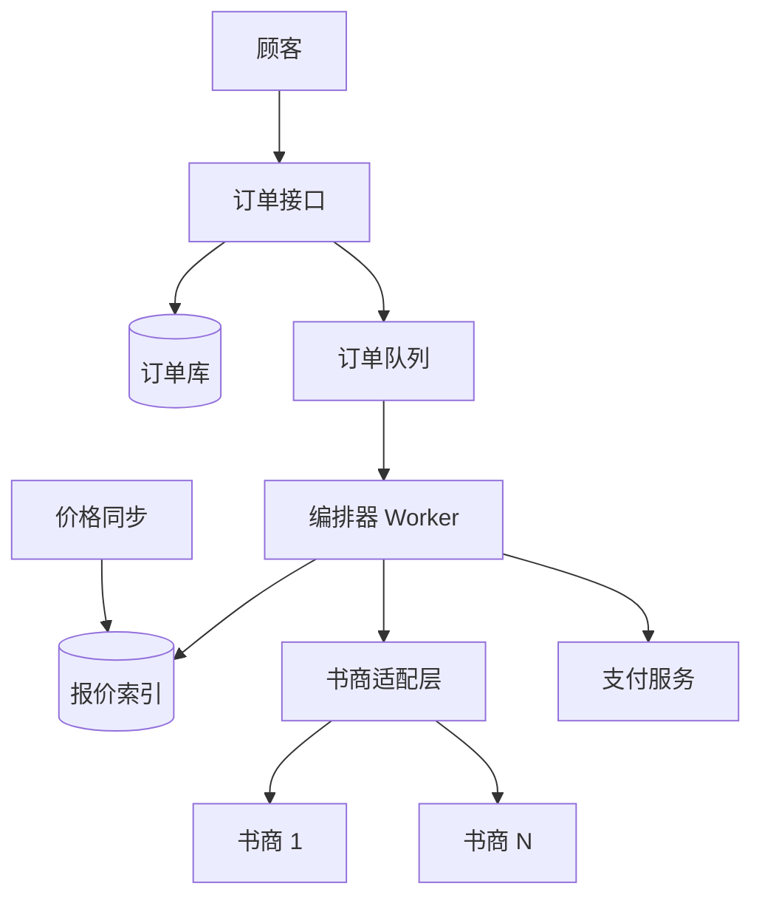

## Q
**图书比价代购平台（Book Seller Platform）**｜系统设计

设计一个图书市场服务：顾客提交"书名、收货信息、支付信息、最高愿付价格"，服务向已注册的多家书商询价，只要有书商报价不高于最高价，就从最低价的书商买下，并告诉顾客是哪家、多少钱；否则告诉顾客最低价来自哪家（或根本没有书商有货）。约束：书名当作唯一 ID，一次只买一本，不是每家书商都卖每种书，同一种书各家价格不同。书商的接口各不相同，需要支持书商注册与适配；要同时给出同步和异步两种接口；规模按 1 万 QPS 设计（也有版本给 1000 QPS、1000 万种书、50 家书商，或只有 20 QPS）；订单完成 p99 约 5 秒。常见追问：书商也在系统之外卖货、支付由谁处理、失败怎么办、幂等怎么保证、用 Saga 还是 Outbox。

给出完整解答：需求、核心实体与接口、整体设计、深入问题、取舍、不同级别的期望。

## A
**一句话。** 这是一道"对一堆不可靠的第三方做扇出，并在其中恰好成交一次"的题：难点不是比价，而是在书商随时可能超时、涨价、卖光、重复响应的情况下，保证不重复购买、不漏扣不多扣顾客的钱，并且不被扇出放大压垮书商。

**需求。**
功能：
1. 书商注册：声明接口地址、鉴权方式、能力（是否支持预留、是否推送价格）；平台能适配不同书商接口。
2. 顾客下单（书名、最高价、收货地址、支付凭证），平台选出不超过最高价的最低报价并代为购买。
3. 返回结果：买到则给出书商与成交价；买不到则给出最低价及书商，或"无货"。
4. 同步接口（等结果）与异步接口（立即返回订单号，之后查询或回调）。
5. 查询订单状态；顾客可看到每一步的进展。

非功能：
- 峰值 1 万 QPS 下单；完成延迟 p99 约 5 秒；书商接口慢且不稳定，必须隔离。
- 正确性第一：同一订单最多成交一次，钱和货对得上；至少一次投递加幂等，而不是"最多一次"。
- 书商库存可能在平台之外被卖掉，所以任何缓存价格只是线索，不是承诺。
- 可用性：个别书商挂掉不应拖垮整单（降级为用剩下的书商比价）。
- 规模参考：1000 万种书、50 家书商，报价记录量级约几亿条以内。

**核心实体与接口。**
实体：`Seller(id, endpoint, authConfig, capabilities, rateLimit, status)`；`Offer(bookId, sellerId, price, qty, asOf)`；`Order(id, customerId, bookId, maxPrice, idempotencyKey, status, chosenSeller, paidPrice, paymentRef)`；`Attempt(orderId, sellerId, quotedPrice, status, sellerOrderRef)`；`PaymentIntent(orderId, authorizedAmount, status)`。

接口：
- `POST /orders {bookId, maxPrice, shipTo, paymentToken}` + 请求头 `Idempotency-Key` → 同步模式在 5 秒内返回结果，超时返回 `202 {orderId}`；`?mode=async` 直接 `202`。
- `GET /orders/{id}`；可选的回调地址 `callbackUrl`。
- 书商注册：`POST /sellers`（含适配声明）；平台希望书商实现的标准接口只有三个：`quote(bookId)`、`purchase(bookId, maxPrice, orderRef)`、`status(orderRef)`，并要求 `purchase` 按 `orderRef` 幂等。

支付信息只能是支付服务商换出来的令牌（token），平台不保存原始卡号。

**整体设计。**

订单的主流程（状态机 `CREATED → QUOTING → PURCHASING → COMPLETED / FAILED_PRICE / FAILED_NO_STOCK / UNKNOWN`）：
1. 接口层用 `Idempotency-Key` 在订单库里 `INSERT ... ON CONFLICT`：重复请求返回同一订单，不再触发第二次购买。订单落库后入队（落库与入队用 Outbox，见下）。
2. 编排器取到订单，先查"报价索引"：`Offer` 表按 `bookId` 取全部书商报价，过滤出价格不超过最高价的，按价格升序。索引由书商推送（webhook、文件）和周期性拉取更新，是扇出的缓存层。
3. 若索引没有命中或报价太旧（`asOf` 超过 TTL，如 60 秒），对相关书商做一次实时 `quote`（并行，单书商超时 1 到 1.5 秒，用熔断器和舱壁隔离）。
4. 从最低价开始尝试购买：对书商调用 `purchase(bookId, maxPrice, orderRef=orderId+attemptNo)`。书商返回 `accepted(price)` 就成交；返回涨价、缺货或拒绝，就记录失败并换下一家。成交价以书商返回为准，并校验仍不超过最高价。
5. 全部失败：把最低价（实时询到的）与书商返回给顾客，状态置为 `FAILED_PRICE` 或 `FAILED_NO_STOCK`。
6. 支付（见深入 2）和通知（回调、邮件）都由事件驱动。

同步与异步共用同一条后台流水线：同步接口只是"提交订单后等待订单进入终态，最多等 5 秒"，到时仍未终态就改为返回 `202`，顾客再轮询或等回调。这样不需要维护两套逻辑，也避免长时间占住连接。

**深入。**

1. 扇出与规模：1 万 QPS 乘 50 家书商，不能每单都扇出。
- 问题：每单向全部书商询价等于 50 万次/秒外部调用，书商有速率限制，延迟也由最慢的一家决定。
- 选项：(a) 全量实时扇出，最新但最慢最贵；(b) 只用缓存报价，最快但可能买到过期价；(c) 报价索引做排序，实时只验证候选（先买最便宜的，由书商响应校正）。
- 选择 (c)：读路径走索引（热书多、请求合并 singleflight，同一种书的并发询价共享一次刷新），写路径靠书商返回的结果作最终裁决。每家书商一个令牌桶限速加独立线程池/信号量（舱壁），慢书商不拖死其他书商；按书商健康度做熔断，断开期间该书商从候选里剔除。1000 QPS、20 QPS 的版本只是把索引与异步化省掉，保留编排与幂等。

2. 恰好成交一次：幂等、Saga 与 Outbox。
- 问题：购买请求发给书商后超时，不知道书商到底有没有下单；盲目重试可能买两本，盲目放弃可能顾客被扣钱却没货。
- 方案：每次尝试有稳定的 `orderRef`（订单号加尝试序号）并要求书商按它幂等；超时不当成失败，而是进入 `UNKNOWN`，用 `status(orderRef)` 查询确认，查到才决定成败；查不到再安全重试同一个 `orderRef`。同一订单同一时刻只允许一个编排器处理（行级状态更新加版本号，或按 `orderId` 分区的队列，天然单消费者）。
- 支付有两种形态。形态一，书商自己收款（类似一键购买）：平台只传令牌，书商处理，平台没有资金风险，只需要对订单状态负责。形态二，平台代收：先对最高价做预授权（authorize，冻结额度），书商确认成交后按实际成交价扣款（capture），失败则作废预授权（void）。这是 Saga：`预授权 → 向书商购买 → 扣款`，每一步有补偿动作。把"需要补偿的步骤"放在前面（预授权可撤销），"不可撤销的步骤"放在后面，书商购买是枢轴（pivot）。
- Outbox：订单状态更新与"要发出的事件"在同一个数据库事务里写入 `outbox` 表，转发进程再投递到队列；这解决了"订单已写入但消息没发出"的双写不一致。消费者按至少一次处理，靠幂等键去重。
- 兜底：一个对账任务，定期扫描长时间停留在 `PURCHASING` 或 `UNKNOWN` 的订单，向书商查询并推进或回滚；这是最后一道防线，也是线上可观测性的重点。

3. 书商注册与接口差异：适配层。
- 问题：每家书商接口不同（REST、SOAP、文件、字段名与错误码各异），平台不应为每家写死逻辑。
- 方案：定义平台的标准接口（上面的三个调用）。书商可以选择：自己实现标准接口（最好，面试中可以直接说"我们定义书商必须支持的 API"）；或者在注册时提供声明式映射（请求模板、响应字段路径、状态码映射），由通用适配器执行；极端情况下为大书商单独写适配器插件（适配器模式）。每家书商的元数据（超时、速率、能力、版本）进配置存储，变更热加载。
- 隔离：适配层按书商独立部署或独立线程池，适配器崩溃不影响其他家；契约测试和沙箱环境用来验证新书商。

4. 书商在系统之外卖货：
- 报价与库存只是对书商的一次查询结果，不是预留。能预留的书商（有 `reserve` 调用）可以先预留再付款；不能预留的，只能"带最高价直接购买"，被拒就退到下一家。所以必须接受失败是常态，并在顾客侧给出清晰状态，而不是承诺必成交。

**取舍与追问。**
- 价格优先还是延迟优先：先买最便宜的书商，拒绝就依次回退，期望延迟取决于命中率；也可以同时向前两名并发下单，但会带来重复购买的风险，需要取消机制，通常不值得。
- 数据存储：订单库用关系型数据库（事务、唯一键，按 `customerId` 或 `orderId` 分片），报价索引用键值或宽表存储，按 `bookId` 分区；热门书的读用缓存。
- 顾客重复提交：同一幂等键返回同一订单；同一顾客对同一种书短时间内两个不同的键，是业务策略问题（提示或限制），不是技术保证。
- 失败怎么讲：每一个外部调用都问三个问题——超时了怎么办、重试会不会重复、失败了谁来补偿。
- 支付安全：令牌化、不落原始卡号；若面试官说忽略支付安全，也要说明令牌从何而来。

**级别期望。**
- 中级：给出下单、询价、购买的基本流程和数据模型；能说出同步改异步的理由。
- 高级：幂等键、订单状态机、超时进入未知状态再查询、报价缓存加实时验证、按书商限速与熔断。
- 资深/Staff：Saga 与 Outbox 的完整论证、对账兜底、适配层的可演进性、容量估算（扇出放大）、书商侧一致性假设的明示、故障注入与可观测性（每个书商的成功率、延迟、拒绝原因）。

**先修概念。** [[hi-system-design-patterns-multi-step-processes|多步骤流程]]、[[hi-system-design-core-concepts-api-design|API 设计]]、[[hi-system-design-core-concepts-data-modeling|数据建模]]、[[hi-system-design-core-concepts-caching|缓存]]、[[hi-system-design-patterns-scaling-reads|扩展读]]、[[hi-system-design-deep-dives-kafka|Kafka]]

**同类题。** [[solution-e-commerce|电商下单]]、[[hi-system-design-problem-breakdowns-payment-system|支付系统（Stripe）]]、[[solution-flash-sale|秒杀系统]]、[[hi-system-design-problem-breakdowns-camelcamelcamel|价格追踪（CamelCamelCamel）]]
