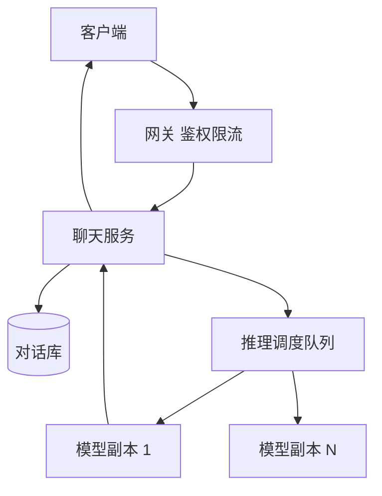

## Q
**对话式 AI 聊天服务（简化版 ChatGPT）**｜系统设计

设计一个类似 ChatGPT 的对话式 AI 系统：用户和模型进行自然语言多轮对话并收到逐字流出的回复。面试官明确要求"先做一个简单版本，支撑有限数量的用户"，所以重点是一条清晰、能跑通的主链路，再按追问扩展：上下文怎么保存与截断、流式输出怎么做、推理资源紧张时怎么排队、怎样限流和控制成本。

给出完整解答：需求、核心实体与接口、整体设计、深入问题、取舍、不同级别的期望。

## A
**一句话。** 聊天服务本身很薄（存消息、拼提示词、转发流），难点集中在昂贵且慢的大模型推理：回复要流式返回、一次生成要占用 GPU 几秒到几十秒、容量有限，所以必须管理上下文长度、排队与限流，并且能在流中途取消或失败后恢复。

**需求。**
功能：
1. 创建对话，发送消息，实时流式接收模型回复。
2. 多轮对话：模型能看到此前的上下文。
3. 对话列表与历史：可以查看、继续、重命名、删除。
4. 中途停止生成；对最近一条回复"重新生成"。
5. 范围外（先声明）：多模态、插件与工具调用、微调；这些作为扩展点。

非功能（简单版的容量假设）：
- 10 万日活，人均每天 10 条消息，约 100 万条/天，约 12 条/秒，峰值按 5 倍约 60 条/秒。
- 一次回复约 500 个词元（token），按 50 词元/秒流出，约 10 秒，所以峰值并发的流约 600 路（60×10）。
- 首词元延迟 < 1 到 2 秒；之后流畅输出；整体可用性 99.9%。
- 存储：每条消息平均约 2KB，100 万条/天约 2GB/天，一年不到 1TB，普通关系型数据库足够。
- 成本与滥用控制：推理按词元计费，必须限流并设预算。

**核心实体与接口。**
实体：`User`；`Conversation(id, userId, title, createdAt, updatedAt)`；`Message(id, conversationId, role[system|user|assistant], content, tokenCount, createdAt, status)`。
接口：
- `POST /conversations`；`GET /conversations`（分页）；`GET /conversations/{id}/messages`；`DELETE /conversations/{id}`。
- `POST /conversations/{id}/messages {content}` → 返回 `text/event-stream`（SSE），不断推送 `delta` 事件，最后推送 `done`（含消息 ID 和词元用量）。
- `POST /conversations/{id}/stop`；`POST /conversations/{id}/regenerate`。

**整体设计。**

一次对话请求的完整链路：
1. 客户端通过 HTTPS 发消息；网关校验登录态，做按用户的限流与并发数限制。
2. 聊天服务把用户消息写入数据库（状态为已发送），读取该对话的历史，拼出提示词（见深入 1），再提交给推理层。
3. 推理层是一组模型服务副本（自己托管的 GPU 服务器，或调用模型提供商的 API）。前面有一个调度队列：按先到先服务加用户优先级分配请求，副本满载时请求排队，队列过长则快速失败并提示稍后重试。
4. 模型副本逐词元生成，聊天服务把词元通过 SSE 原样转发给客户端；同时在内存里累积完整回复。
5. 生成结束（或被停止）后，把完整的助手消息和词元用量一次写入数据库，并更新对话的 `updatedAt`；如果需要标题，用第一条消息异步生成一个简短标题。

为什么用 SSE：回复是单向的服务器推送，基于普通 HTTP，穿透代理与负载均衡容易，浏览器内建重连；而发送新消息、停止生成本来就是独立的 HTTP 请求。WebSocket 在需要双向实时（语音、协同）时才有必要。

**深入。**

1. 上下文管理：
- 问题：模型有上下文窗口上限（例如 8 千到 12.8 万词元），对话越来越长；每次请求都要把历史一起送给模型，长度直接决定成本和延迟（推理的计算量随上下文增长）。
- 选项：(a) 滑动窗口——保留系统提示和最近的若干轮，更早的丢弃，简单、成本可控，但会遗忘；(b) 摘要——把较早的内容让模型压缩成一段摘要，放在窗口开头，保留要点，代价是额外一次推理调用和信息损失；(c) 检索式记忆——把历史片段做向量索引，每次按相关性取回，适合超长对话，复杂度最高。
- 选择：简单版用 (a)，同时在每条消息上存 `tokenCount`，拼提示词时从最新消息向前累加直到达到预算（窗口上限减去为输出预留的词元数）。把 (b) (c) 作为扩展。
- 优化：提示词前缀（系统提示加早期对话）在多轮之间是不变的，推理服务可以复用已计算的前缀缓存（KV cache 前缀复用），降低首词元延迟；所以尽量保持前缀稳定，新内容只往后追加。

2. 流式输出与取消：
- 问题：一次生成持续几十秒，期间网络可能断，用户可能点停止或关闭页面。
- 方案：服务端持有与推理层的流式连接；客户端断开时（SSE 连接关闭），服务端检测到后取消上游请求，释放 GPU 资源，把已生成的部分以"被中断"的状态存下来。"停止"按钮既可以直接关连接，也可以调用 `stop`，两者都触发取消。
- 断线续传：若要求断线后接着看，需要把生成中的内容先写入一个缓冲（例如 Redis 里按消息 ID 追加）；客户端重连时带 `lastEventId`，从缓冲补发，再接上实时流。简单版可以不做，面试中说明"可以这样扩展"即可。
- 背压：客户端读得慢时，服务端的发送缓冲会堆积，需要对每路流设置缓冲上限，超限则断开。

3. 推理容量与排队：
- 问题：GPU 昂贵、容量固定；并发流超过容量时不能让所有人都变慢到不可用。
- 做法：推理服务采用连续批处理（continuous batching），一个副本可同时处理几十路请求，吞吐比逐个处理高得多，但并发过高时每路速度下降、显存（KV cache）耗尽。因此要按副本设并发上限（例如 30 到 60 路，取决于模型大小与硬件），用调度队列做准入控制：满了就排队，等待超过阈值（例如 10 秒）返回 `429`/`503` 与重试提示。副本数按峰值并发的 600 路估算，大约需要十几个到几十个副本，并预留余量。
- 模型路由：简单任务（生成标题）用小模型，主对话用大模型；按用户等级优先调度。
- 容错：副本失败时，已开始的流中断（返回错误，让用户重试或自动重试一次）；未开始的请求从队列里重新分配到别的副本。

4. 限流、预算与安全：
- 按用户限制并发流数量（例如同时 1 到 2 路）、每分钟请求数、每日词元预算；以词元而不是请求数为单位计量，因为成本取决于词元。
- 输入与输出的内容审核（敏感内容分类）放在调度前后，不通过的请求直接拒绝；提示注入与泄露系统提示是需要提到的风险。
- 用量记录：每次生成的输入词元、输出词元写入计量表，用于计费、配额与成本分析。

**取舍与追问。**
- 自托管模型还是调用 API：API 上手快、容量弹性，但成本与限速由供应商决定；自托管成本可控，需要 GPU 运维与容量规划。简单版可以先接 API。
- 消息存储：关系型数据库（`conversations`、`messages` 两表，`messages` 按 `(conversationId, createdAt)` 索引）已够用；用户量增长后按 `userId` 分片。
- 重新生成：保留旧版本还是覆盖：给消息加 `parentId`，形成分支树（可翻看不同回答），简单版覆盖最后一条即可。
- 删除与合规：删除对话时同时删消息；训练数据使用与保留期是产品与合规问题。
- 扩展到更多用户：无状态聊天服务水平扩展，推理副本按并发扩容，数据库读写分离与分片，缓存对话列表。

**级别期望。**
- 中级：客户端、聊天服务、数据库、推理服务的基本链路，说明要流式输出，保存历史。
- 高级：SSE 流式、上下文截断与词元预算、取消与背压、推理排队与并发上限的容量估算、按词元限流。
- 资深/Staff：连续批处理与前缀缓存对容量的影响、摘要与检索式记忆的取舍、模型路由与成本、断线续传与失败恢复、审核与安全、多区域与容量规划。

**先修概念。** [[hi-system-design-patterns-realtime-updates|实时更新]]、[[hi-system-design-core-concepts-api-design|API 设计]]、[[hi-system-design-core-concepts-data-modeling|数据建模]]、[[hi-system-design-patterns-long-running-tasks|长时间运行的任务]]、[[hi-system-design-core-concepts-networking-essentials|网络基础]]、[[hi-system-design-deep-dives-vector-databases|向量数据库]]

**同类题。** [[hi-system-design-problem-breakdowns-chatgpt|ChatGPT（拆解）]]、[[solution-llm-chat-service|大模型聊天服务（本库解答）]]、[[solution-chat-messaging|聊天消息系统]]、[[hi-system-design-problem-breakdowns-whatsapp|即时通讯（WhatsApp）]]
