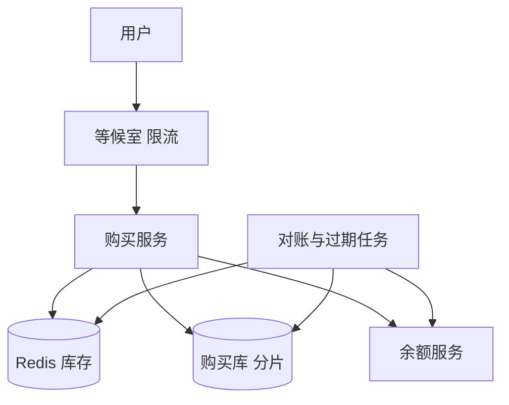

## Q
**设计限时众筹购股系统（用账户余额抢固定数量的公司股份）**｜系统设计

一家公司要向自己的客户出售 1,000 万股股份，每股固定 10 英镑，总共募资 1 亿英镑。活动窗口有限（例如一周），客户登录后可以选择购买的股数，用自己账户里已有的余额支付。余额由一个已有的余额服务（Balance Service）管理，它是所有资金变动的唯一真相，提供 `lookupBalance`、`deposit`、`withdraw` 三个接口。要求：能看到活动和剩余股数；绝不超卖固定的股份池；余额不足不能买；高并发（例如 500 万用户在 1 小时内涌入）；购买记录持久且可审计；请求重复、重试、扣款失败、预留过期、部分失败都要处理；活动开始前和结束后不能购买。面试官重点追问：争用（contention）、如何保护余额服务、幂等。

给出完整解答：需求、核心实体与接口、整体设计、深入问题、取舍、不同级别的期望。

## A
**一句话。** 这是"一个全局有限库存 + 一个不归我们管的资金服务"：库存要原子扣减、绝不超卖，扣钱要恰好一次，而且这两件事跨两个系统，只能用"先做可撤销的预留，再做不可逆的扣款，最后确认"的顺序加幂等来保证一致。

**60 分钟路线。**

| 时间 | 做什么 |
|---|---|
| 0–5 分 | 问清需求，估峰值：500 万用户 1 小时，约 1.4 万次/秒 |
| 5–10 分 | 实体、状态机、三个接口，`purchaseId` 当幂等键 |
| 10–25 分 | 整体设计：先预留（Redis）后扣款（余额服务）再确认 |
| 25–50 分 | 必讲深入：先预留后扣款；扣款超时；保护余额服务 |
| 50–60 分 | 追问：库存热点、为什么不用 2PC、抽签 |

**需求。**
- 功能：查看活动与剩余股数；提交购买（股数）；查询自己的购买结果；活动起止时间控制。
- 非功能：
  - 绝不超卖：已确认股数 + 有效预留股数 ≤ 1,000 万；
  - 绝不透支：余额不足的购买必然失败；
  - 幂等：同一次购买意图重复提交只生效一次；
  - 持久可审计：每次状态变化都留痕；
  - 保护余额服务不被冲垮；
  - 峰值：500 万用户 1 小时，平均约 1,390 人/秒，开抢瞬间按 10 倍约 1.4 万次/秒。
- 估算：1,000 万股 × 10 英镑 = 1 亿英镑。如果平均每人买 2 股以上，500 万用户足以在几分钟内抢完，所以"已售罄"的快速失败路径比成功路径更常见，要做得极便宜。每笔购买约 3–4 次写（预留、扣款状态、确认、审计），按峰值 1.4 万次/秒即约 5 万次写/秒，所以购买记录库必须可分片。

**核心实体与接口。**
- 实体：
  - 活动（Event：`eventId`、总股数、单价、开始/结束时间、单人上限）；
  - 购买（Purchase：`purchaseId`、`eventId`、`userId`、股数、金额、状态、`reserveExpiresAt`）；
  - 状态机 `RESERVED → PAYING → CONFIRMED | FAILED | EXPIRED`；
  - 购买事件流水（每次状态变化追加一行，只增不改）。
  - 库存计数器：Redis 里的 `remaining:{eventId}`。
- 接口：
  - `GET /events/{id}`（静态信息放 CDN，剩余股数单独接口，允许几秒延迟）；
  - `POST /events/{id}/purchases {shares, purchaseId}`（`purchaseId` 由客户端按"用户 + 活动 + 随机数"生成，是幂等键）→ `{status}`；
  - `GET /purchases/{id}`。
- 依赖余额服务：`withdraw(userId, amount, idempotencyKey)`、`deposit(...)`（退款/补偿）。

**整体设计。**

1. 入口：活动页面是静态的，放 CDN，开始前显示倒计时。开抢后，所有购买请求先过等候室（waiting room）和限流：按用户限制同一时刻只能有一个未完成的购买，整体按余额服务能承受的速率放行，其余排队。
2. 校验窗口：用服务端时间对照缓存的活动配置判断是否在窗口内，不信任客户端时间。
3. 幂等：以 `purchaseId` 为主键插入购买行（`INSERT ... ON CONFLICT DO NOTHING`）。已存在则返回已有状态，不再执行后续步骤。
4. 预留股份（第一个可撤销步骤）：在 Redis 里用一段 Lua 脚本原子地"检查剩余 ≥ 请求股数，则扣减并返回成功，否则返回售罄"，脚本在 Redis 中串行执行，所以不会超卖。成功后把购买行状态写成 `RESERVED`，记下过期时间（例如 5 分钟后）。售罄时直接失败，不会再触碰余额服务。
5. 扣款（不可逆的"支点"步骤）：状态改为 `PAYING`，调用 `withdraw(userId, 金额, purchaseId)`，用 `purchaseId` 作幂等键。
   - 成功 → 步骤 6；
   - 余额不足 → 状态 `FAILED`，把股数加回 Redis；
   - 超时或未知错误 → 用同一个幂等键重试；仍不明确就停留在 `PAYING`，交给对账任务（见深入 2）。
6. 确认：状态 `CONFIRMED`，写审计流水，发事件（通知用户、更新已售统计）。
7. 对账与过期任务周期运行：查找超时的 `RESERVED/PAYING`，核实余额服务的实际结果后再决定确认或回收股数；定期核对 Redis 的剩余数是否等于 `总数 − (已确认 + 有效预留)`，不一致就以数据库为准纠正。

**深入。**

1. 【必讲】为什么先预留股份、再扣款，而不是反过来？
   - 先扣款后抢股：抢不到就要退款（再做一次资金操作），售罄后大量用户的钱被扣了又退，余额服务压力翻倍，对账更复杂。
   - 先预留后扣款：预留只是 Redis 里的一次加减，失败可以无代价撤销；不可逆的扣款放在中间偏后，之后只剩可以无限重试的「确认」。
   - 原则：可撤销的步骤放前面，不可逆的放后面，之后的步骤必须能安全重试。

2. 【必讲】扣款结果不确定（超时）：
   - 绝不能直接把股数放回去：钱可能已经扣了，放回去再卖给别人就是超卖或「收了钱没给股」。
   - 用同一个幂等键重试 `withdraw`，余额服务应保证只扣一次并返回同样结果。
   - 仍不明确就停在 `PAYING`，由对账任务按幂等键向余额服务查询：确认没扣才回收股数并置 `FAILED`，确认已扣置 `CONFIRMED`。余额服务无法查询时，只能一直用同一个幂等键重试，需要和对方约定幂等语义。
   - 终态之前股数一直占用，多占一会儿比超卖安全。

3. 【必讲】保护余额服务：它承载全公司的资金业务，不能被一次活动拖垮。
   - 入口限流与等候室：把调用速率压到约定值（例如 2,000 次/秒）；500 万人 1 小时平均只要约 1,400 次/秒，余量足够。
   - 不调 `lookupBalance`：先查再扣有时间窗口，还多一次调用；直接 `withdraw`，余额不足由它拒绝。`lookupBalance` 只用于页面展示，可缓存。
   - 熔断与退避：余额服务变慢时快速失败，让用户稍后重试，避免重试风暴。
   - 同一用户一次只允许一笔未完成的购买，防止并发多笔和重复点击。

4. 【追问再讲】对账与过期任务：周期运行，找出超时的 `RESERVED` / `PAYING`，先核实余额服务的实际结果，再决定确认或回收股数；核对 Redis 剩余数是否等于 `总数 − (已确认 + 有效预留)`，不一致以数据库为准。

5. 【追问再讲】库存热点：全局计数器是热点。
   - Redis 单键每秒可处理十万级操作，峰值 1.4 万次/秒绰绰有余，先不拆。
   - 不够再拆成 N 段（例如 64 段，每段约 15.6 万股），请求随机选一段扣，不够换段；代价是尾部碎片，最后几股散在各段，要尾声合并或逐段扫描。
   - 数据库是真相，Redis 只是加速的闸门；Redis 宕机后先从数据库重算再开放，期间短暂拒绝，比带着错误计数放行安全。

6. 【追问再讲】为什么不用分布式事务（2PC）连接两边：余额服务是别人的，不一定支持；2PC 在高并发下持锁时间长。幂等加补偿（Saga）更实际。若余额服务不保证幂等，只能保证每个购买最多发起一次扣款请求并记录，超时靠对方流水确认，这个接口缺口要提前约定。

7. 【加分】持久与审计、活动窗口。
   - 购买行加追加式的状态流水；每次调余额服务的请求、响应、耗时都记录；每日与余额服务的流水核对。数据库按 `userId` 或 `purchaseId` 哈希分片，同一次购买的写入落在同一分片。
   - 开始前拒绝；结束时已预留的请求给很短的宽限期，仍未完成的由对账任务收尾；边界附近以数据库记录的时间戳为准。

**取舍与追问。** 按被问到的可能性排，通常口述就够：
- 单人限购：数据库里按 `(eventId, userId)` 汇总已购股数，用条件更新保证不超上限。
- 需求远大于供给怎么公平：先到先得对网络快的人有利；可以改为抽签，窗口内收集意向并先冻结资金，结束后随机分配，未中的退款。没有「抢」的并发问题，但流程更长，资金冻结更久。
- 通知：确认后异步发送，用发件箱模式，失败不影响购买结果。

**级别期望。**
- 中级：预留库存 + 扣款的两步流程，Redis 原子扣减防超卖，购买记录表，基本幂等。
- 高级：先预留后扣款的顺序理由、超时的不确定性处理、对账与预留过期、保护下游的限流、单用户串行。
- 资深/专家：库存分段与碎片、等候室与抽签的产品取舍、Redis 失效后的重建、与外部资金服务的幂等语义缺口、审计与对账体系，能清晰说出每个状态下"股数和钱各在谁手里"。

**先修概念。**
- [[hi-system-design-patterns-dealing-with-contention|处理争用（Contention）]]
- [[hi-system-design-patterns-multi-step-processes|多步骤流程]]
- [[hi-system-design-deep-dives-redis|Redis]]
- [[hi-system-design-core-concepts-api-design|API 设计]]
- [[hi-system-design-core-concepts-sharding|分片（Sharding）]]

**同类题。**
- [[hi-system-design-problem-breakdowns-flash-sale|秒杀系统]]
- [[hi-system-design-problem-breakdowns-ticketmaster|票务预订（Ticketmaster）]]：限量库存与预留超时
- [[solution-flash-sale|设计题解：秒杀]]
- [[hi-system-design-problem-breakdowns-payment-system|支付系统（Stripe）]]：对外部资金系统的幂等与对账
