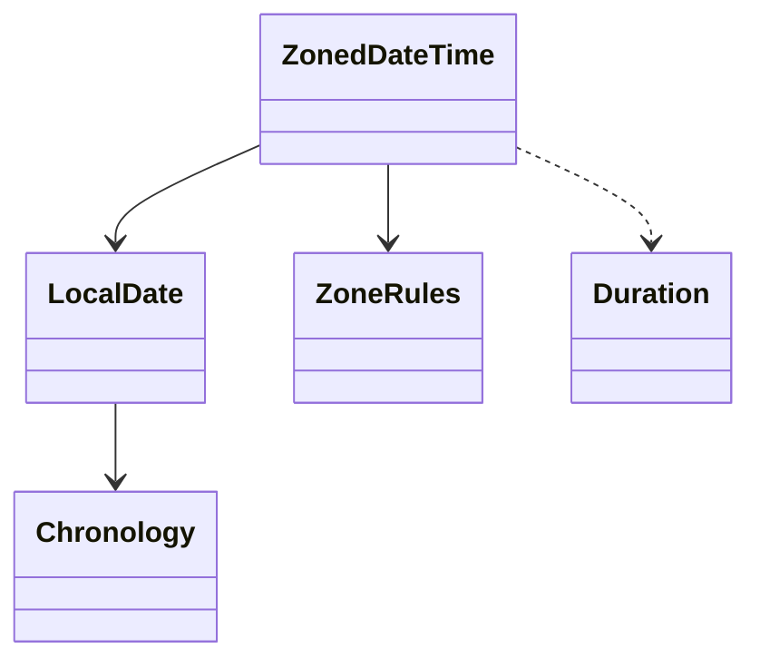

## Q
**设计日期时间库（Date and Time Library）**｜低层设计

设计一个日期时间库：可以存储、管理和操作日期、时间和时长，支持格式化、转换，以及跨时区、跨日历系统的算术运算。这类题目常被包装成"准备系统设计"的面试里突然出现的低层设计题，没有标准答案，面试官考察的是你对"时间到底是什么"的建模能力：哪些概念要分开、哪些边界情况（闰年、月末、夏令时）会出错、接口怎样设计才不容易被误用。

给出完整解答：需求、核心实体与接口、整体设计、深入问题、取舍、不同级别的期望。

## A
**一句话。** 时间库最大的设计原则是把四个常被混在一起的概念分开：时间线上的一个点（Instant）、墙上的钟表读数（LocalDateTime，没有时区）、时区规则（偏移量随日期变化）、时间的量（精确时长 Duration 与日历时长 Period），并全部做成不可变的值对象；绝大多数日期时间 bug 都来自把它们混为一谈。

**需求。**
- 功能：
  - 从年月日、时分秒构造并校验（非法日期如 2 月 30 日必须被拒绝）；
  - 加减天、月、年（月末要合理处理）；加减精确时长；
  - 两个日期/时间点之间的差；比较大小；星期几；
  - 在时区之间转换，处理夏令时；
  - 格式化与解析（ISO-8601 和自定义模式）；
  - 支持多种日历（公历、农历、伊斯兰历等）的扩展。
- 非功能：
  - 不可变、线程安全、可作字典的键；
  - 算术结果可预期、文档化，不出"意外"；
  - 内部表示可高效比较与存储；
  - 可测试：当前时间由可注入的时钟提供。

**核心实体与接口。**
- `Instant`：时间线上的一个点，存"自纪元起的秒 + 纳秒"。注意不能只用一个 64 位纳秒整数，它只覆盖 1970 年前后约 292 年（约 1677–2262 年），所以秒和纳秒分开存。
- `LocalDate`：没有时区的日期，内部只存一个整数——自 1970-01-01 起的天数（纪元日，epoch day）。
- `LocalTime`：一天内的时间，存当天的纳秒数。`LocalDateTime` 是两者的组合。
- `ZoneRules` / `ZoneId`：时区规则：一串"在某个 UTC 时刻偏移量变成多少"的转换点。
- `ZonedDateTime`：一个时间点 + 一个时区，用来展示；内部真正存的是时间点。
- `Duration`：精确的时间长度（秒、纳秒），与日历无关。
- `Period`：日历意义上的长度（年、月、日），"一个月"到底多少天取决于从哪天开始。
- `Chronology`（策略）：日历系统，负责"纪元日 ↔ 年月日"的转换、每月天数、闰年判断。
- `Formatter`（建造者）：由模式字符串（如 `yyyy-MM-dd HH:mm`）生成一串格式化/解析单元。
- `Clock`：提供当前时间，便于测试替换。
- 模式：值对象与不可变性、工厂方法（`of` 带校验）、策略（日历与时区规则可替换）、建造者（格式化器）。

**整体设计。**



设计要点：
1. 每个类型的字段只存一个"规范化"的整数（纪元日、当天纳秒、UTC 秒），所有比较、排序、哈希都是整数运算；展示用的年月日由算法现算。
2. 构造即校验：`LocalDate.of(2024, 2, 30)` 直接抛异常，系统里不存在非法的日期对象，下游代码不必再检查。
3. 年月日与纪元日之间用经典的民用历算法互转（先把 1、2 月归入上一年，让闰日落在年末，再按 400 年一个周期换算），不依赖循环逐年累加。
4. 偏移量不存在 `ZonedDateTime` 里，而是由 `ZoneRules` 根据 UTC 时间点现算，避免规则更新后存量数据变脏。

```python
from __future__ import annotations

import bisect
from dataclasses import dataclass
from typing import Sequence

SEC_PER_DAY = 86_400


# ---------- 日历算法：全部落到"纪元日"（自 1970-01-01 起的天数）这个整数上 ----------
def is_leap(y: int) -> bool:
    return y % 4 == 0 and (y % 100 != 0 or y % 400 == 0)


def month_len(y: int, m: int) -> int:
    return 29 if m == 2 and is_leap(y) else (31, 28, 31, 30, 31, 30, 31, 31, 30, 31, 30, 31)[m - 1]


def days_from_civil(y: int, m: int, d: int) -> int:
    y -= m <= 2                                   # 把 1、2 月算进上一年，闰日就落在"年末"
    era = y // 400
    yoe = y - era * 400
    doy = (153 * (m + (-3 if m > 2 else 9)) + 2) // 5 + d - 1
    doe = yoe * 365 + yoe // 4 - yoe // 100 + doy
    return era * 146097 + doe - 719468


def civil_from_days(z: int) -> tuple[int, int, int]:
    z += 719468
    era = z // 146097
    doe = z - era * 146097
    yoe = (doe - doe // 1460 + doe // 36524 - doe // 146096) // 365
    y = yoe + era * 400
    doy = doe - (365 * yoe + yoe // 4 - yoe // 100)
    mp = (5 * doy + 2) // 153
    d = doy - (153 * mp + 2) // 5 + 1
    m = mp + (3 if mp < 10 else -9)
    return y + (m <= 2), m, d


@dataclass(frozen=True, order=True)               # 不可变值对象：线程安全，可作 dict 的 key
class LocalDate:
    epoch_day: int

    @staticmethod
    def of(y: int, m: int, d: int) -> "LocalDate":
        if not (1 <= m <= 12 and 1 <= d <= month_len(y, m)):
            raise ValueError(f"invalid date {y}-{m}-{d}")   # 构造即校验：不存在"非法的 LocalDate"
        return LocalDate(days_from_civil(y, m, d))

    def ymd(self) -> tuple[int, int, int]: return civil_from_days(self.epoch_day)
    def day_of_week(self) -> int: return (self.epoch_day + 3) % 7 + 1   # 1=周一 … 7=周日
    def plus_days(self, n: int) -> "LocalDate": return LocalDate(self.epoch_day + n)

    def plus_months(self, n: int) -> "LocalDate":
        y, m, d = self.ymd()
        t = y * 12 + (m - 1) + n
        y, m = divmod(t, 12)
        return LocalDate.of(y, m + 1, min(d, month_len(y, m + 1)))   # 1 月 31 日 + 1 月 = 2 月末，而不是报错


# ---------- 时区：偏移量不是常数，而是"时间轴上的分段函数" ----------
class ZoneRules:
    def __init__(self, initial: int, transitions: Sequence[tuple[int, int]]) -> None:
        self._at = [t for t, _ in transitions]       # 转换发生的 UTC 秒，升序
        self._off = [initial] + [o for _, o in transitions]

    def offset_at(self, utc_sec: int) -> int:
        return self._off[bisect.bisect_right(self._at, utc_sec)]

    def resolve_local(self, local_sec: int) -> tuple[int, int]:
        """本地墙钟 -> (UTC 秒, 偏移)。夏令时间隙：顺延到间隙之后；重叠：取较早的那次（较大的偏移）。"""
        valid = sorted({o for o in self._off if self.offset_at(local_sec - o) == o}, reverse=True)
        if valid:
            return local_sec - valid[0], valid[0]
        for i, t in enumerate(self._at):             # 落在间隙里：找到那次"拨快"
            before, after = self._off[i], self._off[i + 1]
            if t + before <= local_sec < t + after:
                return local_sec - before, after    # 墙钟 +间隙长度 = 该点在 UTC 轴上的位置不变
        raise AssertionError("unreachable")


@dataclass(frozen=True)
class Duration:                                   # 精确的时间长度，与日历无关
    seconds: int
    @staticmethod
    def of_hours(h: int) -> "Duration": return Duration(h * 3600)


@dataclass(frozen=True)
class ZonedDateTime:
    utc_sec: int                                  # 真正的"时间点"只存这一个数
    rules: ZoneRules                              # 展示用的偏移由规则现算，不存

    @staticmethod
    def of(local_date: LocalDate, sec_of_day: int, rules: ZoneRules) -> "ZonedDateTime":
        utc, _ = rules.resolve_local(local_date.epoch_day * SEC_PER_DAY + sec_of_day)
        return ZonedDateTime(utc, rules)

    def offset(self) -> int: return self.rules.offset_at(self.utc_sec)
    def _local(self) -> int: return self.utc_sec + self.offset()
    def local_date(self) -> LocalDate: return LocalDate(self._local() // SEC_PER_DAY)
    def local_time(self) -> tuple[int, int, int]:
        s = self._local() % SEC_PER_DAY
        return s // 3600, s % 3600 // 60, s % 60

    def plus(self, d: Duration) -> "ZonedDateTime":              # 精确时长：在时间轴上加，跨夏令时墙钟会"跳"
        return ZonedDateTime(self.utc_sec + d.seconds, self.rules)

    def plus_days(self, n: int) -> "ZonedDateTime":              # 日历天数：在墙钟上加，再重新解析偏移，保持"同一钟点"
        h, m, s = self.local_time()
        return ZonedDateTime.of(self.local_date().plus_days(n), h * 3600 + m * 60 + s, self.rules)
```

**深入。**
1. 月份运算：1 月 31 日加一个月是几号？
   - 报错：不友好；
   - 溢出到 3 月 2 日或 3 日：结果不可预期，而且 `加一个月再减一个月` 回不到原日期；
   - 截断到月末（2 月 29 日或 28 日）：被主流库采用，结果合理；
   - 选截断，并在文档里写明"加月后日号不超过目标月的天数"。因此月份加法不满足结合律（先加两个月和连加两次一个月可能不同），这是必须让使用者知道的事实。
2. Duration 与 Period 为什么必须分开：夏令时当天只有 23 小时（春季拨快）或 25 小时（秋季拨慢）。2024 年 3 月 9 日中午加"1 天"（Period，日历天）得到 3 月 10 日中午，实际过去了 23 小时；加"24 小时"（Duration）得到 3 月 10 日 13:00。两种语义都有用——"明天同一时间开会"用日历天，"24 小时后到期"用精确时长。ZonedDateTime 的 `plus_days` 在墙钟上加再重新解析偏移，`plus(Duration)` 在时间线上加。
3. 夏令时的间隙与重叠：
   - 间隙（春季拨快）：本地时间 02:30 根本不存在。常见处理：顺延间隙长度（得到 03:30），也可以抛异常让调用方决定；
   - 重叠（秋季拨慢）：本地时间 01:30 出现两次。默认取较早的一次（第一次出现，偏移量更大），并提供"取较晚一次"的选项；
   - 实现上：对每个可能的偏移量 `o`，检查"本地时间减去 `o` 得到的 UTC 时刻，在规则里的偏移量是否正好是 `o`"，符合的偏移量集合大小是 0（间隙）、1（正常）、2（重叠）。
4. 时区规则存储：IANA 时区数据库给出历史上的转换点和未来的规则（如"三月第二个星期日"）；内部用按时间排序的转换点列表，二分查找某一 UTC 时刻的偏移量，O(log n)；未来规则按年份惰性展开。规则会更新（政府改夏令时），所以存数据库的未来事件应该存"本地时间 + 时区名"，不要只存 UTC，否则规则变化后事件的墙钟时间会错；已经发生的事件存 UTC 就够了。
5. 日历系统扩展：把"纪元日 ↔ 年月日"抽成 `Chronology` 策略，公历、儒略历、伊斯兰历、佛历各一个实现；`LocalDate` 保存纪元日，不依赖具体日历，因此跨日历转换天然成立：先转成纪元日，再用目标日历展开。星期、两日期相差天数这类运算只依赖纪元日，所有日历共用。
6. 格式化与解析：格式模式拆成单元（年、月、日、时、分、字面量），用建造者组合成格式化器，格式化与解析是同一个单元序列的两个方向。解析要严格：位数、范围、歧义（如两位数年份）都要有明确规则，并返回错误位置；本地化（月份名称、星期名称）通过 locale 数据注入。
7. 闰秒：POSIX 时间忽略闰秒，每天固定 86,400 秒；多数系统用"闰秒涂抹"（在一天里均匀拉长）处理。库里不建模闰秒，在文档中说明即可。
8. 正确性验证：与参考实现做大规模随机对照（例如对三百万天范围内的随机日期，比较纪元日与年月日互转、星期几），再针对边界日期（闰日、世纪年 1900/2000、月末、夏令时转换当天）写固定用例。

**取舍与追问。**
- 为什么不直接存 "年、月、日" 三个字段？比较、差值、加减天数都需要先换算，而且容易存出非法组合；存纪元日后，加减天是整数加减，差值是整数减法，年月日只在展示时现算。
- 为什么用不可变对象？共享安全（线程安全、可作键）、没有"改了一个对象影响另一处"的别名问题；代价是每次运算产生新对象，对这类小对象可忽略。
- `LocalDateTime` 和 `ZonedDateTime` 的区别在哪里？前者只是一个读数，没有对应的时间点，不能直接比较先后，也不能转成 UTC；后者有时区，才对应唯一的时间点。把两者混用是最常见的 bug 来源。
- 时区转换的接口：`zdt.with_zone(other)` 保持时间点不变，只改变展示；`zdt.with_local_same(other)` 保持墙钟读数不变，改变时间点。两个语义容易混淆，应该用不同的方法名。
- 周数与周起始日：ISO 周以周一为周起始、第一周包含该年第一个星期四；美国习惯以周日为起始，这是 locale 相关的，放在 `WeekFields` 一类的对象里，不放进核心类型。
- 性能：所有核心运算是整数运算，热点路径（排序、比较）零分配；时区规则的二分查找可以缓存"当前偏移量段"。

**级别期望。**
- 中级：类划分清晰（日期、时间、时长），构造校验，闰年与月末处理，基本格式化。
- 高级：区分 Instant 与本地时间，Duration 与 Period，不可变设计，用纪元日表示，时区转换及夏令时的间隙与重叠。
- 资深/专家：时区规则的存储与更新问题（存本地时间 + 时区名），日历系统抽象，解析的严格性与本地化，闰秒策略，大规模对照测试与边界用例。

**先修概念。**
- [[hi-low-level-design-in-a-hurry-delivery|答题框架（Delivery Framework）]]
- [[hi-low-level-design-in-a-hurry-oop-concepts|面向对象概念]]
- [[hi-low-level-design-in-a-hurry-design-principles|设计原则]]
- [[hi-low-level-design-in-a-hurry-patterns|设计模式]]

**同类题。**
- [[solution-calendar|设计题解：日历系统（系统设计）]]
- [[solution-meeting-scheduler|设计题解：会议安排]]
- [[solution-amz-parking-fees|设计题解：停车计费]]：时间区间运算
- [[solution-ttl-cache|设计题解：带过期时间的缓存]]：时钟注入与测试
