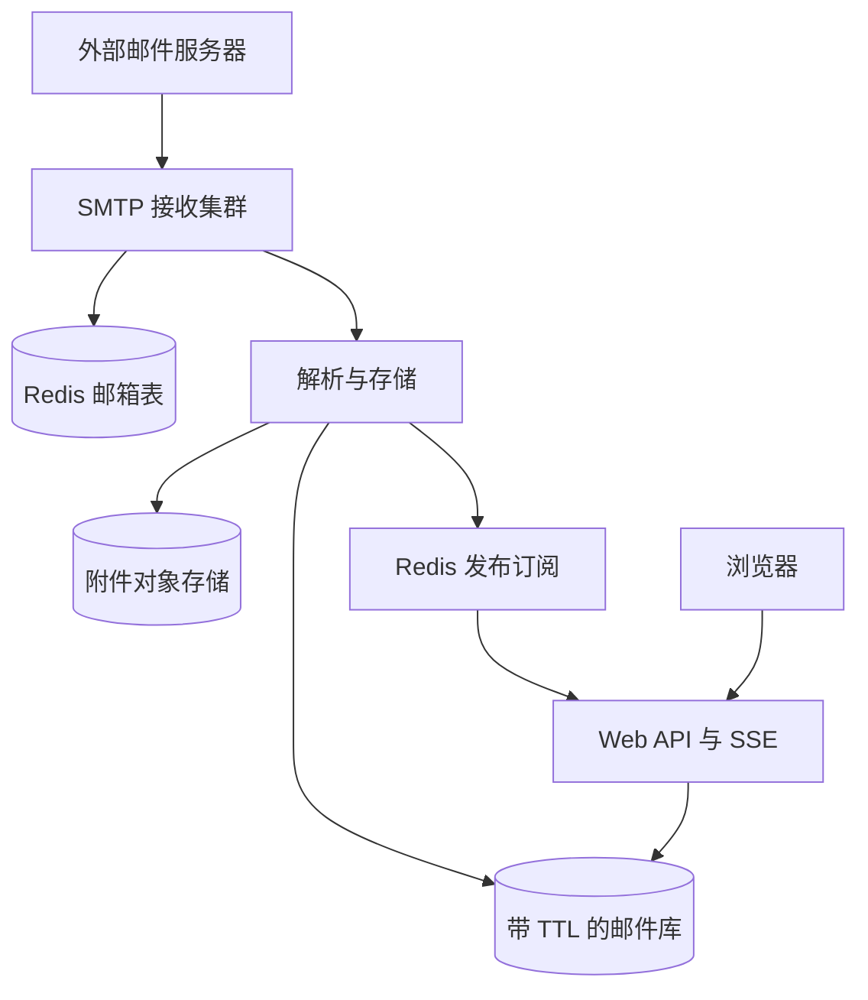

## Q
**设计临时邮箱服务（类似 tempmail.org）**｜系统设计

设计一个一次性邮箱网站：用户点一下就得到一个临时邮箱地址，外部系统（比如某个网站发来的验证邮件）可以给这个地址发信，用户在网页上实时看到收到的邮件；邮箱到期（例如 5 小时，也可能是 10 分钟）后自动销毁，邮件一并删除。常见追问：邮箱过期后地址能不能再次分配，怎样在不泄露前一个用户隐私的前提下复用；明确的约束是"过期的邮件不能复用"；还会问怎么接收邮件（SMTP）、怎么实时通知网页、怎么防滥用和垃圾邮件、规模多大怎么扩展。

给出完整解答：需求、核心实体与接口、整体设计、深入问题、取舍、不同级别的期望。

## A
**一句话。** 这是"定时消失的数据"加"对外开放的 SMTP 入口"：难点有两个——只为活着的邮箱存信（入口处就要拒绝其余的流量），以及地址回收后如何不让新主人收到旧主人的邮件。

**需求。**
- 功能：
  - 一键生成随机地址（也可自选前缀）；
  - 接收发往该地址的邮件，包括正文与小附件；
  - 网页上实时看到新邮件，可打开、删除；
  - 邮箱到期后自动销毁（默认 5 小时），可以延长；
  - 只收不发。
- 非功能：
  - 到期的邮件必须真的不可读（而不是"迟早会被清掉"）；
  - 入口扛得住垃圾邮件洪流，不能因此耗尽存储；
  - 新邮件几秒内出现在网页；
  - 单封邮件有大小上限（例如 10 MB）；
  - 隐私：不记录无关的个人信息。
- 估算：假设每天入站 1 亿封，平均约 1,160 封/秒，高峰 10 倍；平均每封 50 KB。因为邮件只保留 5 小时，常驻数据量约 1 亿 × (5 ÷ 24) × 50 KB ≈ 1 TB，三副本约 3 TB，一个小型集群即可，不是容量问题。地址空间：10 位小写字母加数字有 36^10 ≈ 3.7 × 10^15 种，即使每天新建 1,000 万个邮箱，也要数亿天才会用光，实际上永远不会碰撞。

**核心实体与接口。**
- 实体：
  - 邮箱（Mailbox：`address`、`createdAt`、`expiresAt`、访问令牌）；
  - 邮件（Email：`emailId`、邮箱、发件人、主题、正文引用、附件引用、`receivedAt`）；
  - 附件（存对象存储，邮件里只存引用）。
- 接口：
  - `POST /mailboxes {prefix?}` → `{address, token, expiresAt}`；
  - `GET /mailboxes/{address}/emails`（头带令牌；或 `?since=` 增量）；
  - `GET /mailboxes/{address}/emails/{id}`；`DELETE` 同路径；
  - `POST /mailboxes/{address}/extend`；
  - `GET /mailboxes/{address}/stream`（SSE，推送新邮件事件）。
- 对外还有一个入口：SMTP 服务（25 端口），域名的 MX 记录指向它。

**整体设计。**

1. 创建邮箱：Web API 生成随机前缀，在 Redis 里 `SET mbx:{address} {meta} NX EX 18000`（`NX` 保证不覆盖已有的，`EX` 设置 5 小时的存活时间），返回地址和访问令牌。数据库里的 `expiresAt` 是同一个时间。
2. 接收邮件：外部服务器根据 MX 记录连到我们的 SMTP 接收集群（用成熟的 MTA，如 Postfix，或自写的轻量 SMTP 服务；入口前放 L4 负载均衡）。
   - 在 `RCPT TO` 阶段就查 Redis 邮箱表：地址不存在或已过期，直接回 550（用户不存在）。这一步把绝大多数垃圾流量挡在门外，不占存储、不产生退信；
   - 地址存在则接受，在 `DATA` 阶段强制大小上限（超出回 552）。
3. 解析与存储：把 MIME 解析成主题、纯文本、HTML、附件；附件上传对象存储；正文与元数据写入邮件库，写入时带 TTL（等于邮箱剩余寿命）。随后向 Redis 频道 `mbx:{address}` 发布一条"新邮件"事件。
4. 实时展示：浏览器打开页面后建立 SSE 连接，Web API 订阅对应频道，收到事件就把新邮件摘要推给浏览器；SSE 断开时前端每 5–10 秒轮询一次兜底。
5. 到期：Redis 的 key 到期后，SMTP 入口立即拒绝新邮件；邮件库里同一时刻的数据已由 TTL 清除；读取接口还要额外检查 `expiresAt`，因为部分数据库的过期删除是惰性的，不能依赖它来保证"到期即不可读"。附件对象按"到期日"加前缀，并用生命周期规则和每日任务清理。

**深入。**
1. 邮件库怎么选，才能让到期的数据便宜地消失？
   - Redis 全放内存：快，但 1 TB 常驻放内存成本高；
   - 关系库定时 `DELETE`：大批删除会产生写放大和碎片，高峰期拖慢写入；
   - 宽列库（Cassandra）按写入 TTL + 时间窗口压缩策略（TWCS）：同一时间窗口写入的数据在同一个文件里，窗口整体过期后整个文件直接丢弃，几乎没有删除成本；
   - DynamoDB 的 TTL 功能同样可用，但删除可能延后，所以读取必须再核对 `expiresAt`。
   - 选宽列库（或带 TTL 的 DynamoDB），按 `address` 分区、`receivedAt` 排序，取一个邮箱的全部邮件就是一次分区读。Redis 只放"邮箱是否存在"和发布订阅。
2. 地址回收后能不能复用，怎样不泄露前一个用户的隐私？风险在于：外部邮件服务器遇到暂时性错误会重试很多天（规范建议至少尝试 4–5 天），旧邮箱到期后，仍在重试的邮件（例如发给旧用户的密码重置链接）可能落进新主人手里。
   - 方案 A：永不复用。随机地址空间巨大，浪费可以忽略，隐私风险为零，实现最简单；
   - 方案 B：冷却期后复用。地址过期后进入"墓碑"状态至少 7 天（长于典型重试窗口），期间入口回 550；冷却结束时确认旧数据已全部删除，并给新邮箱换一个新的访问令牌；
   - 方案 C：每次分配加入"世代"。地址相同但内部带世代号，收到邮件时检查发送时间是否晚于当前世代的创建时间。邮件并没有可靠的发送时间可用，所以不可行。
   - 选 A；用户自选前缀（可预测的名字）才需要 B，并告知用户此类地址是公开的。
3. 访问控制与隐私：随机地址难以猜到，所以"拿到地址即可读"是可接受的；自选前缀的地址容易被猜中，要么要求访问令牌（只有创建者持有），要么明确提示该地址公开。日志里不保存邮件内容，访问日志按天轮转删除。
4. 防滥用与安全：
   - 创建限流：每个 IP 每小时限量创建邮箱，并配验证码；
   - 入站限制：每个邮箱最多保存 N 封、总大小上限；超限回 452；
   - 垃圾邮件和恶意内容：HTML 用白名单严格过滤，禁用脚本，外部图片通过代理加载（避免追踪像素泄露用户 IP）；附件扫描或直接禁用可执行类型；
   - 域名被各网站拉黑是该类服务的常态问题，使用多个域名轮换，并监控被封情况；
   - 响应滥用投诉的删除通道。
5. 高并发入口：SMTP 接收集群无状态，水平扩展；对 Redis 的存在性检查是 O(1)，单次不到 1 毫秒，即使高峰 10 倍（约 1.2 万次/秒）也轻松；对单个发件 IP 做连接数和速率限制。

**取舍与追问。**
- "为什么不全部用 Redis？" 成本和容量；Redis 适合小而热的状态，邮件正文放宽列库。
- "有人给不存在的地址发信怎么办？" 在 RCPT 阶段拒绝，不接收、不退信，所以也不会成为退信放大器。
- "邮箱可延长吗？" 可以：更新 Redis 的 EXPIRE、数据库里的 `expiresAt`，对已存邮件，TTL 不能原地延长，所以写入时按"最大允许寿命"设置 TTL（例如 24 小时），逻辑上的到期由 `expiresAt` 控制。
- "要不要支持发信？" 不要，发信会立刻带来垃圾邮件和信誉问题。
- "多区域？" 每个区域独立部署 SMTP 和存储，MX 记录给多个优先级；用户的邮箱绑定在创建它的区域，其他区域的 API 请求代理过去。
- "规模翻 10 倍？" 邮件库增加分区，SMTP 集群加机器；常驻数据 10 TB，仍然是线性扩展。

**级别期望。**
- 中级：MX + SMTP 接收、邮箱与邮件两张表、TTL 到期、网页轮询或推送新邮件。
- 高级：在 RCPT 阶段拒绝无效地址、读取时校验到期、实时推送方案、容量估算、滥用防护。
- 资深/专家：到期数据的存储选型（TWCS）、地址复用的隐私风险与冷却期、HTML 与附件安全、域名信誉与轮换、多区域部署、滥用响应流程。

**先修概念。**
- [[hi-system-design-core-concepts-networking-essentials|网络基础]]
- [[hi-system-design-deep-dives-redis|Redis]]
- [[hi-system-design-deep-dives-cassandra|Cassandra]]
- [[hi-system-design-patterns-realtime-updates|实时更新]]
- [[hi-system-design-core-concepts-data-modeling|数据建模]]

**同类题。**
- [[solution-email-service|设计题解：邮件服务]]
- [[hi-system-design-problem-breakdowns-bitly|短链接服务（Bitly）]]：随机标识符的生成与冲突
- [[solution-pastebin|设计题解：Pastebin]]：带过期时间的内容存储
- [[hi-system-design-problem-breakdowns-notification-system|通知系统]]
