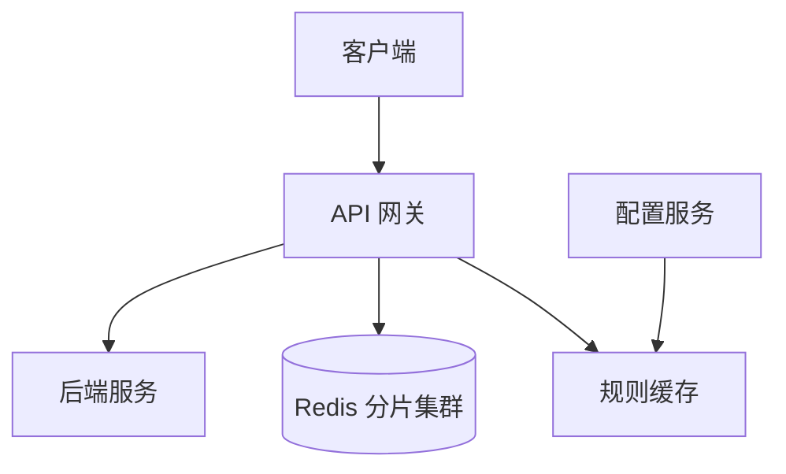

## Q
**分布式限流器（Rate Limiter）**｜系统设计

设计一个限流系统，控制 API 请求的速率以防止过载并保证公平：按用户 ID、IP 或 API Key 识别客户端，按可配置规则（如每用户每分钟 100 次）限制请求，超限时返回 HTTP 429 并带上剩余额度和重置时间的响应头。要能在多台服务器间共同计数。规模按每秒 100 万请求、1 亿日活设计，单次检查额外延迟 < 10ms。常见变体：给公司内部服务之间做限流；"每 T 秒最多 N 个请求"的基础版；要求支持固定窗口、滑动窗口、令牌桶等多种算法；以及"1 亿日活怎么保证系统不被打垮"的开放版。

给出完整解答：需求、核心实体与接口、整体设计、深入问题、取舍、不同级别的期望。

## A
**一句话。** 限流的本质是在分布式环境里对海量计数器做低延迟的"原子读改写"：难点是算法选择（突发与精度）、状态放哪里与怎么分片，以及限流组件自己出故障时应该放行还是拒绝。

**60 分钟路线。**

| 时间 | 做什么 |
|---|---|
| 0–5 分 | 问清需求和数字：100 万次/秒、1 亿日活、检查 < 10ms |
| 5–10 分 | 实体和 `isRequestAllowed`，429 与响应头 |
| 10–20 分 | 整体设计：网关加 Redis 分片，一次检查的流程 |
| 20–50 分 | 必讲深入：算法和 Lua 原子性；分片扛 100 万次/秒；限流器挂了放行还是拒绝 |
| 50–60 分 | 追问：延迟、热点客户端、多规则、动态规则 |

**需求。**
功能：
1. 按用户 ID、IP 或 API Key 识别客户端并匹配规则。
2. 按可配置规则限流（如每用户每分钟 100 次；搜索接口每 IP 每分钟 10 次）。
3. 超限返回 429，附 `X-RateLimit-Remaining`、`X-RateLimit-Reset`、`Retry-After`。
4. 规则可以动态修改，不需要发版。
暂不做：限流数据的复杂分析、长期持久化。

非功能：
- 吞吐：峰值 100 万请求/秒，1 亿日活。
- 延迟：每次检查增加 < 10ms（越低越好，最好 1 到 2ms）。
- 可用性高，允许最终一致：各节点之间对限额的执行有短暂偏差可以接受。
- 内存估算：1 亿活跃客户端，每个状态约 100 字节，约 10GB，分散到多个分片，完全放得进内存。

**核心实体与接口。**
实体：`Rule(ruleId, clientType, endpoint, limit, windowSec, algorithm, burst)`；`Client`（用户、IP、API Key，或其组合）；每个客户端每条规则有一份计数状态。
核心接口（限流组件对内暴露）：`isRequestAllowed(clientId, ruleId) → {allowed, remaining, resetAt}`。对外的体现只是响应头与 429。

**整体设计。**



1. 放在哪里：(a) 业务进程内：每台机器各自计数，机器数变化时总限额失控，各实例之间无法共享，最差；(b) 独立的限流服务：集中，但多一跳网络，自己还要高可用；(c) API 网关或负载均衡层：所有流量必经之处，把限流作为网关的一个过滤器，无需业务改动，是最常见的选择。内部服务之间的限流，可以做成服务网格（sidecar）或客户端库，向同一个 Redis 集群发检查。
2. 识别客户端：网关从请求中取出标识（认证后的用户 ID 优先，其次 API Key，最后是 IP），拼出键 `rl:{ruleId}:{clientId}`。IP 限额要放宽，因为公司出口 NAT 和公共 Wi-Fi 会让很多用户共用一个 IP。
3. 检查：网关把键发给 Redis，由一个原子脚本完成读状态、补充令牌、判定、写回；返回是否放行与剩余额度。放行就转发请求，拒绝就直接回 429，不触达后端。
4. 规则：网关本地缓存规则，由配置服务维护，改动后推送或轮询到网关。

**深入。**

1. 【必讲】算法与原子性。
- 固定窗口计数（fixed window）：按时间切片，每片一个计数器，`INCR` 加 `EXPIRE`。最便宜，但窗口交界处 1 秒内可打出两倍额度。
- 滑动窗口日志（sliding window log）：时间戳存入有序集合，统计窗口内个数。最精确，但内存按请求数线性增长。
- 滑动窗口计数（sliding window counter）：保留当前与上一窗口两个计数，`上一窗口计数 × 重叠比例 + 当前计数`。内存小，误差小，是折中。
- 令牌桶（token bucket）：每个客户端一个桶，容量 `burst`，按速率补充，每次请求消耗一个。状态只有「剩余令牌数 + 上次补充时间」，允许可控突发，长期速率受限。这是默认选择；漏桶把突发抹平成恒定速率，适合只能匀速处理的下游。精度要求高时用滑动窗口计数。
- 原子性：读状态、算令牌、写回必须一步完成，否则两个网关同时检查各读到旧值，双双放行。用 Redis Lua 脚本在服务端一次执行，也只占一次网络往返：

```lua
local cap = tonumber(ARGV[1])
local rate = tonumber(ARGV[2])
local cost = tonumber(ARGV[3])
local t = redis.call('TIME')
local now = t[1] * 1000 + math.floor(t[2] / 1000)
local d = redis.call('HMGET', KEYS[1], 'tokens', 'ts')
local tokens = tonumber(d[1]) or cap
local ts = tonumber(d[2]) or now
tokens = math.min(cap, tokens + math.max(0, now - ts) * rate / 1000)
local ok = tokens >= cost
if ok then tokens = tokens - cost end
redis.call('HSET', KEYS[1], 'tokens', tokens, 'ts', now)
redis.call('PEXPIRE', KEYS[1], math.ceil(cap / rate * 2000))
return {ok and 1 or 0, math.floor(tokens)}
```

  时间用 Redis 的 `TIME` 而不是网关本地时间，避免多网关时钟偏差；`PEXPIRE` 让不活跃客户端的桶自动消失。

2. 【必讲】怎样扛 100 万次/秒。
- 问题：单个 Redis 约每秒 10 万次量级，一次检查至少一次脚本调用，单实例撑不住。
- 方案：按客户端标识分片，同一客户端永远落在同一分片，否则状态被拆散就失效。常用 Redis Cluster 的 16384 个哈希槽，网关用集群客户端自动路由。每片按 5 到 7 成负载约 7 万次/秒算，需要约 15 个主分片，留余量。每个分片主从复制，主挂了副本提升。

3. 【必讲】限流器挂了怎么办。
- 失败即拒绝（fail-closed）：保护后端，但等于关掉整个 API，还引发客户端重试风暴。适合支付这类宁可停也不能放开的场景。
- 失败即放行（fail-open）：API 保持可用，但丢失保护；限流故障常与高峰同时发生，放行可能引发级联故障。
- 折中：放行，但退化为每网关本地的粗粒度限流（进程内令牌桶，限额按网关数均分），同时告警。关键是明确说出选择和理由。
- 预防：每个分片主从复制加自动故障转移，监控 Redis 的 CPU、内存、网络和命中率，进入放行模式要报警。

4. 【追问再讲】降低检查延迟。
- 基础：网关与 Redis 保持长连接池，避免每次握手；同一区域就近部署；跨区域各自限流，接受最终一致。
- 进阶：网关一次从 Redis 领一批令牌在本地发放，Redis 压力降一个数量级；代价是限额变近似（一个网关最多多放行一批），重启会丢未用完的令牌。
- 顺序：先做连接池和就近部署，批领留作追问。

5. 【追问再讲】热点客户端：一个客户端的请求量足以压垮一个分片。
- 合法大客户：要求客户端自己限流并遵守响应头，批量接口减少调用，付费大客户更高限额，必要时专用分片。
- 恶意流量：连续超限若干次后进封禁列表，网关本地缓存几秒先查，不用每次打 Redis；更上游由 CDN、DDoS 防护（如 Cloudflare、AWS Shield）拦截。
- 共享出口 IP（公司 NAT、公共 Wi-Fi）：IP 限额一开始就放宽，主要靠认证后的用户限额。

6. 【加分】动态规则。
- 轮询：网关每 30 秒左右拉一次并缓存，简单可靠，但紧急调低限额要等一个周期。
- 推送：etcd、ZooKeeper 的 watch 或 Pub/Sub，秒级到达；要处理断连和部分网关漏收，所以要有轮询兜底。
- 默认轮询加缓存；安全应急要求高再叠加推送。

**取舍与追问。** 按被问到的可能性排，通常口述就够：
- 多规则（如每秒 10 次且每天 1 万次）：每条规则各自一个键，脚本里一次检查多个键，全部通过才扣减。这些键必须落在同一分片（hash tag `{clientId}`），否则要多次往返，也无法原子。
- 为什么允许最终一致：限流本身是近似保护，偶尔多放几个请求的代价远小于每次请求做强一致协调的延迟。
- 返回给客户端：429 加 `Retry-After`，让客户端指数退避，避免重试风暴。
- 公平性与成本：按用户、租户、接口多层限流，层次越多检查越多；通常「全局保护 + 用户配额」两层就够。
- 内部服务限流：防止单个调用方耗尽共享下游，常与舱壁、熔断配合，而不是替代它们。

**级别期望。**
- 中级：说清放在网关，实现固定窗口或令牌桶，用 Redis 存计数，返回 429。
- 高级：对比四种算法，用 Lua 保证原子性，分片与一致性哈希，容量估算，fail-open 与 fail-closed 的取舍。
- 资深/Staff：本地批领令牌与近似限额的误差分析、热点 key 与封禁策略、多区域最终一致、动态规则的推送与兜底、限流器自身的可观测与降级策略。

**先修概念。** [[hi-system-design-deep-dives-redis|Redis]]、[[hi-system-design-core-concepts-sharding|分片（Sharding）]]、[[hi-system-design-core-concepts-consistent-hashing|一致性哈希]]、[[hi-system-design-deep-dives-api-gateway|API 网关]]、[[hi-system-design-core-concepts-cap-theorem|CAP 定理]]、[[hi-system-design-patterns-scaling-writes|扩展写]]

**同类题。** [[hi-system-design-problem-breakdowns-distributed-rate-limiter|分布式限流器（拆解）]]、[[rate-limiter-system|限流器（低层设计版）]]、[[solution-distributed-cache|分布式缓存]]、[[hi-system-design-problem-breakdowns-ad-click-aggregator|广告点击聚合]]
