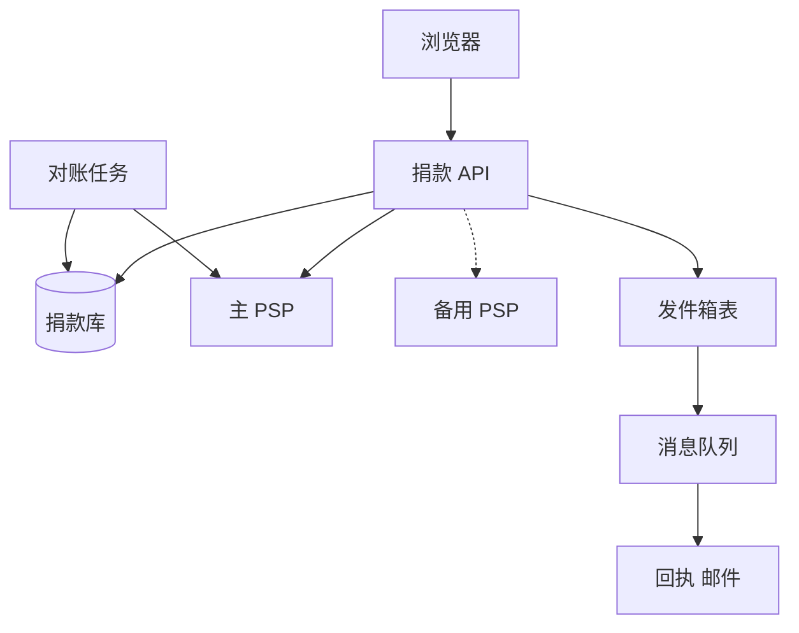

## Q
**设计限时捐款网站**｜系统设计

设计一个只运行 24–72 小时的慈善捐款网站：预先写死的几家慈善机构（例如 5 个），用户选择一家并捐款，可以多次捐、不要求登录；支付走第三方支付服务商（PSP，如 Stripe、Adyen），我们自己不碰卡号。典型规模：3 天内收到 10 亿美元、每笔 10 美元，即 1 亿笔、平均约 386 笔/秒；或者较小的版本 1 亿美元（平均约 39 笔/秒）。重点不是页面，而是后端支付流程：支付失败怎么处理、怎么识别失败、有没有备用支付方式、怎么保证不重复扣款，成功后要通知用户。面试官常加的限制：不允许使用 webhook；不需要展示总额；先别管规模，把基本元素设计出来；要求懂支付与令牌化（tokenization）。

给出完整解答：需求、核心实体与接口、整体设计、深入问题、取舍、不同级别的期望。

## A
**一句话。** 业务极简单，难点全在"和第三方付款服务打交道时的不确定性"：用户点了两次、PSP 超时、PSP 挂了、webhook 丢了，每一种情况下都要保证"最多扣一次钱，且系统最终知道扣了没有"。

**60 分钟路线。**

| 时间 | 做什么 |
|---|---|
| 0–5 分 | 需求和估算：约 386 笔/秒，尖峰约 2,000 笔/秒，付款走令牌化 |
| 5–10 分 | 实体和接口：`Donation` 状态机，`POST /donations` 带前端生成的 `donationId` |
| 10–25 分 | 画主流程：写行 → 调 PSP → 成功写发件箱 → 发回执 |
| 25–50 分 | 深入：三层防重复扣款、结果未知时的对账、拒绝与故障的区分和备用 PSP |
| 50–60 分 | 追问：授权与请款分步、尖峰并发、欺诈、活动结束 |

**需求。**
- 功能：展示慈善机构列表；提交捐款（金额、机构、付款信息、邮箱）；成功后发送收据；（可选）展示每家机构的累计金额。
- 非功能：
  - 绝不重复扣款，绝不"扣了款却没记录"；
  - 支付失败时可恢复、可换付款方式；
  - 流量尖峰（活动开始、截止前、媒体曝光）能扛；
  - 敏感信息不进我们的系统（PCI 范围最小化）；
  - 活动结束后系统整体下线，数据仍要保留用于审计、税务回执。
- 估算：10 亿美元 ÷ 10 美元 = 1 亿笔；3 天 = 259,200 秒 → 平均约 386 笔/秒；尖峰按 5 倍 ≈ 2,000 笔/秒。每笔记录约 1 KB，总共约 100 GB，一台数据库能放下，难的是并发而不是容量。PSP 对每个账号有请求频率限制，必须提前和 PSP 约定更高额度。

**核心实体与接口。**
- 实体：
  - 慈善机构（Charity，固定几行，配置即可）；
  - 捐款（Donation：`donationId`、`charityId`、金额、币种、状态、PSP 引用号、邮箱、`createdAt`）；
  - 状态机 `CREATED → PROCESSING → SUCCEEDED | FAILED | UNKNOWN`，`UNKNOWN` 经对账变成前两者之一；
  - 回执任务（Receipt）。
- 接口：
  - `GET /charities`；
  - `POST /donations`（体：`donationId`（由页面加载时生成的 UUID）、`charityId`、金额、支付令牌（PSP 的前端组件换来的 token）、邮箱）→ `{donationId, status}`；
  - `GET /donations/{id}`（前端轮询状态）。
- 付款信息由 PSP 的前端组件（hosted fields / Elements）直接采集，浏览器向 PSP 换取一次性令牌后才把令牌发给我们。我们的服务器从头到尾没见过卡号，PCI 合规范围最小。

**整体设计。**

1. 页面加载时生成 `donationId`（UUID）并随表单提交。用户连点两次、网络重发、浏览器后退重交，都是同一个 `donationId`，数据库上的唯一约束保证只会有一条记录，也只会向 PSP 发起一次扣款。
2. 服务端先写入 `donationId` 对应的行，状态 `CREATED`（已存在则直接返回当前状态，这就是幂等）。再把状态更新为 `PROCESSING`，然后调用 PSP 创建并确认支付，`donationId` 同时作为 PSP 的幂等键（idempotency key）。
3. PSP 同步返回结果：成功 → `SUCCEEDED`；明确拒绝（余额不足、卡被拒、风控拦截）→ `FAILED` 并给用户明确提示，让他换卡；超时或 5xx → `UNKNOWN`。
4. 成功时，在同一个数据库事务里把状态更新和一条"发件箱"（outbox）记录一起写入，随后由发件箱投递器把事件推到队列，回执服务消费后发邮件。这样"状态已改但邮件事件丢了"不会发生；邮件至少发一次，用 `donationId` 去重。
5. `UNKNOWN` 的处理：不能让用户直接重试（可能扣两次）。对账任务每隔几十秒扫描卡在 `PROCESSING`/`UNKNOWN` 的捐款，用 PSP 的幂等键或元数据去 PSP 查询真实结果，查到成功就补成 `SUCCEEDED`（并触发回执），查到不存在就置 `FAILED` 允许用户重试。
6. 累计金额（若需要展示）：不要在一条行上 `UPDATE total = total + 10`，5 家机构就是 5 个热点行。方案是分片计数器（每家机构 N 个子计数器，写入时随机选一个，读取时求和），或者消费捐款成功事件、批量累加到 Redis，展示允许延迟几秒。账目真相仍是捐款表。

**深入。**
1. 【必讲】防止重复扣款：问题来自三处——用户重复提交、我们的重试、PSP 的超时。
   - 前端：提交后按钮置灰，但这只是体验，不是保证；
   - 服务端：`donationId` 唯一约束 + 状态机，只有 `CREATED → PROCESSING` 的那次转换能触发 PSP 调用（用条件更新 `WHERE status='CREATED'`，并发下只有一个请求赢）；
   - PSP：同一个幂等键，PSP 保证只处理一次并返回同样的结果。
   - 三层叠加，缺一个都可能出事故。
2. 【必讲】不能用 webhook 时怎么拿到异步结果？同步确认：使用 PSP 的"服务端直接确认"接口，响应里就带最终结果（卡支付通常是即时的）。对需要额外验证（如 3-D Secure）的支付，由前端完成验证后再调用我们的确认接口。兜底靠对账轮询，而不是靠回调。如果允许 webhook，也只把它当"加速通知"，仍然要保留轮询兜底，因为 webhook 会丢、会重复、会乱序。
3. 【必讲】失败识别与备用支付方式：
   - 区分"被拒绝"与"没拿到结果"：被拒绝是业务结果，换 PSP 重试没有意义（卡本身有问题），应该让用户换卡；"没拿到结果"才可能是 PSP 故障。
   - 备用 PSP：对主 PSP 做熔断（连续失败率超过阈值就打开），打开后新请求路由到备用 PSP；但一笔"结果未知"的交易在查清之前绝对不能转给另一家 PSP 重发，否则可能扣两次。先查询或取消，再改路由。
   - 备用支付方式：除信用卡外还提供钱包（Apple Pay、PayPal 等），前端在卡支付失败时提示改用其他方式。
4. 【追问再讲】授权与请款分两步：先 authorize 后 capture，让「切换」更安全。授权失败可以直接换通道，扣款只在确定后做一次；代价是多一次调用，延迟加倍。
5. 【追问再讲】流量尖峰：同步直连 PSP 简单，但尖峰时线程会堵在 PSP 的网络调用上。办法：API 层无状态水平扩展；对 PSP 的并发调用数用信号量限制（并发 = 吞吐 × 延迟，2,000 笔/秒 × 0.5 s ≈ 1,000 个并发）；超过时返回"排队中"并让前端轮询 `GET /donations/{id}`，后台 worker 从队列取出继续调 PSP。代价是用户要多等几秒，好处是 PSP 不会被打爆、我们也不会丢请求。
6. 【追问再讲】欺诈与滥用：公开页面不需要登录，所以会被"卡测试"（用小额捐款验证偷来的卡）攻击。对策：按 IP 和设备限速、验证码、PSP 的风控（Radar 一类）、对大量小额失败的 IP 自动封禁。
7. 【加分】活动结束与数据：截止时间由服务端时钟判定，到点拒绝新捐款；PSP 的支付与我们的捐款表做一次全量对账，差异逐条处理；保留回执所需字段（姓名、邮箱、金额），其余数据按合规要求删除；基础设施整体拆除。

**取舍与追问。** 按被问到的可能性排，通常口述就够：
- 同步 vs 异步：同步（用户直接看到结果）体验好、实现简单；异步（先入队）更抗尖峰，但要多一个状态页。3 天、2,000 笔/秒的规模下，同步 + 并发上限 + 排队兜底是合理的折中。
- 数据库选型：每笔都是按主键读写，没有复杂关联，关系库完全够用（≈2,000 写/秒，单主库可扛）；如果要多区域写入，换 DynamoDB 一类。
- 为什么用 UUID 由前端生成，而不是服务端生成？服务端生成的 ID 在用户重发时没法关联；客户端生成的 ID 让"同一次意图"在任何重试中保持同一个键。
- 如果要展示总额但不能有热点：见分片计数器，展示数据允许 5–10 秒延迟，不影响对账。
- 如果通知失败：邮件通过队列重试，退避加死信队列；不影响支付状态；用户可以在状态页看到成功。
- 简化版本（先别管规模）：单个服务 + 一张表 + PSP 的同步确认 + 唯一键 + 对账任务，就已经满足全部正确性要求；规模只是在此基础上加水平扩展和并发限制。

**级别期望。**
- 中级：表单到 PSP 的主流程，知道不碰卡号（令牌化），能用唯一键防重复提交，有失败时的用户提示。
- 高级：幂等键三层防护、`UNKNOWN` 状态与对账、区分拒绝与故障、熔断与备用 PSP 的安全切换规则、发件箱模式。
- 资深/专家：尖峰下对 PSP 限速的并发控制与降级、计数器热点、欺诈防护、授权/请款分步的取舍、活动结束后的全量对账与数据处置，能主动说清"哪些失败可以安全重试、哪些不可以"。

**先修概念。**
- [[hi-system-design-patterns-multi-step-processes|多步骤流程]]
- [[hi-system-design-core-concepts-api-design|API 设计]]
- [[hi-system-design-patterns-dealing-with-contention|处理争用（Contention）]]
- [[hi-system-design-patterns-scaling-writes|扩展写]]
- [[hi-system-design-deep-dives-kafka|Kafka]]

**同类题。**
- [[hi-system-design-problem-breakdowns-payment-system|支付系统（Stripe）]]
- [[solution-payment-system|设计题解：支付系统]]
- [[hi-system-design-problem-breakdowns-flash-sale|秒杀系统]]：尖峰与热点行
- [[hi-system-design-problem-breakdowns-ticketmaster|票务预订（Ticketmaster）]]：限量资源与支付衔接
