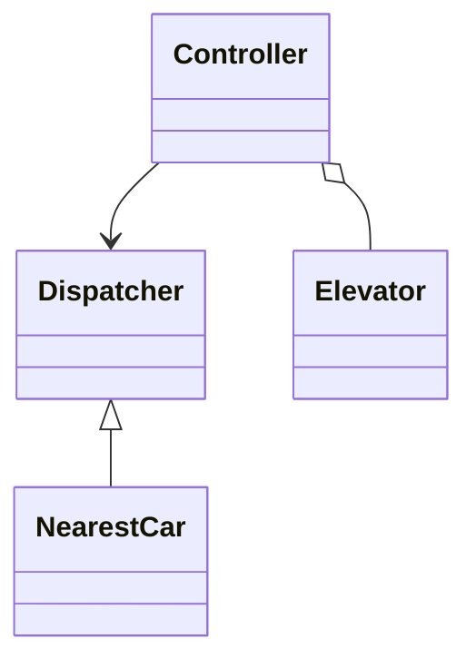

## Q
**设计电梯系统（面向对象，可运行的代码）**｜低层设计

设计并实现一个面向对象的电梯系统，覆盖电梯的核心行为：楼层里的上行/下行呼叫、轿厢里按下目的楼层、运行方向、开关门，以及基本的调度逻辑（多部电梯时，哪一部去接哪个呼叫）。原题要求用 Java 写出可运行的类设计，面试官会看你的类划分、状态怎么建模、调度策略能不能替换、并发请求怎么处理。常见追问：如何避免某个请求一直得不到服务（饥饿）、电梯故障或超载怎么办、高峰期怎么优化。

给出完整解答：需求、核心实体与接口、整体设计、深入问题、取舍、不同级别的期望。

## A
**一句话。** 电梯系统的本质是"一个小状态机 + 一个可替换的调度策略"：单部电梯用 LOOK 扫描（沿当前方向走到最远的请求再掉头）保证效率和无饥饿，多部电梯之间用代价函数挑最合适的一部，而所有状态变化都收在一个线程里，避免加锁。

**60 分钟路线。**

| 时间 | 做什么 |
|---|---|
| 0–8 分 | 问清需求（几部电梯、多少层、要不要调度策略可换），定接口 |
| 8–13 分 | 类划分和流程：`Elevator`、`Dispatcher`、`Controller` |
| 13–45 分 | 写核心实现：LOOK 的 `tick`、外呼按方向分开存、`Controller` |
| 45–50 分 | 跑例子：2、9、7 的停靠顺序 |
| 50–60 分 | 追问：多部电梯分配、并发、故障与边界 |

**需求。**
- 功能：
  - 每层楼有上行、下行两个呼叫按钮；轿厢内有目的楼层按钮；
  - 一部电梯有方向（上/下/空闲）和当前楼层，到达有请求的楼层就开门；
  - 多部电梯，由控制器决定每个楼层呼叫分配给谁；
  - 非法楼层要拒绝；重复按同一个按钮不产生重复请求。
- 非功能：
  - 无饥饿：任何请求最终会被服务；
  - 调度算法可替换，不改电梯本身的代码；
  - 并发安全：多个楼层的乘客同时按按钮；
  - 可测试：时间由"滴答"驱动，不依赖真实睡眠。

**核心实体与接口。**
- `Dir`：枚举 UP、DOWN、IDLE。
- `Elevator`：一部电梯，持有当前楼层、方向、三组待服务楼层：轿厢内选择（`inside`）、分配给它的上行外呼、下行外呼。对外提供 `tick()`（推进一个时间片）、`eta(floor, dir)`（调度用的代价估计）。
- **Dispatcher 是策略模式：** `Dispatcher`（抽象）与 `NearestCar`：策略模式，`pick(cars, floor, dir)` 返回负责这次呼叫的电梯。
- `Controller`：对外入口，`hall_call(floor, dir)`、`cabin_call(car_id, floor)`、`tick()`。
- 可扩展的类（只口述，不写）：`Door`（开关门计时）、`Display`（观察者，订阅楼层变化）、`Request`（命令对象，便于日志与重放）。
- 使用的模式：策略（调度算法）、状态（方向 + 门状态；状态增多时把 `Dir` 升级为状态类）、观察者（楼层显示）。

**整体设计。**



流程：
1. 乘客按下楼层外呼 → `Controller.hall_call(floor, dir)` → 调度器对每部电梯调用 `eta`，选代价最小的一部 → 把楼层加入那部电梯的对应方向集合。一旦分配就不再改派，避免来回抖动。
2. 轿厢内按键 → `cabin_call(car_id, floor)` → 加入该电梯的 `inside` 集合（轿厢内的选择属于这部电梯，不经过调度）。
3. **tick() 驱动每部电梯：** 控制器的 `tick()` 驱动每部电梯 `tick()`：到站条件满足就开门并清除该楼层请求，否则朝当前方向走一层；前方没有请求时才掉头；没有请求就变成 IDLE。
4. `eta` 的估算：空闲电梯是楼层距离；运行方向相同且顺路是楼层距离；否则要先跑到当前方向上最远的请求，再折返；每个待停靠站再加固定的开关门代价。

**核心实现。** 约 32 分钟，一个代码块写完：`Elevator`（LOOK 的 `tick`、`eta`）、可替换的 `Dispatcher`、`Controller`。

```python
from __future__ import annotations

from abc import ABC, abstractmethod
from enum import Enum
from typing import Optional


class Dir(Enum):
    UP = 1
    DOWN = -1
    IDLE = 0


class Elevator:
    """一部电梯 = 一个小状态机：IDLE / 向上 / 向下；只管自己的停靠集合，不知道别的电梯。"""
    def __init__(self, eid: int, start: int = 0) -> None:
        self.id, self.floor, self.dir = eid, start, Dir.IDLE
        self.inside: set[int] = set()                         # 轿厢内按下的目的楼层
        self.hall = {Dir.UP: set(), Dir.DOWN: set()}          # 分配给本车的外呼，按方向分开

    def targets(self) -> set[int]:
        return self.inside | self.hall[Dir.UP] | self.hall[Dir.DOWN]

    def _ahead(self, d: Dir) -> bool:
        return any((f - self.floor) * d.value > 0 for f in self.targets())

    def eta(self, floor: int, d: Dir) -> int:
        """调度器用的代价估计：同向顺路最便宜，否则要先跑完当前方向的最远一站再折返。"""
        if self.dir is Dir.IDLE or not self.targets():            # 刚开完最后一站、方向还没复位时也算空闲
            return abs(floor - self.floor)
        on_the_way = (floor - self.floor) * self.dir.value >= 0
        if on_the_way and d is self.dir:
            return abs(floor - self.floor) + 2 * len(self.targets())   # 每个停靠约 2 个时间片
        far = max(self.targets(), key=lambda f: abs(f - self.floor))
        return abs(far - self.floor) + abs(far - floor) + 2 * len(self.targets())

    def tick(self) -> Optional[str]:
        """推进一个时间片：到站开门，或朝当前方向走一层。"""
        t = self.targets()
        if not t:
            self.dir = Dir.IDLE
            return None
        if self.dir is Dir.IDLE:
            nearest = min(t, key=lambda f: abs(f - self.floor))
            self.dir = Dir.UP if nearest > self.floor else Dir.DOWN
        if not self._ahead(self.dir) and self.floor not in t:
            self.dir = Dir.UP if self.dir is Dir.DOWN else Dir.DOWN   # LOOK：前方没有请求才掉头
        f, d = self.floor, self.dir
        if f in self.inside or f in self.hall[d] or (not self._ahead(d) and (f in self.hall[Dir.UP] or f in self.hall[Dir.DOWN])):
            self.inside.discard(f)
            self.hall[d].discard(f)
            if not self._ahead(d):                                    # 折返点：把反向的外呼也接上
                opp = Dir.UP if d is Dir.DOWN else Dir.DOWN
                if f in self.hall[opp]:
                    self.hall[opp].discard(f); self.dir = opp
            return f"open@{f}"
        self.floor += d.value
        return None


class Dispatcher(ABC):                                     # 策略模式：换调度算法不动控制器
    @abstractmethod
    def pick(self, cars: list[Elevator], floor: int, d: Dir) -> Elevator: ...


class NearestCar(Dispatcher):
    def pick(self, cars, floor, d):
        return min(cars, key=lambda c: c.eta(floor, d))


class Controller:
    def __init__(self, n_cars: int, n_floors: int, dispatcher: Dispatcher) -> None:
        self.cars = [Elevator(i) for i in range(n_cars)]
        self.n_floors, self.dispatcher = n_floors, dispatcher

    def hall_call(self, floor: int, d: Dir) -> int:
        if not 0 <= floor < self.n_floors:
            raise ValueError("no such floor")
        car = self.dispatcher.pick(self.cars, floor, d)
        car.hall[d].add(floor)                              # 一旦分配就不再改派（避免来回抖动）
        return car.id

    def cabin_call(self, car_id: int, floor: int) -> None:
        self.cars[car_id].inside.add(floor)

    def tick(self) -> list[Optional[str]]:
        return [c.tick() for c in self.cars]
```

要点：
- 外呼按方向分开存放。向上的电梯经过"下行呼叫"的楼层时不停，因为想下楼的乘客不会愿意上行；只有在折返点（前方没有请求了）才接反方向的呼叫并把方向翻转。
- 用集合保存楼层：重复按键天然去重。
- `Dispatcher` 是抽象类，换成"分区调度"或"目的楼层调度"只需新增一个子类。

**运行。** 电梯在 0 层，轿厢内选 9，7 层有下行呼叫，2 层有上行呼叫：
- 连续调用 `tick`，停靠顺序是 2、9、7：先上行接 2 层，到 9 层后前方没有请求才掉头，下行接 7 层。
- 向上的电梯经过 7 层时不停，因为那是下行呼叫。

**深入。**
1. 【必讲】单部电梯的调度策略：
   - 先来先服务（FCFS）：公平，但电梯会在楼层间来回折腾，总行程长；
   - SCAN（电梯算法）：沿一个方向扫到楼顶/楼底再掉头，没有饥饿，但会空跑到端点；
   - LOOK：SCAN 的改进，走到该方向最远的"请求"就掉头，不跑端点；
   - 最短寻道优先（SSTF）：效率高，但边缘楼层可能一直被近处的请求挤掉，会饥饿；
   - 选 LOOK：行程短且无饥饿，因为每次掉头后总会扫过所有请求。
2. 【必讲】多部电梯如何分配：
   - 最近的空闲电梯：简单，但会让忙碌电梯顺路的呼叫被忽略；
   - 代价函数（上面的实现）：把方向、位置、已有停靠数都折进一个预计到达时间，顺路的同向电梯自然最优；
   - 分区：高峰期把电梯固定负责楼层区间，减少全楼层往返；
   - 【加分】目的楼层调度：乘客在大厅先输入目的楼层，系统把去往相近楼层的乘客编到同一部电梯，吞吐最高，但需要不同的硬件和 API。
3. 【必讲】并发：外部有多个线程在同时按按钮。做法是单写者原则：外部线程只往线程安全的请求队列放"请求对象"，由控制器的调度线程在 `tick` 里取出并修改电梯状态，所以 `Elevator` 内部不需要锁，也不会出现"边移动边被修改"的竞争。读状态（显示屏）通过快照或观察者通知。
4. 【追问再讲】故障、超载与维护：电梯进入 MAINTENANCE 状态后，把它名下尚未服务的外呼取出来重新分配给其他电梯；超载时拒绝新的外呼分配，但继续送完已有乘客；紧急停止只允许开门，并清空待服务集合。这三种都是状态机上的新状态加转换，不改调度器。
5. 【追问再讲】边界情况：在当前楼层按外呼（直接开门）；轿厢内按当前楼层（忽略）；同时有人要上行和下行但都在同一层（折返点把两个方向都接上）；楼层越界抛异常；电梯在开门时又有新请求（排入集合，门关后处理）。

**取舍与追问。** 按被问到的可能性排，通常口述就够：
- 测试：因为时间由 `tick` 驱动，可以脚本化地按键并断言停靠顺序，例如上面运行的 2、9、7。
- 状态建模：当前用方向枚举加到站判断就够；如果需要门开/关/故障/维护这些状态，应该用状态模式，每个状态类负责自己的 `tick` 行为，避免大量 `if`。
- 复杂度：`tick` 里要扫集合找前方请求，复杂度与待停靠站数成正比，对几十层楼足够；楼层很多时可以按方向各维护一个有序结构（最小堆/平衡树）。
- 高峰优化：上班高峰大量乘客从大堂向上，可在空闲时把电梯预先停在大堂（预置位置），下班高峰反之。
- 公平性与优先级：VIP 或货梯可以给请求带上优先级，在 `eta` 中加权，或使用独立的电梯组。
- 如果要求用 Java：枚举 `Direction`、接口 `DispatchStrategy`、类 `Elevator`/`ElevatorController`，请求队列用 `BlockingQueue`，调度线程用 `ScheduledExecutorService` 每个时间片调用一次 `tick`，思路完全相同。

**级别期望。**
- 中级：类划分合理（电梯、控制器、请求），能写出沿方向运行并开门的主循环，处理基本边界。
- 高级：LOOK 扫描并解释为什么无饥饿，外呼按方向区分，调度策略可替换，说明并发模型。
- 资深/专家：代价函数与调度策略对比、故障转移时的重新分配、状态模式的演进、目的楼层调度的取舍、可测试的时钟设计。

**先修概念。**
- **答题框架：** [[hi-low-level-design-in-a-hurry-delivery|答题框架（Delivery Framework）]]
- [[hi-low-level-design-in-a-hurry-patterns|设计模式]]
- [[hi-low-level-design-in-a-hurry-oop-concepts|面向对象概念]]
- [[hi-low-level-design-concurrency-intro|并发入门]]

**同类题。**
- [[hi-low-level-design-problem-breakdowns-elevator|电梯]]
- [[solution-elevator|设计题解：电梯]]
- [[solution-parking-lot|设计题解：停车场]]
- [[solution-traffic-signal|设计题解：红绿灯]]：另一个状态机类题目
